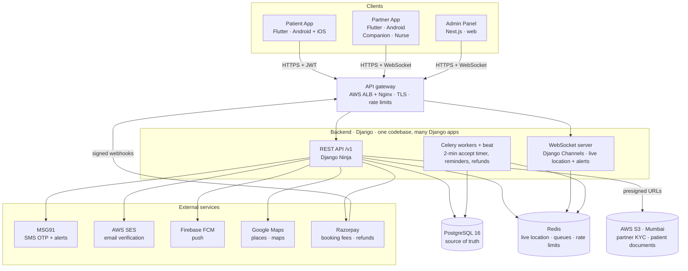
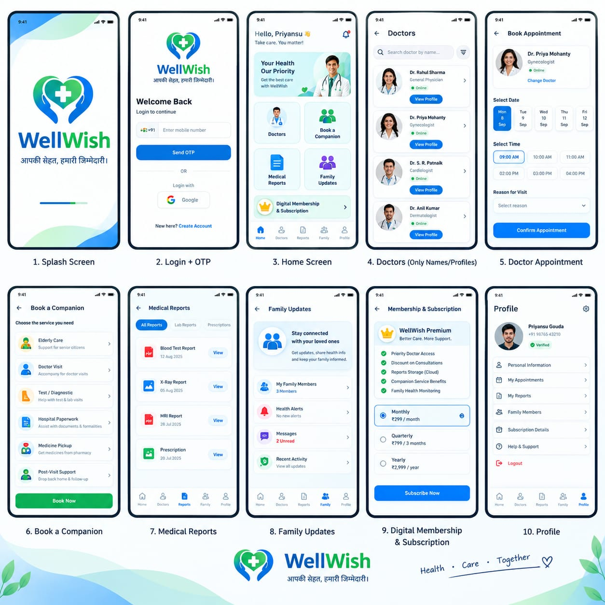
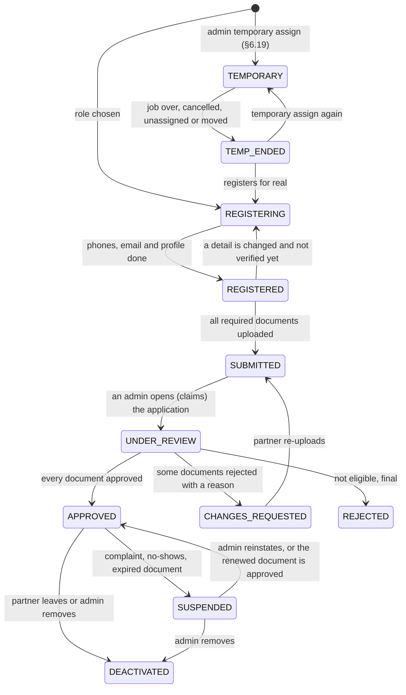
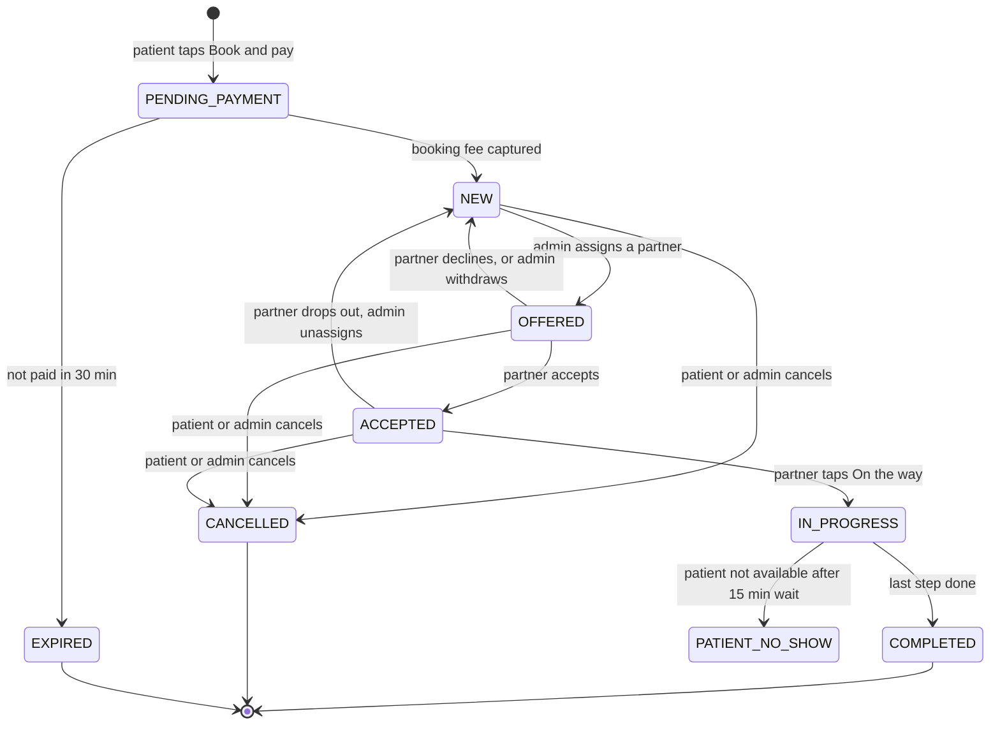
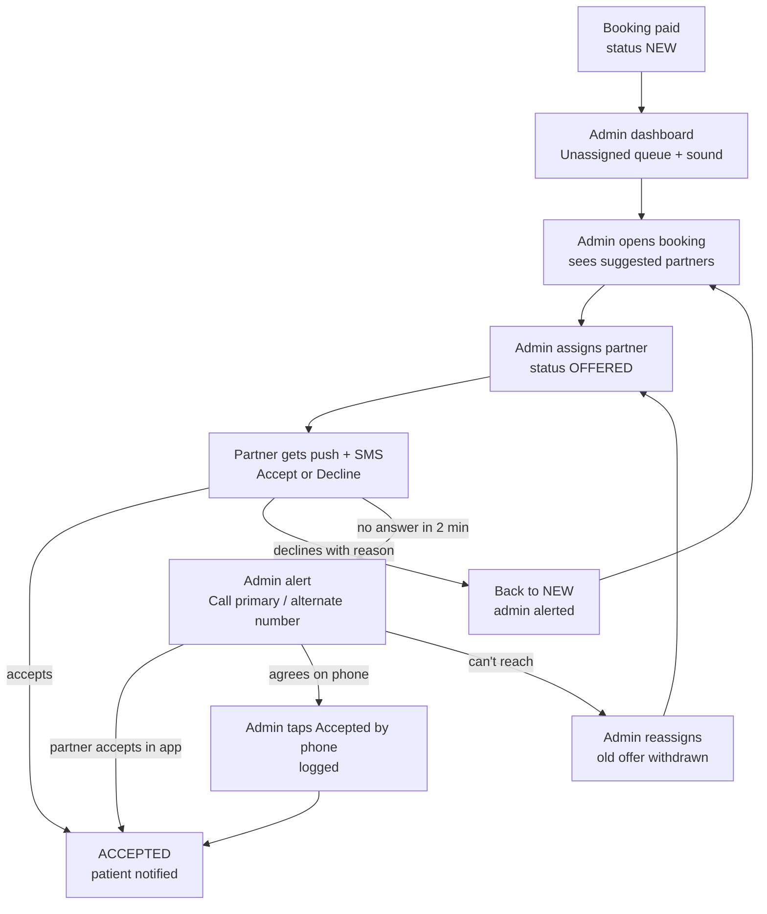
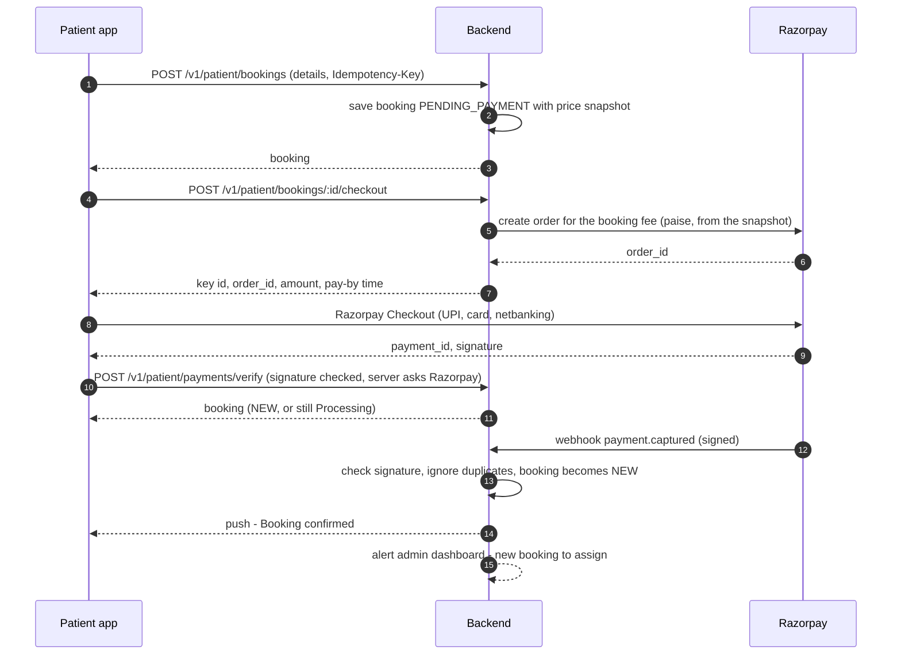

# WellWish — Architecture and Module Workflows

> **Version** 2.33 · **Date** 16 Oct 2026 · **Status** Draft for review
> **Changed in 2.0:** rewritten after the client meeting. No doctor login or doctor booking (doctors are a directory only). The Partner app is for **companions and nurses**. **Admin assigns every booking by hand.** Patients pay only the **booking fee** in the app; the balance is paid directly to the companion or nurse. The old version is in [archive/ARCHITECTURE-v1.2.md](archive/ARCHITECTURE-v1.2.md).
> **Changed in 2.1:** scheduling for future dates (§6.17), family members and booking for relatives (§6.18), admin add/edit/delete table (§9.1).
> **Changed in 2.14 (Phase 7):** **Assignment** (§6.10): the admin's **queue** (Today / Tomorrow / Later with counts) lists paid bookings still NEW or OFFERED, soonest first, red once past the assign deadline. Candidates are approved partners of the right type with no accepted booking overlapping the visit's busy time, "Available today" first, then nearest. Assigning makes the booking OFFERED and sets `bookings.partner` to the offered partner (cleared again on decline, withdraw or unassign); reassigning withdraws the open offer ("Booking withdrawn"); a partner already busy then is refused (409 `PARTNER_BUSY`), also when they try to accept. An offer has a **kind**: NEW, or **RECONFIRM** when the time of an offered or accepted booking changes (§6.17): an accepted partner still free at the new time gets a RECONFIRM offer ("Time changed: please confirm", with the 2-minute rule); one who is busy at the new time is released and the booking goes back to the queue (the reschedule no longer fails); an offered booking keeps its offer with the 2-minute timer restarted. At 2 minutes an open offer raises an OFFER_TIMEOUT alert (once per offer) and reminds the partner; a decline (reason + optional note) raises a DECLINED alert; past the deadline (6 PM India time the day before, or 3 h before pickup, whichever is first; settings `assign_deadline_evening_hour`, `assign_deadline_hours_before`) an ESCALATION alert (once per booking time) and an **email to the Super Admins**. Alerts are kept in a new table `staff_alerts` until an admin acknowledges them, and reach the panel over `/ws/staff/` with a sound (groups by permission: `staff.ops` for `bookings.view` or `live.view`, `staff.partners` for `partners.review`). Before accepting, the partner sees a summary only (the area is the address without its first part, distance, time, hospital, needs, number of documents, the balance); the full address, phones, health notes and documents open after accepting. **After the job** phones stay visible for 1 hour and health notes and documents for 24 hours (§6.8, §6.15); every document view by a partner is logged (`partner.document_viewed`). The patient sees the accepted partner's photo, name, role, rating and a Call button on the booking (P18), updated live over `/ws/patient/`. **Available today** (§8.3) needs today's selfie (`selfie_checks`; 409 `SELFIE_REQUIRED`) and resets every day (`partner_profiles.available_on`); admins spot-check selfies (Partners → Selfie checks). **Reminders** (§10.5): T−24 h (sent 22–24 h before) and T−2 h (1–2 h before) to the booker (inbox), the member (SMS) and the accepted partner, once per booking time (new table `booking_reminders`); a booking made inside a window gets no reminder for it. New events `offer.sent`, `offer.reminder`, `offer.withdrawn`, `booking.assigned`, `booking.reminder` (§10.2); new SMS templates BOOKING_ASSIGNED, BOOKING_REMINDER, OFFER_NEW, OFFER_TIME_CHANGED, JOB_CANCELLED (§6.14). **Push notifications (Firebase) are added later** (developer decision): until then the app inbox, SMS and the live socket carry these messages. *Deep check:* locks are always taken booking first, then its offers (a partner accepting while an admin reassigns, cancels or moves the time no longer deadlocks); **two admins at once** (§6.16): assign, accepted by phone and unassign carry the offer the admin saw (`expectedAssignmentId`) and a changed booking answers 409 `OFFER_CHANGED` ("It's now with Ravi by Priya"); a partner who declines a new time loses the old job too, and a cancelled booking tells only its current partner, once; a suspended or deactivated partner's open offers go back to the queue and their upcoming jobs raise a PARTNER_UNAVAILABLE alert and show in the queue until reassigned (accepted by phone is refused for them); a new time the partner hasn't confirmed, or a suspended partner's job, also escalates at the deadline; a rescheduled offered booking gets a fresh offer (new timer, its own alert); `reconfirm_needed` is cleared when an offer ends; the 2-minute reminder reaches the partner through the inbox and the socket (`offer.reminder`); reminders skip bookings booked, paid or moved inside their window; only `bookings.manage` can silence alerts; socket messages after commit are robust (one failing send doesn't stop the SMS, timers and emails after it); an admin's live socket closes when their session ends and rejoins after a role change; the apps refresh a refused socket token (4001) and stop on 4003; offer countdowns in the apps and the admin panel use the server's clock (from the `Date` header), and the partner sees whether an offer is still open (`response`).
> **Changed in 2.33 (16 Oct 2026, developer asked for a limit and left the choice to Claude):** the **family inbox keeps the last 30 days, at most the newest 50 messages**; the bell counts unread among those only, and a nightly job (03:05 IST, `notifications.delete_old_family_messages`) deletes family messages older than 30 days (they hold names and dates). Not 1 day: a booking made for next week, or a refund that takes 5–7 days, would lose its messages. The partner inbox keeps everything (approval, changes needed and rejection reasons are read much later). The list ends with "Messages from the last 30 days are kept here."
> **Changed in 2.32 (Phase 9C, 16 Oct 2026, developer decision after the full test):** the **family inbox (P25)**, listed since v2.0 but never built: the bell on Home shows the number of unread messages and opens Notifications (newest first; opening it marks them read; a message about a booking opens that booking). It shows what was only sent as push until now (and push is off until Firebase): booking confirmed, partner assigned, reminders, partner on the way, completed, cancelled, rescheduled, refund processed, WellWish's reply. `GET /v1/patient/notifications`, `GET …/unread-count`, `POST …/read` (like the partner inbox). A new socket message **`notification.new`** `{type, unread}` goes to the person's app (`user.{app}.{id}`) when an inbox message is saved, so the bell updates at once (both apps). Found in the full test and fixed: every booking status change (`transition()`) and every time change now sends `booking.updated` to the family's app, whoever made it (an admin's cancel or new time, the unpaid expiry), so Home and the booking never show an old status.
> **Changed in 2.31 (Phase 9B, 14 Oct 2026, developer request):** **store requirements** (new §6.20). Legal pages (Terms of Use, Privacy Policy, Refund Policy, Partner Terms) kept in `legal_documents`, edited and versioned by a Super Admin (`legal.manage`), public at `/legal/…` and readable from the consent screens; their consent versions come from the published documents. **Partners accept** the Partner Terms and Privacy Policy (new and existing). **Partner account deletion** in the app (while it waits the status stays, so sanctions keep working; no offers, not reviewed; erased after `account_deletion_days`, status `DELETED`, table `partner_deletions`). A **web page** `/delete-account` for both apps. Uploads use a **presigned POST** with a size range, so the storage itself refuses a file over the limit (was 10.2).
> **Changed in 2.30 (Phase 9 live check, 14 Oct 2026):** the **NOT_STARTED** check looks back a month (a booking stuck as accepted for days raised nothing: it only looked 2 days back), and the admin panel's Live page lists NOT_STARTED with the other visit alerts; `staff_alerts.kind` lists it.
> **Changed in 2.29 (Phase 9 deep check, 13 Oct 2026):** **fake GPS** (§6.16): the suspension counts different jobs flagged since the partner was last approved or reinstated, and never happens in the middle of a visit (it waits until that job ends); an **SOS** with a fake position still goes, flagged for the admins (`sos_events.mock_location`), and the emergency SMS leaves the place out. **Write limit**: sign-in and token refresh are left out (their own limits; a shared IP must never log people out; the apps keep the session on a 429 or 408 refresh), Razorpay's webhook counts per IP, bad webhook signatures are their own metric (`WebhookBadSignatures`, alarm at 20 in 5 min); rate-limit keys are an HMAC. **Logs**: tracebacks are masked too, `%`-encoded text is decoded before masking, the web server's access log has no query strings, Celery logs through the same mask; Sentry's `extra` and nested breadcrumb data are masked. An admin's edit of a patient no longer cancels a pending deletion, and its audit row lists which details changed, not their values. NOT_STARTED closes when the partner is on the way. The SOS escalation retries a failed email or SMS. Admin panel: `Referrer-Policy: strict-origin-when-cross-origin` (map tiles), location allowed for the panel itself ("Use my current location"), uploads straight to S3 allowed by the CSP. CloudWatch: a "metrics missing" alarm (the worker or beat stopped).
> **Changed in 2.28 (Phase 9.11, 13 Oct 2026):** **small fixes carried over**. A booking still waiting (unpaid, unassigned, accepted but never started) whose pickup was more than 12 hours ago is shown with the past ones, not as "next"; an accepted booking whose partner hasn't tapped "On the way" 30 minutes after pickup raises a **NOT_STARTED** alert (once; nothing closes by itself: the admin calls, marks the steps or cancels). The partner's Home also lists a job still in progress from an earlier day (a night visit past midnight). Live points and a catch-up batch update the route one at a time (the booking's row lock). The apps ping their socket every 10 s (a dead connection is noticed within ~20 s, was ~50 s). Login session rows revoked or expired a month ago are deleted every night. **File keys are opaque** (`f/<random>.<ext>`): the upload row's purpose and owner decide who may attach a file. The balance collected can have paise; the family sees "Paid ₹X to …" once it's recorded; the payment result follows the booking ("Partner assigned"); the partner's reviews show the tags; "Approve partner" asks first; the apps say why a session ended (blocked, job over).
> **Changed in 2.27 (Phase 9.8, 13 Oct 2026):** **accessibility** (§5): the apps follow the phone's text size up to Android's largest (200 %, never capped) without anything cut off; bottom sheets scroll; everything tappable is at least 48 × 48 dp with a name TalkBack reads (pills, link buttons, the consent tile as one ticked / not-ticked control, the code boxes "The 6-digit code"). Checked by tests on the key screens at 100 % and 200 % and by running every widget test at 200 % (`--dart-define=WW_TEXT_SCALE=2`).
> **Changed in 2.26 (Phase 9.10, 13 Oct 2026):** **the admin's actions on a patient account** (§9.1, `patients.manage`, each with a reason and audit-logged): **block / unblock** for abuse, the patient app only (`patient_profiles.blocked_at` / `blocked_reason`): logged out on every phone at once (revoke reason ACCOUNT_BLOCKED), its login, Google sign-in and token refresh refused (403 ACCOUNT_BLOCKED, "This account is blocked"); the partner app of someone who is also a partner and their bookings are not touched; **edit the details on the patient's request**: name, date of birth, gender, app language (the phone number is the login and can't change), the change logged with before and after; **start "delete my account"** for a patient who asks by phone: the same as in the app (409 ACTIVE_BOOKINGS; erased after the waiting time unless they log in again). The apps show why a session ended: blocked, or a temporary partner's job over (`SessionEndReason.accountBlocked`, `jobOver`, from the socket or a refused refresh).
> **Changed in 2.25 (Phase 9.6, 13 Oct 2026):** **backups** (§12): RDS automated backups kept 7 days (point-in-time restore), a manual snapshot before each release, S3 versioning with old versions kept 7 days, so a deleted account's data leaves the backups within 7 days; the monthly restore test restores into a temporary instance and checks every table's rows and `migrate --check` ([runbooks/backups.md](runbooks/backups.md)). On the PC: `.\ww.ps1 backup` and `restore-test` (into a separate database).
> **Changed in 2.24 (Phase 9.5, 13 Oct 2026):** **monitoring** (§6.15, §13). **SOS not acknowledged within 2 minutes** (checked every minute): the Super Admins get an email and WellWish's support phone (setting `support_phone`) an SMS (new DLT template SOS_UNACKED, 19 in all), once per SOS (`sos_events.escalated_at`, event `sos.unacknowledged`). **Alarm metrics** (`common/metrics.py`): SMS, email and webhook failures and offer timeouts are counted where they happen; every minute these and the bookings unassigned 30 minutes after payment and the SOS waiting over 2 minutes go to CloudWatch (`CLOUDWATCH_NAMESPACE`, the server's IAM role; only logged without it); the 8 alarms of §13 (5xx and p95 from the load balancer, these six) are `infra/cloudwatch/alarms.json`, created with `create_alarms.py`. **Sentry in the apps and the admin panel**, off without a DSN (`SENTRY_DSN_PATIENT` / `_PARTNER` for `.\ww.ps1 build`, `NEXT_PUBLIC_SENTRY_DSN`): errors only, nothing about the person (no user, cookies, headers, query strings or bodies), every text masked like the server's logs.
> **Changed in 2.23 (Phase 9.4, 13 Oct 2026):** **load test** (§13): `.\ww.ps1 loadtest [minutes] [API processes]` runs Locust against the API as on a server (no DEBUG, no auto-reload) on its own fresh database: 100 partners on live jobs send a point every 10 s over the partner socket (the time until the family's socket gets it is measured), each opens Home every minute, and patients book 30 times a minute; target p95 < 300 ms with nothing failing. Met with one API process (p95 61 ms) and two (49 ms). Each server process now loads the API when it starts (`config/asgi.py`), not on its first request (that took ~2 s).
> **Changed in 2.22 (Phase 9.3, 13 Oct 2026):** **security checklist** (§12, §6.16). **Write rate limit**: every POST / PUT / PATCH / DELETE under `/v1/` at most 60 a minute per caller and 300 per IP (settings `WRITE_RATE_LIMIT_PER_MINUTE`, `WRITE_RATE_LIMIT_PER_IP_MINUTE`, 0 = off), else 429 `TOO_MANY_REQUESTS` with `Retry-After` (Razorpay's webhook and the dev file stand-ins left out); rate-limit keys keep only a hash of the phone, token or IP. **Fake GPS**: a step's or "patient not available" position marked `mock` (new `mock` on the step body, sent from Android's flag) is not kept: the step still saves (an arrival is then flagged as without a position) and MOCK_GPS is raised; the partner's **3rd MOCK_GPS flag** over all jobs suspends them for review (cause `MOCK_GPS`, as §6.16 says; the job they're on gets PARTNER_UNAVAILABLE). **Logs**: every log line, also the web server's access log, goes through a mask (phone numbers → last 4, tokens, codes, 12-digit numbers); Sentry texts and breadcrumbs too. **Admin panel**: Content Security Policy with a nonce per page, no framing, nosniff, same-origin referrer, no camera / mic / location, HSTS in production. **Apps**: store builds through `.\ww.ps1 build` (obfuscated, symbols kept on the PC, release key from `android/key.properties`); the Partner app warns (never blocks) on a rooted phone. Tests: every endpoint with another user's id (404), every admin endpoint's permission, every request body `extra="forbid"`.
> **Changed in 2.21 (Phase 9.2, 13 Oct 2026):** **dashboard and reports** (§9.1, §10.3, §12). `GET /v1/admin/dashboard` (`dashboard.view`): today's visits by status and the Unassigned queue (incl. past the deadline) for `bookings.view`, fees today and this month for `payments.view`, applications waiting for `partners.review`, open alerts by kind and open SOS for `bookings.view` / `live.view`; the page updates live and every minute. **Reports** (a new menu section; each on screen and as CSV): bookings by visit date and service (`bookings.view`), fees collected (`payments.view`; the Payments → Fee report moved here), cancellations and refunds (`payments.view`), partner performance (`partners.view`; a temporary assign isn't counted as an offer). No new permission: each report needs the permission its data already needs. All CSV files use one helper (`common/reports.py`): UTF-8 with a BOM, no caching, formula-looking text cells start with `'`, amounts are numbers; every export is audit-logged (`reports.exported`, `payments.report_exported`, `audit.exported`).
> **Changed in 2.20 (Phase 9.1, 13 Oct 2026):** **languages** (§5, §6.3, §6.14, §10.3): Noto Sans Oriya / Devanagari are bundled as the fallback of Poppins (it has no Odia letters); a **new account starts in the phone's language** (`language` on `POST /v1/auth/otp/verify`) and **partners choose English / Hindi / Odia** in any app bar (`PUT /v1/partner/me/language`); dates and service names inside messages are in the person's language (the Intl/CLDR day and month names the apps show); the partner emails exist in Hindi and Odia; required documents have `help_hi/help_or`, `condition_hi/condition_or`; the partner's reviews carry the service name in Hindi and Odia. **SMS stay English** (developer decision): 18 DLT templates, listed in `docs/DLT-SMS-TEMPLATES.md`; a variable is at most 30 characters (longer ones are shortened), links are `{#url#}`. A check (`tool/check_texts.dart`, in `.\ww.ps1 check`) fails on text shown on screen that isn't in the translations. The Hindi and Odia texts go to the client for review (`docs/translations/`).
> **Changed in 2.19 (Phase 8B deep check, 12 Oct 2026):** temporary partner (§6.19): a temporary-assigned booking counts as having its partner (not in the Unassigned queue, no "still no partner" escalation); **"End app access now"** for an admin during the visit (`POST /v1/admin/bookings/:id/temporary-partner/end`, `bookings.manage`, reason logged; the booking is flagged PARTNER_UNAVAILABLE if not finished; developer OK 13 Oct 2026); the same person can be given a new booking during the hour after Completed (the finished job's access ends then); a reused person's selfie from an earlier day is no longer their photo (today's stays: it counts for "On the way"); the ID photo opens only for `bookings.manage`, `partners.review` or `partners.add` (not view-only roles); the admin's ID card shows the selfie of this job (not "today's"); ending access is tied to the booking (a late end for an old booking never ends a newer one); the selfie on the visit day sits above the job in the app instead of hiding it.
> **Changed in 2.18 (Phase 8, developer decision 12 Oct 2026):** **an emailed code instead of the authenticator** (§6.4): "the authenticator app alone is a bad idea, we need another option if the phone is lost". At the code step, "No phone? Email me a code" sends a 6-digit code to the admin's work email (`POST /v1/admin/auth/email-code`; only an HMAC kept, with a new 10-minute sign-in step; works once; resend after 30 / 60 / 120 s, at most 5 an hour; typed in the same box, wrong ones count like wrong 2FA codes; audit `staff.email_code_sent`, sign-in `email_code`). Not before 2FA is set up (the first sign-in still scans the QR code). The authenticator stays the normal way; recovery codes, trusted browsers and the Super Admin reset stay as they are.
> **Changed in 2.17 (design for Phase 8B, developer decision 12 Oct 2026):** **Temporary partner** (new §6.19). When every partner is busy, an admin with `bookings.manage` can **temporary-assign** one booking to a person they have phoned: mobile number, name, ID type + last 4, ID photo, nursing registration number for a nurse booking, a reason and an "ID checked" tick. The assignment (kind TEMPORARY) is accepted at once; the person logs in to the Partner app with an SMS code (new partner status `TEMPORARY`), sees only that booking, takes a selfie before "On the way" and does the visit as in §6.11. Access ends when the booking is cancelled, unassigned, reassigned or its time changes, or 1 hour after Completed (status `TEMP_ENDED`, sessions revoked); they then see the app as someone not registered and can register for real (`TEMP_ENDED` → `REGISTERING`). Numbers of registered partners or applicants and of the booking's own family are refused. **The family isn't told** (developer: "it's the company sending them; the company verifies, the patient needn't worry"): their app shows a temporary partner exactly like any partner, the patient API never carries the temporary flag, and the normal cancel rules apply. "Temporary partner" shows only in the admin panel and the audit log. New table `temporary_id_checks`, assignment kind TEMPORARY, SMS TEMP_PARTNER_JOB, endpoint `POST /v1/admin/bookings/:id/temporary-assign` (§6.3, §6.10, §6.14, §9.1, §10, §11). *Phase 8 second deep check (built now):* after a recovery code the account is never password-only (the new secret lives in the setup step until confirmed); recovery codes count as saved only after "I've saved them" (`POST /v1/admin/me/recovery-codes/saved`, `recoveryCodesSaved` on `/me`, new column `staff_users.recovery_codes_saved_at`); 2FA tries counted under the row lock; trusted-browser sign-ins told apart in the audit log; a missing visit code isn't a wrong try (422 `OTP_REQUIRED`) and the wait stays capped however many wrong codes; the balance only when due and never above it (409 `BALANCE_NOT_DUE`, 422 `BALANCE_TOO_HIGH`); "Visit completed" without "Pay ₹0" when paid in full (JOB_COMPLETED_PAID); OTP_LOCKED and ESCALATION alerts close by themselves, an acknowledged NO_LOCATION isn't repeated for the same silence; points for another partner's booking answer 404 (§6.4, §6.10, §6.11).
> **Changed in 2.16 (Phase 8, developer decision 12 Oct 2026):** **admin sign-in recovery** (§6.4). The admin 2FA stays, made easier and never a dead end: **Trust this browser for 30 days** (a ticked box at the code step; a random token in an httpOnly cookie `ww_staff_trust`, stored hashed in `staff_trusted_browsers`; the next sign-ins in that browser need only the password); **10 one-time recovery codes** given when 2FA is set up (shown once, stored hashed in `staff_recovery_codes`; "Lost your phone? Use a recovery code" at the code step; using one clears the old authenticator, so the admin scans a new QR code and gets new codes; the admin and every other Super Admin are emailed; new codes from the panel need the password); the code step says a Super Admin can reset 2FA; a Super Admin sees a warning while they are the only active Super Admin; and a **server emergency command** `ww.ps1 manage reset_staff_2fa --email … [--new-password]` for when even the last Super Admin is locked out. Resetting 2FA, a new password, disabling or "sign out everywhere" also forgets the trusted browsers and the recovery codes (2FA reset only).
> **Changed in 2.15 (Phase 8):** **Full price in the app** (§1.2, developer decision): booking fee = total price per service, balance ₹0; partners paid outside the app until a payout feature. **Assign deadline** (§6.17, developer decision 12 Oct 2026): a booking paid late gets 30 minutes after payment before it counts as late (same-day bookings were red at once). **The visit** (§6.11). "On the way" is taken from 2 hours before pickup (developer decision; 409 TOO_EARLY_TO_START). "On the way" and "Completed" go through `transition()` (events START, COMPLETE); the steps between are timeline rows (`event` STEP) saved under the same booking row lock, all with the `step`, and `bookings.current_step`; each tap carries the phone's position and time; "Reached …" more than 300 m from the place, or with no position, still saves but is flagged (FAR_STEP alert). **Job OTP**: 4 digits made when the partner accepts, kept as an HMAC hash **plus an encrypted copy** (`bookings.otp_enc`, Fernet) so the family's app can show it until that step is done (a hash alone can't be shown); sent by SMS (JOB_OTP) to the member's own phone; after 4 wrong codes the partner waits before the next try, 5 min, then 10, 20, 40 (at most 60) with each further wrong code (`bookings.otp_retry_at`; 409 `OTP_WAIT` {retryAt}; developer decision 12 Oct 2026, never a hard lock; each try is counted under the booking's row lock, so tries sent together can't skip the wait; the first wait raises the OTP_LOCKED alert) and the admin can mark the step after a call at any time (`POST /v1/admin/bookings/:id/steps`, reason logged, no code). The OTP step and a care note with vitals need the network; other step taps are kept on the phone with their time and sent when back online, in order. **Live location** from "On the way" to "Completed" (Android foreground service with its notification, every 10 s) over `/ws/partner/` `location.update` (refused points answer `location.rejected`), or a `track-batch` after being offline; points are checked (a real position with its accuracy ≤ 50 m, mock → MOCK_GPS alert, > 120 km/h dropped); live points carry the server's time, batch points the phone's time kept between "On the way" and now, and a batch is still taken for 5 minutes after the end while the route isn't saved (it's saved 2 minutes after the end); the latest point and the track sit in Redis, the family gets every point (`booking.location` with an ETA, the same shape as `GET …/live`), the admins' map at most every 15 s (`job.location`); at the end the track is saved as an encoded polyline with its km (`booking_tracks`). **ETA** is a straight-line estimate at 20 km/h until a routing key exists. No point for 2 minutes → NO_LOCATION alert (a point too rough to use, e.g. ~300 m indoors, still counts as the phone being on; the phone uses Android's fused location, GPS + Wi-Fi + towers, with GPS-only as the fallback); the last step before "Completed" done an hour ago → NOT_COMPLETED alert. **Patient not available**: 15 minutes after arriving and at least one logged call (`POST …/calls`), then NO_SHOW alert for the admin. **Care note** (nurse, at "Care done"): a `patient_documents` row of type CARE_NOTE with `text` and optional `vitals` and no file (counts nothing towards the 200 MB); vitals are kept only there, never on the timeline. **Balance collected**: amount + cash/UPI, a record only, can be corrected for 24 h. **Partner totals** (`GET /v1/partner/totals`, §6.13). **Safety** (§6.15): SOS from either app (one open SOS per booking and side; pressing again, even at the same moment, updates the location) → an alarm that repeats on every admin page until acknowledged, also for an SOS raised while the panel was closed (`sos.new` / `sos.updated` on `staff.ops`; resolving twice answers 409 SOS_ALREADY_RESOLVED) and an SMS with the location (SOS_ALERT) to the emergency contacts; the admin acknowledges and resolves with a note (logged). **Trip share link**: a secret link (`{SHARE_LINK_BASE_URL}/t/#<token>`, token stored hashed; the token stays after "#" and goes to `GET /v1/public/track` in the `X-Share-Token` header, so it never appears in a logged URL) to a small live page for someone without the app, ending with the visit (12 h at most). **Reviews**: once per completed booking, 1–5 stars, tags (On time, Kind, Helpful, Professional, Explained well / Late, Rude, Not helpful) and a comment; admins hide (never delete) with a reason and the partner's average leaves hidden ones out. **Report a problem** within 24 h after the visit: a support ticket; admin replies reach the family's inbox (TICKET_REPLY). New tables `booking_tracks`, `sos_events`, `share_links`, `reviews`, `support_tickets`; new columns `bookings.otp_enc`, `patient_documents.text` / `vitals`; new alert kinds NO_LOCATION, FAR_STEP, MOCK_GPS, OTP_LOCKED, NO_SHOW, NOT_COMPLETED (acknowledged with `bookings.manage` or `live.manage`; `alert.acked` closes the banner on every admin screen; a visit alert shows the booking's partner with both phone numbers); new events `booking.otp`, `booking.no_show`, `ticket.replied`; new SMS JOB_OTP, SOS_ALERT; new setting `SHARE_LINK_BASE_URL`. Admin panel: Live map (jobs with both partner numbers, SOS console, the visit's alerts), Support → Tickets and Reviews, and the booking page's Visit card (steps, mark a step, balance, route). The partner app stops sharing when the job is over (also when an admin ended it: the partner's app gets `booking.updated`), at logout and on `location.rejected` NOT_IN_PROGRESS, and never switches jobs by itself; kept steps survive a restart and are retried every 30 s. **Account erasure** (§12) also clears the visit's positions, vitals and step notes on the timeline, the saved routes, SOS positions, share links, review comments and reported-problem texts. **Settings → Test messages** (developer request, 12 Oct 2026; local development only): the last 50 SMS and emails of the past hour that the dev backends kept instead of sending (login and visit codes, SOS alerts, partner email codes), with the code shown big and copyable, refreshed every 5 s (`GET /v1/admin/dev/outbox`, `settings.manage`; 404 unless `APP_ENV` is dev and the console SMS backend is used, which deployed settings refuse, so codes can never be read on a real server).
> **Changed in 2.13 (Phase 6):** the **Razorpay keys are entered in the admin panel** (Settings → Payment keys, `settings.manage`; developer decision): key id, key secret and webhook secret are stored **encrypted** (table `gateway_keys`, `FIELD_ENCRYPTION_KEY`), never shown again (last 4 characters only), saving is logged without the values; environment keys are only a fallback. Without keys, "Pay" keeps the booking unpaid and the app says online payment isn't available yet (503 `PAYMENTS_NOT_SET_UP`). Paying (§6.12) is its own call: `POST /v1/patient/bookings/:id/checkout` creates (or reuses) the Razorpay order for the **booking fee from the price snapshot**; "Book" no longer returns an order, and "Pay" again on the booking page reuses it while the payment time lasts. The app sends Checkout's result to `verify` (signature checked), then the server asks Razorpay itself; the webhook (`payment.captured`, `order.paid`, `payment.failed`, `refund.processed`, `refund.failed`) and the 10-minute reconcile confirm it too. A captured amount other than the fee never confirms a booking. Money that arrives after the booking expired, after its time was taken, or a second payment for the same booking is **refunded in full** automatically (no approval). An unpaid booking with a payment in progress is not expired by `expire_unpaid`. **Cancel** (§6.12): the patient may cancel while NEW, OFFERED or ACCEPTED; the refund is created **in the same transaction** as the cancel (a hook from the payments app), so the answer already shows it; refunds above `refund_approval_above_paise` (₹500) wait for Finance (approve or reject, with a note, logged); a refund Razorpay couldn't take is sent again by the 30-minute sweep. The admin cancels with any refund 0–100% and a reason. **Reschedule** (§6.17): the cut-off is a setting `reschedule_cutoff_hours` (3); `GET /v1/patient/bookings/:id/reschedule-times` offers the same dates and times as booking, where the booking's own place counts as free; if a partner had the offer or had accepted, `bookings.reconfirm_needed` is set (used in Phase 7). The admin may reschedule inside the minimum notice and beyond the cut-off and limit, and it doesn't count against the patient's changes. New events `booking.paid`, `booking.rescheduled` (§10.2); SMS and app messages for confirmed, cancelled, rescheduled and refund processed (§6.14). Admin pages: Payments, Refunds (approve), Fee report (CSV), Settings → Payment keys; the booking page shows payments and refunds and has Cancel + refund and Change date or time (§9.1). *Deep check:* a refund is never made twice (before sending, Razorpay is asked for a refund carrying our refund id, in case an earlier answer was lost); Razorpay refusing a refund makes it FAILED, and Finance can **send it again** (`POST /v1/admin/refunds/:id/retry`, logged); a failed try doesn't close the order (Checkout retries on it), the 10-minute reconcile checks the newest orders of the current keys and closes orders nobody paid an hour after the payment time; a webhook is recorded and handled in one transaction (a failed one is handled again on Razorpay's retry); money of a wrong amount is refunded in full; the cancel refund is taken from the payment that paid for the booking and never exceeds what is left of it; while a payment is being confirmed the booking shows no "Pay" (`paymentPending`) and checkout answers 409 `PAYMENT_IN_PROGRESS` (a second order could charge twice), for at most 2 hours; a booking fee is at least ₹1 (Razorpay's minimum); admin cancel / reschedule and their audit records are one transaction.
> **Changed in 2.12 (Phase 5):** booking times (§6.17): the service hours limit the **start** time (the last start is before closing; hours may run past midnight; a long visit may end later); times are offered and shown in **India time**; "max bookings per time" counts companion and nurse bookings apart, and an unpaid booking holds its place until its payment time ends. `booking-times` also returns every date of the window with `available` (the date strip greys out blocked or full dates). Booking (§6.9): the `Idempotency-Key` is kept on the booking (`bookings.idempotency_key`, one per account); at most **5 unpaid bookings** per account (429 `TOO_MANY_UNPAID`); codes come from a database sequence (`WW-10001`…); the `expire_unpaid` task (§10.5) is built now, so unpaid bookings stop holding times. The server checks by visit type: a home visit has no hospital, doctor or appointment; an errand's hospital is optional; a doctor must be listed at the chosen hospital; the appointment is the same day, not before pickup; attached documents must be the booked member's. Until Phase 6, "Pay ₹X" saves the booking as Pending payment and shows "Booking saved". Directory (§6.7): without a location every active hospital is listed by name; in the booking flow "nearby" means near the member's saved address; "My hospital isn't listed" is typed in (name and area). Family (§6.18, §12): removing a member or deleting the account is refused while a **paid** booking isn't finished (409 `MEMBER_HAS_BOOKINGS` / `ACTIVE_BOOKINGS`), their unpaid ones expire; an erased account keeps its bookings without the member's name, phone, address and notes. Admin (§9.1): the bookings list hides unpaid and expired bookings unless picked in the status filter; document titles need `patients.documents`; the patient page and the member profile (P29) list bookings. *Deep check:* a retried "Book" is matched to its booking after the account lock (a retry could otherwise be refused as "full" or "too many unpaid" because of itself); the key is stored with a fingerprint of what was sent (same key, other details: 422 `IDEMPOTENCY_KEY_REUSED`); the appointment must fall within the service's duration after pickup (the partner's blocked time covers it); asking to delete the account expires unpaid bookings at once, and the erase waits while a paid booking is still open; removing a member locks the account like "Book" does; an address a booking finds outside a service area is stored as outside; nearby search with a location applies the same filters as without (active doctors, city); admin: the list opens on upcoming (from today, plus unfinished ones whose time passed) with a Past view (latest first), a booking code finds a booking in any state, phone search covers the member's phone and uses the last 10 digits, the patient's notes need `patients.documents` (they can be medical), the patient page's bookings need `bookings.view`, erased accounts show as "Account deleted"
> **Changed in 2.11 (Phase 4):** the patient app also uses a free **OpenStreetMap** map until the Google Maps key arrives: the address screen has a map to drag the pin, "use my current location" and the address fields (developer decision, §3.2). **Account deletion** (§12): the patient is logged out at once, the data is erased after a **waiting time set by the admin (default 7 days, 1–30)** (logging in again cancels), the user row is anonymised unless the person is also a partner; new table `account_deletions`. Documents: types, the Reports/Prescriptions tabs (`?group=`), the 200 MB check at upload and at save, delete removes the file at once (§6.8). Members: editing yourself also updates your profile; a member's language uses the partners' words (Odia, Hindi…); up to 10 addresses per member; whether an address is inside a service area is stored when saved (§6.18). The admin sees family members without health notes and opens a document only with a reason, logged (§9.1). New endpoints: member photo upload, document storage, admin patient detail, admin document view, account-deletion list (§10.3). Schema names are unique across apps (the contract keys them by name). *Deep check:* removing a member can also delete their documents, and kept ones stop counting towards the 200 MB; PDFs open from the app's private cache, never the browser or Downloads; an uploaded file can be attached to one record only; at most 30 unsaved uploads per person per day; a file the storage can't delete now is retried by the daily cleanup; the admin sees the document list only with `patients.documents` (§9.2) and no "getting around" (it is a health note); "today" means India's date (§6.8, §6.18, §9.1, §12).
> **Changed in 2.10 (Phase 3):** partner status `REGISTERING` (role chosen, details not finished) comes before `REGISTERED`; the partner API is closed by default before approval and open only for `/me`, `/me/device`, `/register/*`, `/kyc/*` and `/notifications*` (§6.3). Document numbers: Aadhaar kept as `XXXX XXXX 1234`, PAN as `XXXXXX234F`, licence and registration numbers as printed (§6.3). A renewed document waits for review next to the current one and replaces it when approved; approving the renewal reinstates a partner suspended for that expired document (§6.3). Email codes last 10 minutes, 5 tries, resend after 30/60/120 s, 5 per hour (§6.3). A partner added by an admin verifies the alternate phone and email at the first login; the app fills in what the admin typed (§6.3). The partner app reads the location from the phone's own GPS, not Google's fused provider (§6.3). The `files` app owns an `uploads` table; uploads not attached within 24 h are deleted (§6.8, §10.1). App inbox and email texts live in `notification_templates` (English, Hindi, Odia); SMS texts are fixed DLT templates in code; "changes requested" also goes by SMS (§6.14). New endpoints: partner notifications inbox, admin partner edit/deactivate/log out, application release, required documents (§10.3). Phase 3 events (§10.2).
> **Changed in 2.9 (Phase 2):** exact decimals (latitude, longitude, radius) travel as text in the API, e.g. `"20.296100"`, because the generated Dart client can't read number-or-text fields (§10.3). Admin endpoints for admin users (disable/enable, reset 2FA, set a new password, sign out everywhere), the audit log (filters, CSV export), service areas and photo uploads (§10.3). A Super Admin can set a new password for an admin who forgot theirs; it signs them out everywhere (§9.1). Exporting the audit log is itself audited, and CSV cells that start like a formula get a leading `'` (§12). `blocked_times.service_type` is empty for "all services" (§11). Query parameters are camelCase like the JSON (`?partnerType=NURSE`).
> **Changed in 2.8 (Phase 2, developer decision):** no Google Maps key yet. The admin panel uses a free **OpenStreetMap** map (Leaflet) for map pins and service-area circles, next to an **address field, latitude/longitude fields and a "use my current location" button**. Google Maps Platform stays the plan for the mobile apps and replaces OpenStreetMap when the key arrives (§3.2). Every admin has their own login; a Super Admin gives each one a role (§9.2). Shared logins are not allowed, because the audit log must show who did what.
> **Changed in 2.7 (Phase 1 deep check):** a spent refresh token used again within 30 s is a retry, not theft (§6.4). Admin 2FA: wrong codes are counted per staff member and lock sign-in for 15 min; a sign-in challenge works once (§6.4, §12). Socket user groups are per app: `user.{app}.{id}` (§6.14). Client IP is read from the addresses our own proxy added; Sentry never receives request bodies, headers or variables (§12).
> **Changed in 2.6 (Phase 1):** admin sessions get their own table `staff_sessions` (12 h, 30-min idle) (§10.1, §11). The admin panel calls the API on its own origin: Next.js (and Nginx in production) forwards `/v1/*`, so the httpOnly refresh cookie is first-party (§6.4). Permission codes for the admin roles (§9.2). New endpoints: logout-all, admin refresh/me/roles, devices, consents, partner me; OTP send takes the Android SMS hash and OTP verify takes the Google link token (§10.3). OTP limit per device: 10 per hour (§6.2). The login screens shared by both apps live in `packages/ww_auth` (§4). OTP SMS are sent inside the request, never queued (§10.5).
> **Changed in 2.5 (Phase 0):** the **official logo** (`docs/ui-reference/wellwish-logo.jpg`) is now the brand source: splash, app icons and admin use it, and brand colours were sampled from it (§5). The generated Dart API client lives in its own package `packages/ww_api` (§4).
> **Changed in 2.4:** **Docker is back for local development** (Docker Desktop + WSL 2). PostgreSQL, Redis, the Django API, the Celery worker and Celery beat run in containers from `infra/docker-compose.yml`. The Flutter apps and the admin panel still run directly on Windows. Locations stay plain lat/lng (no PostGIS), and dev uploads still go to a local folder. Production is unchanged for now (§3.2, §4, §13).
> **Changed in 2.3:** **no Docker.** Local development runs directly on Windows (PostgreSQL + a Redis-compatible service). PostGIS/GeoDjango is dropped: locations are plain latitude/longitude with a distance formula. A PowerShell script `ww.ps1` replaces `make`. Production runs on a Linux server with systemd (§3.2, §4, §6.7, §11, §13).
> **Changed in 2.2:** one developer builds the project with Claude, phase by phase. The task list is in [PHASES.md](PHASES.md), progress in [PROGRESS.md](PROGRESS.md), and the working process in [CLAUDE.md](../CLAUDE.md). Service areas added (§9.1, §11).
>
> आपकी सेहत, हमारी जिम्मेदारी। — *Your health, our responsibility.*

This is the single source of truth for how WellWish works. If code and this document disagree, fix one of them in the same PR.

---

## Contents

**Part A — Overview**
1. [What we are building](#1-what-we-are-building)
2. [Users and roles](#2-users-and-roles)
3. [System architecture and tech stack](#3-system-architecture-and-tech-stack)
4. [Repository structure](#4-repository-structure)
5. [UI reference and design system](#5-ui-reference-and-design-system)

**Part B — Core logic**
6. [Core logic](#6-core-logic)
   - 6.1 Accounts · 6.2 Patient OTP login · 6.3 Partner registration and verification · 6.4 Sessions and admin login · 6.5 Authorization
   - 6.6 Services and prices · 6.7 Hospitals and doctors directory · 6.8 Medical documents
   - 6.9 Booking lifecycle · 6.10 Manual assignment (2-minute rule) · 6.11 Job steps, OTP and live location
   - 6.12 Payment, cancellation and refund · 6.13 Partner totals · 6.14 Notifications and realtime · 6.15 Safety · 6.16 Edge cases
   - 6.17 Scheduling (book for a date and time) · 6.18 Family members (book for parents and relatives) · 6.19 Temporary partner (one booking) · 6.20 Legal pages and account deletion

**Part C — Module workflows**
7. [Module 1 — Patient App](#7-module-1--patient-app)
8. [Module 2 — Partner App (Companion, Nurse)](#8-module-2--partner-app)
9. [Module 3 — Admin Panel](#9-module-3--admin-panel)
10. [Backend apps, APIs, events and jobs](#10-backend-apps-apis-events-and-jobs)

**Part D — Data, security, operations**
11. [Database schema](#11-database-schema)
12. [Security checklist](#12-security-checklist)
13. [Environments, CI/CD and monitoring](#13-environments-cicd-and-monitoring)
14. [How the work is done](#14-how-the-work-is-done)

**Part E — Delivery**
15. [Project phases](#15-project-phases)
16. [Documentation folder](#16-documentation-folder)
17. [Open points to confirm](#17-open-points-to-confirm)
18. [Glossary](#18-glossary)

---

# Part A — Overview

## 1. What we are building

WellWish lets a patient (or their family) **book a verified companion or home nurse** in a few taps.

**Example**

1. A son books a **Doctor visit companion** for his mother.
2. He picks a nearby hospital and the doctor she needs to see.
3. He attaches her old reports, which are already saved in the app.
4. He pays the **booking fee** online.
5. The WellWish admin **assigns a companion**, who gets a notification and accepts.
6. On the day, the companion shares live location, picks the mother up, takes her to the hospital, brings her home, and marks each step in the app.
7. The family pays the **balance directly to the companion**.

### 1.1 The three modules

| # | Module | App name | Platform | Used by | Main job |
|---|---|---|---|---|---|
| 1 | Patient App | **WellWish** | Flutter · Android + iOS | Patients and family | Find hospitals and doctors, keep documents, book a companion or nurse, pay the booking fee, track the visit |
| 2 | Partner App | **WellWish Partner** | Flutter · Android | Companions and nurses | Register with documents, get verified, accept assigned bookings, mark steps, share location, see totals |
| 3 | Admin Panel | **WellWish Admin** | Next.js · web | WellWish staff | Verify or add partners, set services and prices, manage hospitals and doctors, **assign bookings**, refunds, reports |
| — | Backend | WellWish API | Django + Django Ninja (Python) | All three | Business logic, data, payments, notifications, live location |

### 1.2 How money works

| What | Who pays | When | Paid to | Through the app? |
|---|---|---|---|---|
| **Booking fee** (set by admin per service) | Patient | At booking | WellWish | ✔ Razorpay |
| **Balance** (service price − booking fee) | Patient | After the service | Companion / nurse directly | ✘ Cash or UPI to the partner. The partner records it for their totals. |
| Extras agreed on the day (cab/auto, extra time, medicines) | Patient | On the day | Whoever provides it (driver, pharmacy, partner) | ✘ |
| Refund when the patient cancels | WellWish → patient | On cancel | Patient | ✔ **50% of the booking fee** (admin can change the %) |

**WellWish earns the booking fee.** It doesn't take a share of the balance and doesn't pay partners, so there is **no partner wallet and no payouts** in this version.

**Full price in the app (developer decision, 12 Oct 2026):** the admin sets each service's booking fee **equal to its total price**, so the family pays the whole price when booking and the balance is ₹0 (the apps then show nothing to collect: no "pay your companion after", no "collect balance"). A cancel before "On the way" refunds the refund % (50%) of what was paid. WellWish pays the partners **outside the app** for now; a partner-earnings and payout feature is planned for a later phase. A service can still use a smaller fee + balance.

### 1.3 What changed after the client meeting

| Before (v1.2) | Now (v2.0) |
|---|---|
| Doctors log in, manage slots, and patients book doctor appointments | **No doctor login, no doctor booking.** Doctors are a list (name, speciality, hospital) the patient picks from for the visit. |
| Partner app for companions, nurses and doctors | Partner app for **companions and nurses** only |
| Automatic assignment (filter, score, offers) | **Admin assigns by hand.** The partner accepts or declines. After 2 minutes with no answer, the admin calls them. |
| Per-km / per-hour pricing, final bill after the trip | **Fixed price per service.** Booking fee paid online, balance paid directly to the partner. |
| Partner wallet, weekly payouts, commission | **None.** WellWish keeps the booking fee only. |
| Patients see nearby companions and choose one | Patients see **nearby hospitals**. The admin chooses the companion. |
| Membership plans | Not in this version. Confirm with the client ([§17](#17-open-points-to-confirm)). |

---

## 2. Users and roles

| Role | App | How the account is created | What they can do |
|---|---|---|---|
| **Patient (account owner)** | Patient | Signs up with phone OTP (or Google + phone OTP) | Book for themselves and family members, upload and reuse documents, pay booking fees, track visits, cancel |
| **Family member** | — (no login) | Added by the account owner | The person care is booked for (mother, father…) |
| **Companion** | Partner | Self-registration (2 phones + email verified, documents) → **admin approval**, or **added by admin** | Accept assigned bookings, do the visit, mark steps, share location, record balance collected, see totals |
| **Nurse** | Partner | Same as companion, plus nursing qualification and registration | Same as companion, for nursing services |
| **Admin staff** | Admin | Created by a Super Admin. Email + password + 2FA. | Depends on admin role (§9.2) |

A partner can log in and see bookings **only after an admin approves them**. Before that, the Partner app shows only their registration and document status.

---

## 3. System architecture and tech stack

### 3.1 Architecture diagram



**How a request flows**
1. An app calls `https://api.wellwish.in/v1/...` with a JWT. The gateway handles TLS and rate limits.
2. The API checks the token, the app it belongs to, the role and ownership (§6.5), then runs the logic and writes to PostgreSQL.
3. Delayed work goes to Celery: the 2-minute accept timer, reminders, refund processing, SMS.
4. Live data goes over WebSockets (Django Channels): partner location during a job, admin alerts. Redis keeps the latest position, PostgreSQL keeps the history.
5. Files go straight between the app and S3 using short-lived presigned URLs. They never pass through the API.

**Rule:** REST + PostgreSQL is the truth. A socket event only tells an app *that something changed*. After a reconnect, the app re-fetches over REST.

### 3.2 Tech stack

| Layer | Choice | Why |
|---|---|---|
| Patient + Partner apps | **Flutter** (stable), **Riverpod**, **go_router**, monorepo with **melos** | One codebase for Android and iOS. Already installed on the dev machine. |
| Admin panel | Content Security Policy with a fresh nonce per page (only the panel's own scripts run; images and frames only from the panel, OpenStreetMap tiles and S3; connections to the panel, S3 for uploads and Sentry when set), no framing (`frame-ancestors 'none'`, X-Frame-Options DENY), nosniff, `Referrer-Policy: strict-origin-when-cross-origin` (OpenStreetMap needs the origin), no camera / microphone, location only for the panel itself, HSTS in production. |
| Backend | **Python 3.12 + Django 5.2 LTS + Django Ninja** | FastAPI-style endpoints on top of Django's ORM, migrations and auth. LTS until April 2028. |
| Geo | **Plain latitude/longitude** + a distance formula (haversine) in `common/geo.py` | Nearby hospitals, distance from partner to pickup. No PostGIS/GDAL, which are hard to install on Windows. |
| API contract | Django Ninja's built-in **OpenAPI** | Generated Dart client for Flutter, TypeScript client for admin |
| Auth | **PyJWT** in a Ninja `HttpBearer` auth class + session table, **pyotp** for admin 2FA, Argon2 passwords | §6.2–6.5 |
| Database | **PostgreSQL 16+** with the built-in `btree_gist` extension | Transactions for bookings and payments, and the no-overlap rule for partners |
| Cache / live data | **Redis 7** | Latest partner location, rate limits, short caches |
| Background jobs | **Celery** + **django-celery-beat** | Accept timer, reminders, sweeps, refunds |
| Realtime | **Django Channels** + channels-redis | Live location to the patient, alerts to admin |
| Files | **AWS S3** (Mumbai), private, encrypted. In local development, a local folder behind the same upload-URL flow. | Partner KYC documents and patient medical documents stay in India |
| Maps | **Google Maps Platform**: Places Autocomplete, Maps SDK. Until the key arrives: OpenStreetMap (Leaflet) in the admin panel, plus address and latitude/longitude fields; in the patient app an OpenStreetMap map (`flutter_map`) to drag the address pin, plus "use my current location". OpenStreetMap's free tile server allows light use only, so this is for development and testing, not launch. | Address search, hospital map, live tracking map |
| SMS / Email | **MSG91** (DLT templates), **AWS SES** | Phone OTP and alerts, email verification codes |
| Push | **Firebase Cloud Messaging** | All apps |
| Payments | **Razorpay** (Orders, Checkout, Webhooks, Refunds) | Booking fees and 50% refunds |
| Hosting | **AWS Mumbai, no containers**: an EC2 Ubuntu server with Nginx + systemd services (`api`, `ws`, `celery-worker`, `celery-beat`), RDS PostgreSQL, ElastiCache Redis (or Redis on the server), S3 | Simple to run and update. Data stays in India. |
| Monitoring | **Sentry**, CloudWatch | Errors and alerts |
| Local dev (Windows + **Docker Desktop on WSL 2**) | Containers for **PostgreSQL 16, Redis 7, Django API (Python 3.13), Celery worker, Celery beat**. On Windows directly: Node LTS (admin panel), Flutter + Android emulator. `ww.ps1` wraps `docker compose`. | No PostgreSQL or Redis to install. The backend runs on Linux like production, and Celery works normally. |

**Why Django Ninja (not FastAPI or DRF):** FastAPI-style typed endpoints and automatic API docs, while keeping Django's ORM, per-app migrations (clean, separate history per module), Celery and Channels. FastAPI would mean building all of those ourselves. The built-in Django admin is enabled for developers only, behind VPN or an IP allowlist.

---

## 4. Repository structure

```
wellwish/
├── apps/
│   ├── patient_app/              Flutter · "WellWish"
│   ├── partner_app/              Flutter · "WellWish Partner" (companion, nurse)
│   └── admin_web/                Next.js · "WellWish Admin"
├── packages/
│   ├── ww_ui/                    Dart · theme, colours, shared widgets, logo assets
│   ├── ww_core/                  Dart · flavor config, Dio client, API errors, token storage, socket client
│   ├── ww_api/                   Dart · API client GENERATED from docs/api/openapi.json (never edit by hand)
│   ├── ww_auth/                  Dart · login screens shared by both apps (phone, OTP, SMS auto-read)
│   └── ww_l10n/                  Dart · English, Hindi, Odia
├── backend/                      Django project
│   ├── config/                   settings/ (base, dev, staging, prod), urls.py, asgi.py, celery.py
│   ├── common/                   auth, permissions, errors, pagination, money, events, state machine helper
│   ├── apps/
│   │   ├── accounts/  patients/  addresses/  documents/
│   │   ├── partners/  kyc/
│   │   ├── hospitals/  services/
│   │   ├── bookings/  assignments/  tracking/
│   │   ├── payments/  notifications/  reviews/  safety/
│   │   └── staff/  audit/  files/  app_config/  webhooks/
│   ├── seeds/                    `python manage.py seed`
│   ├── requirements/             base.txt, dev.txt, prod.txt (pinned)
│   ├── manage.py
│   └── Dockerfile                Python 3.13 image used by the api, worker and beat containers
├── infra/                        docker-compose.yml (local dev) + production server files: nginx config, systemd services, deploy script
├── ww.ps1                        dev commands (PowerShell): up, down, check, test, migrate, seed, openapi, gen-clients
├── docs/
└── .github/                      workflows/, CODEOWNERS
```

**Inside every Django app:**
```
apps/bookings/
├── models.py        tables this app owns
├── migrations/      this app's migrations only
├── schemas.py       Pydantic request/response schemas (the API contract)
├── api/             patient.py, partner.py, staff.py — one Ninja Router per client app
├── services.py      business logic: every write goes through here
├── selectors.py     read queries, always filtered by the caller
├── tasks.py         Celery tasks
├── consumers.py     WebSocket consumers (only apps with live data)
├── events.py        events this app publishes and handles
└── tests/
```

**Each Django app owns its tables.** Other apps call its `services.py` or react to its events (§10.2). They never write to its tables directly. `accounts.User` is the custom `AUTH_USER_MODEL` and must exist in the very first migration.

---

## 5. UI reference and design system

All Patient App screens **must look like the mockup**. The Partner App and Admin Panel use the same colours, type and components.



| Mockup # | Screen | Use in v2.0 |
|---|---|---|
| 1 | Splash | Patient app (Partner app: same, with "Partner" under the logo) |
| 2 | Login + OTP | Patient app (Partner app: same layout) |
| 3 | Home | Patient Home. Tiles: **Doctors, Book a Companion, Book a Nurse (new), Medical Reports, Family**. Membership banner hidden. |
| 4 | Doctors (names/profiles only) | **Doctor directory.** "View Profile" shows details. No booking from here. |
| 5 | Book Appointment | Becomes **Visit details** in the booking flow: date, time, reason. The button says "Continue". |
| 6 | Book a Companion | **Companion service list** (with fixed prices) |
| 7 | Medical Reports | **My documents** (upload once, reuse in bookings) |
| 8 | Family Updates | **Family**: members, recent activity |
| 9 | Membership | Not in this version (§17) |
| 10 | Profile | Profile |

**Official logo:** `docs/ui-reference/wellwish-logo.jpg` (heart of a blue and a green hand, family, cross; WellWish lettering; tagline "आपकी सेहत, हमारी ज़िम्मेदारी"). The splash shows the full logo; app icons and headers use the heart mark.

**Design tokens** (exact values live only in `packages/ww_ui/lib/src/tokens.dart`; brand colours sampled from the official logo):
- **Colours:** primary `#0072E4`, brand blue `#0062D6`, brand green `#14965E`, brand navy `#0B4266`, text `#0F2547` / `#6B7785`, background `#F5F9FF`, card `#FFFFFF`, border `#E3EAF3`, tint `#EAF2FF`, danger `#E53935`
- **Shape and spacing:** card radius 12, button radius 10, screen padding 16 px
- **Font:** Poppins (English and Hindi). Poppins has no Odia letters, so **Noto Sans Oriya** (and Noto Sans Devanagari for any Hindi letter Poppins lacks) is bundled in `ww_ui` as the fallback (OFL), the same on every phone (v2.20)
- **Language:** English, Hindi or Odia. Before login the phone's language; a new account starts in it (the app sends it with the login code). Patients change it in Settings, partners with the language button in every app bar (v2.20). The language also decides the inbox, push and email texts; **SMS are always English** (§6.14).

**Shared widgets** (build once in `ww_ui`): buttons, phone and OTP fields, cards, list tiles, date strip, time grid, pill tabs, bottom nav, status timeline, price breakdown, map view, SOS button, empty/error/loading states.

**Languages:** English, Hindi, Odia (ARB files in `ww_l10n`). No hard-coded text.

**Accessibility** (Phase 9.8): the apps follow the phone's text size up to Android's largest (200 %), never capped, with nothing cut off (screens and bottom sheets scroll). Everything tappable is at least **48 × 48 dp** and has a name TalkBack reads (an icon button has a tooltip; a card with a tappable row inside isn't a second tap area). Tests: `accessibility_test.dart` in both apps (key screens at 100 % and 200 %: Android's tap-target and labelled-tap-target guidelines) and `flutter test --dart-define=WW_TEXT_SCALE=2` runs every widget test with the largest text.

---

# Part B — Core logic

## 6. Core logic

### 6.1 Accounts

```
users (one row per phone number)
 ├── patient_profile   — created on first Patient App login
 │    └── members      — "Self" + family members (mother, father…)
 └── partner_profile   — created at Partner App registration (role: COMPANION | NURSE)
staff_users            — admin panel users (email + password + 2FA), separate table
```
- `users.phone` is unique, in E.164 format (`+919876543210`).
- **Every booking points to a member**, never directly to a user. The account owner is also a member (`SELF`). Parents and relatives are members too (§6.18).
- One person can be both a patient and a partner (two profiles). Each app logs in to its own profile.

### 6.2 Patient OTP login

| Rule | Value |
|---|---|
| Phone format | Indian mobiles only: `+91` + 10 digits starting 6–9 |
| OTP | 6 digits from Python's `secrets` module |
| Storage | Only an HMAC of the OTP in Redis (`otp:{purpose}:{phone}`), TTL 5 min. Never the plain OTP. |
| Wrong tries | Max 5 per OTP, then a new OTP is needed |
| Resend | After 30 s, then 60 s, then 120 s |
| Limits | 5 per phone per hour, 10 per day, 20 per IP per hour, 10 per device per hour. 10 failures in 1 h → 1-hour lock + admin alert. |
| Auto-read | Android SMS Retriever (app hash in the template), iOS one-time-code autofill |
| Google sign-in | Allowed, but the phone must be verified by OTP once |
| Test numbers | Dev/staging: seeded numbers accept `123456`. Production: one store-review number only, logged on every use. |

New patient → profile (name, DOB, gender) → `SELF` member created → consent screen → location permission (to sort nearby hospitals) → Home.

### 6.3 Partner registration and verification

**Registration needs two verified phone numbers and a verified email.** This lets the admin always reach the partner (§6.10).

| Step | What happens |
|---|---|
| 1. Choose role | Companion or Nurse |
| 2. Primary phone | OTP verification. This is the **login number**, unique among partners. |
| 3. Alternate phone | OTP verification. Must be different from the primary. Used by the admin to call. |
| 4. Email | A 6-digit code is sent by email (AWS SES). The partner enters it in the app. The code lasts 10 minutes and allows 5 tries; a new code can be asked after 30, 60, then 120 s, at most 5 per hour. |
| 5. Profile | Name, DOB (18+), gender, photo, home address + map pin (base location), languages, skills, emergency contact. The pin comes from "use my current location" (the phone's own GPS, so Android doesn't ask for Google's extra "Location Accuracy" setting). |
| 6. Documents | Uploaded straight to S3 (a local folder in dev), list below |
| 7. Submit | Status → **SUBMITTED**. Admin gets a "New partner application" alert. |

Before step 1 the partner accepts the **Partner Terms** and the **Privacy Policy** (v2.31, §6.20). A partner can delete their own account at any status (§6.20: status `DELETED` once erased). The server refuses `register/start` until both are accepted (409 `CONSENT_NEEDED`).

**Documents** (the list lives in the `required_documents` table, so admin can change it without an app release; each row says whether it is mandatory, has an expiry date, needs the camera (selfie) and which number it asks for):

| Document | Companion | Nurse |
|---|---|---|
| Aadhaar (masked number only) | ✔ | ✔ |
| PAN card | ✔ | ✔ |
| Live selfie + profile photo | ✔ | ✔ |
| Police verification certificate (renewed yearly) | ✔ | ✔ |
| Address proof | ✔ | ✔ |
| Nursing qualification (ANM / GNM / B.Sc) | — | ✔ |
| Nursing council registration (number + certificate + valid till) | — | ✔ |
| Driving licence | If they will drive | If they will drive |
| First-aid / elderly-care training | Optional | — |


Every move goes through `transition()` and is written to the audit log (`partner.status_changed`).

**Login rule:** a partner can log in at any status. **Only `APPROVED` partners see bookings and totals** (a `TEMPORARY` partner sees only their one booking, §6.19). Every other status shows only the registration steps, the status screen, the documents screen and the inbox. The API enforces this by default: every partner route needs `APPROVED` except `/v1/partner/me`, `/v1/partner/me/device`, `/v1/partner/register/*`, `/v1/partner/kyc/*` and `/v1/partner/notifications*`. A new route stays closed until it is added to that list on purpose.

**Document numbers:** Aadhaar is stored as `XXXX XXXX 1234` and PAN as `XXXXXX234F` (last 4 only; the full number is never stored). Licence and nursing-registration numbers are stored as printed (`OD-02-2019-0012345`), so the admin can match them against the certificate.

**Review lock:** opening an application claims it for 30 minutes (other admins see who has it). The first claim moves it from `SUBMITTED` to `UNDER_REVIEW`. Every document view is audit-logged.

**Admin can add a partner manually** (e.g. someone recruited in person):
1. Admin fills the same form in the panel, uploads the documents and ticks each one as checked.
2. The partner is created as `APPROVED` with `added_by_admin = true`.
3. The partner gets an SMS with the app link and logs in with OTP on the primary phone. They land on the approved home, which asks them to verify the alternate phone and email the admin typed in (already filled in; the partner only enters the codes).

**Document expiry:** reminder 30 days before. On expiry the document becomes `EXPIRED`; if it is mandatory, the partner is suspended until a new one is approved.

**Renewals (approved or suspended partners):** a new upload doesn't replace the current document straight away. It waits for review next to it (the admin sees "(renewal)") and replaces it when approved. If the partner was suspended because that document expired, approving the renewal reinstates them automatically.

### 6.4 Sessions and admin login

| | Patient App | Partner App | Admin Panel |
|---|---|---|---|
| Login | Phone OTP (or Google + phone) | Phone OTP on the primary number | Email + password (Argon2) + TOTP 2FA |
| Access token | JWT, 15 min | JWT, 15 min | JWT, 15 min |
| Refresh token | 30 days, rotating | 30 days, rotating | 12 h, 30-min idle logout |
| Devices | Many | **One active device** (a new login logs out the old one) | Many, logged |
| Storage | `flutter_secure_storage` | Same | httpOnly Secure cookie |

- **JWT claims:** `sub`, `aud` (patient / partner / staff), `pid` (profile id), `role`, `sid` (session id).
- **Admin panel and the refresh cookie:** the panel calls the API on its own origin. Next.js (dev) and Nginx (production) forward `/v1/*` to the API, so the cookie is first-party: `httpOnly`, `SameSite=Strict`, path `/v1/admin/auth`, `Secure` outside local dev. Refresh and logout also need the header `X-WW-Client: admin`. The access token is kept in memory only.
- **Refresh tokens** are random strings stored only as hashes. Each one can be used once. If a used token comes back **more than 30 s later**, the whole session family is revoked. Within 30 s it is a retry (the answer was lost on a weak network, or two admin tabs refreshed together) and gets a new token in the same session.
- **Admin sign-in limits:** 5 wrong passwords per email, or 5 wrong 2FA codes per staff member (counted across sign-ins), lock sign-in for 15 minutes and are written to the audit log. A sign-in challenge works for one sign-in only, and a 2FA code works once. Wrong recovery codes count as wrong 2FA codes.
- **Admin sign-in recovery (v2.16):** the 2FA is never a dead end.
  - **Trust this browser for 30 days:** a box at the code step. The server keeps a hash of a random token (`staff_trusted_browsers`, at most 10 per admin) and sets it as an httpOnly cookie `ww_staff_trust` (path `/v1/admin/auth`, `SameSite=Strict`, `Secure` outside local dev). Next time, the right password in that browser signs in at once (`step: SIGNED_IN`). Forgotten when 2FA is reset, the password is set, the admin is disabled or signed out everywhere. Don't tick it on a shared computer.
  - **Recovery codes:** 10 one-time codes (`xxxx-xxxx`) when 2FA is set up, shown once, stored as HMAC hashes (`staff_recovery_codes`). "Lost your phone? Use a recovery code" at the code step (`POST /v1/admin/auth/recovery`): the code is used up, the old authenticator is cleared (sessions and trusted browsers too) and the admin scans a new QR code at once, which brings 10 new codes. The admin and every other active Super Admin get an email; the audit log has it. New codes any time from the panel, with the password (`POST /v1/admin/me/recovery-codes`); `GET /v1/admin/me` says how many are left.
  - **Never password-only (v2.17, deep check):** after a recovery code the new authenticator's secret travels only in that setup step (encrypted), so until a code from it is confirmed the account stays at the code step: someone with the password can't take over the setup, and a setup left half-done needs another recovery code or a Super Admin reset.
  - **"I've saved them" (v2.17):** codes count as saved only when the admin confirms (`POST /v1/admin/me/recovery-codes/saved`; `recoveryCodesSaved` on `/me`). Codes shown but never confirmed (e.g. the page was reloaded) bring a warning with "Make new codes"; the new-codes dialog closes only after the confirmation.
  - 2FA and recovery tries are checked and counted under the admin's row lock, so tries sent at the same moment can't get past the limit. The audit log tells a sign-in with the code (`two_factor`) from one through a trusted browser (`via_trusted_browser` with its id; trusting a browser is `staff.browser_trusted`).
  - **Email me a code (v2.18):** at the code step, "No phone? Email me a code" sends a 6-digit code to the admin's work email (`POST /v1/admin/auth/email-code` → a new sign-in step of 10 minutes and the masked address). It's typed in the same box (the authenticator code still works); kept only as an HMAC, works once; resend after 30 / 60 / 120 s, at most 5 an hour; wrong ones count like wrong 2FA codes. Only for an account whose 2FA is set up. The email says to change the password if it wasn't them. So with the password, either the phone or the work email signs in.
  - **A Super Admin resets 2FA** (Admin users → Reset 2FA): said on the code step. A Super Admin who is the only active one sees a warning to add a second (`onlySuperAdmin` on `/me`).
  - **Server emergency command** for when even the last Super Admin is locked out: `ww.ps1 manage reset_staff_2fa --email … [--new-password]` (needs access to the server; audit log, email to the admin).
- **Suspending a partner** revokes their sessions and disconnects their socket at once.

### 6.5 Authorization

1. **Auth class** (`SessionJWTAuth`, a Ninja `HttpBearer`): valid JWT and an active session.
2. **Audience check:** `/v1/patient/*` needs `aud=patient`, `/v1/partner/*` needs `aud=partner`, `/v1/admin/*` needs `aud=staff`. It's set once on each top-level router.
3. **Role and status checks:**
   - partner endpoints need `APPROVED`, except registration/KYC
   - nurse-only actions check `role=NURSE`
   - staff endpoints use `@staff_permission("bookings.assign")` (§9.2)
4. **Ownership (in every selector):**
   - A patient sees only bookings and documents of their own members.
   - A partner sees a booking only while assigned to it. They see the patient's documents only from acceptance until 24 h after completion.
   - A failed ownership check returns **404**, so IDs can't be probed.

### 6.6 Services and prices

Admin manages a **service catalogue**. Each service has a **fixed price**, part of which is the **booking fee** paid online.

| Field | Example | Notes |
|---|---|---|
| Name | Doctor visit companion | Shown in the app (with Hindi and Odia names) |
| Partner type | COMPANION | or NURSE |
| Total price | ₹500 | Shown to the patient |
| Booking fee | ₹100 | **Paid online at booking.** This is WellWish's income. |
| Balance | ₹400 | = total − booking fee. Calculated, never typed. **Paid directly to the partner after the service.** |
| Visit type | HOSPITAL_VISIT | Decides the steps (§6.11) and the booking form: HOSPITAL_VISIT, HOME_VISIT or ERRAND |
| Needs documents | Optional / Required | e.g. prescription **required** for injection and IV |
| Expected duration | 4 h | Used to block the partner's time and warn about overlaps |
| Active | Yes | Inactive services are hidden |

**Sample catalogue** (example prices — the admin sets the real ones):

| Service | Type | Visit type | Total | Booking fee (online) | Balance (to partner) |
|---|---|---|---|---|---|
| Doctor visit companion | Companion | Hospital visit | ₹500 | ₹100 | ₹400 |
| Test / diagnostic companion | Companion | Hospital visit | ₹400 | ₹80 | ₹320 |
| Hospital paperwork | Companion | Errand | ₹300 | ₹60 | ₹240 |
| Medicine pickup | Companion | Errand | ₹200 | ₹50 | ₹150 |
| Elderly care at home (4 h) | Companion | Home visit | ₹600 | ₹100 | ₹500 |
| Post-visit support | Companion | Hospital visit | ₹300 | ₹60 | ₹240 |
| Injection visit | Nurse | Home visit | ₹300 | ₹60 | ₹240 |
| Wound dressing | Nurse | Home visit | ₹400 | ₹80 | ₹320 |
| IV drip | Nurse | Home visit | ₹700 | ₹120 | ₹580 |
| 12-hour nursing shift | Nurse | Home visit | ₹1,500 | ₹200 | ₹1,300 |

**Rules**
- **Money is stored in paise** (integers). Never floats.
- Every booking saves a **price snapshot**: name, total, fee and balance at booking time. If the admin changes prices later, existing bookings don't change.
- The review screen says clearly: **"Pay now ₹100 · Pay your companion ₹400 after the visit. Cab/auto fares and any extra time are settled directly with the companion."**
- Price changes are logged in the audit log.

### 6.7 Hospitals and doctors directory

Doctors don't log in and can't be booked. The directory helps the patient tell WellWish **where** to go and **whom** they are seeing, and helps the companion find the right department.

| Admin manages | Fields |
|---|---|
| Hospital | Name, type (hospital / clinic / diagnostic centre), address, **map pin**, phone, OPD hours, departments, photo, active |
| Doctor | Name, photo, speciality, qualifications, hospital(s), OPD days and times (as text), languages, active |
| Speciality | Name, icon |

**Nearby hospitals** (Patient App):
- Use the phone's location (or a chosen address: in the booking flow, the member's saved address). Show hospitals within **10 km**, closest first. Widen to 25 km if fewer than 5 are found. Without a location (permission refused), every active hospital is listed by name.
- Search by hospital or doctor name, filter by speciality. List view + map view.
- Hospital page → its doctors → doctor profile.
- **"My hospital isn't listed":** the patient types the name and area (Google Places once the key arrives, §3.2). The booking saves it as free text and the admin can add it to the directory later.

```python
# common/geo.py: a quick box filter first (uses the lat/lng index), then the exact distance
def nearby(qs, lat, lng, km):
    dlat = km / 111.0
    dlng = km / (111.0 * cos(radians(lat)))
    qs = qs.filter(lat__range=(lat - dlat, lat + dlat), lng__range=(lng - dlng, lng + dlng))
    return qs.annotate(distance_km=haversine_km(lat, lng)).filter(distance_km__lte=km).order_by("distance_km")
# haversine_km() is an ORM expression built from Django's Radians, Sin, Cos, ASin, Sqrt functions
```

### 6.8 Medical documents (upload once, reuse)

- Patients upload documents to **their account**, filed under a family member: prescriptions, lab reports, X-ray/scans, discharge summaries, ID, other.
- **In a booking**, the patient ticks documents they've already uploaded, or uploads new ones (which are also saved to the account for next time).
- Upload goes **straight to S3**:
  1. The app asks for an upload URL (type, size, file type).
  2. It uploads the file with a form **POST** to the presigned POST it got (v2.31): its fields first (`uploadFields`, the signed policy), the file last as `file`. The storage itself refuses a file over the purpose's limit (`content-length-range`), of another type or under another key; the local dev stand-in takes the same POST (204 like S3). `.\ww.ps1 s3-test` proves it against an S3-compatible store.
  3. It confirms. The API then checks the size and the real file type (magic bytes).
  - Limits: PDF/JPG/PNG/HEIC, max 10 MB, 200 MB per account.
- Types: prescription, lab report, X-ray/scan, discharge summary, ID, other. The app's tabs: **Reports** = lab reports, scans and discharge summaries; **Prescriptions**.
- The 200 MB is checked when the upload URL is asked for and again when the document is saved. Deleting a document removes the file at once (if the storage can't, the daily cleanup retries it); the row stays (marked deleted) so a past booking can say "document removed". Documents of a removed family member are hidden with them and no longer count towards the 200 MB; when removing the member, the patient can tick "also delete their medical documents".
- An uploaded file can be attached to one record only (a photo can't be shared by two members). At most 30 uploads per person per day may be left unsaved; unsaved ones are deleted after 24 h.
- Viewing uses a link that expires in 5 minutes. Files are never public. In the app photos open full screen; PDFs are saved in the app's private cache (deleted after an hour) and opened read-only in the phone's PDF app, never through the browser, so they don't land in the shared Downloads folder.
- Every upload URL handed out is recorded in the `uploads` table (key, purpose, owner). Keys are opaque (`f/<random>.<ext>`, v2.28: a view link says nothing about the file), and attaching a file checks its upload row's purpose and owner, so nobody can attach someone else's file or use it for something else (older keys carry `kyc/{owner}/…` and are checked by it when their row is gone). Uploads not attached within 24 h are deleted by a daily job. Partner KYC files follow the same rules (JPG/PNG/WEBP/PDF, 10 MB).
- **The assigned partner** sees the documents attached to their booking only from acceptance until 24 h after completion. Every view is logged.
- Services marked "documents required" (injection, IV) can't be booked without at least one prescription attached. The admin checks it before assigning.

### 6.9 Booking lifecycle



| Status | Patient sees | Admin sees |
|---|---|---|
| PENDING_PAYMENT | "Complete payment" | — (hidden) |
| NEW | "Booked. We're assigning your companion." | **Unassigned queue** (red if the visit is within 6 h) |
| OFFERED | "Booked. We're assigning your companion." | "Waiting for Ramesh B. to accept — 1:42 left" |
| ACCEPTED | Partner's name, photo, phone, rating | Assigned |
| IN_PROGRESS | Live map + current step | Live jobs map |
| COMPLETED | "Pay ₹400 to your companion" + rate | Done, with the balance amount the partner recorded |
| CANCELLED | Refund amount and status | Refund status |

**Booking codes** for phone support: `WW-24105` (shown everywhere).

**Coding rules (same pattern everywhere)**
- **One gate for every status change.** All changes go through `bookings.services.transition(booking, event, actor)`. It checks an allowed-transitions table and returns `409 INVALID_TRANSITION` for anything else.
- **Optimistic locking.** A `version` column means a cancel and an accept arriving together can't both win.
- **Event log.** Every change writes a `booking_events` row: from, to, actor, time, GPS, note.
- **Idempotency.** "Create booking" and "pay" need an `Idempotency-Key` header (8–64 letters, digits, `-`, `_`), so a retry never creates a second booking. The booking keeps the key (unique per account): the same key again returns the same booking. The app makes one key per Review screen and a new one when anything in the booking changes.
- **Unpaid bookings.** At most 5 per account at a time (429 `TOO_MANY_UNPAID`). They expire after the payment time (setting, 30 min) and then stop holding their time.
- **Server checks by visit type** (§6.6): a home visit has no hospital, doctor or appointment; an errand's hospital is optional; a hospital visit needs a hospital (listed or typed in). A doctor must be listed at the chosen hospital. The appointment is on the pickup's day, not before it and within the service's duration after it (so the partner's blocked time covers it). Attached documents must be the booked member's (422 `INVALID_BOOKING` with `details.field`).
- **No double-booking a partner.** The database enforces it:
  ```python
  ExclusionConstraint(name="no_partner_overlap",
      expressions=[("partner", RangeOperators.EQUAL), ("busy_window", RangeOperators.OVERLAPS)],
      condition=Q(status__in=["ACCEPTED", "IN_PROGRESS"]))
  # busy_window = visit start − 1 h  →  visit start + expected duration + 30 min
  ```

### 6.10 Manual assignment (2-minute rule)



**The partner suggestion list** (in the assign dialog, sorted best first):
- Only `APPROVED` partners of the right type (companion / nurse).
- **Free at that time**: no accepted booking overlapping the visit.
- **Distance** from the partner's base location to the pickup or home address.
- Marked **Available** today (a simple switch in the Partner app, §8.3).
- Also shown: gender, languages, skills, rating, jobs this week, **both phone numbers** with call buttons.
- The admin can still pick someone further down the list. The list only helps.

**Rules**
- **One open offer per booking.** Assigning someone else withdraws the current offer, and that partner gets "Booking withdrawn".
- **2-minute timer** (setting `accept_timeout_seconds = 120`). A Celery task runs at 2 minutes.
  - If the offer is still open, the admin gets an alert (sound + banner) with **Call primary**, **Call alternate**, **Accepted by phone** and **Reassign**.
  - The offer stays open until the partner answers or the admin reassigns, so a partner who accepts at 3 minutes still gets the job.
- **Accept** shows a summary first: service, date and time, area and distance, hospital, special needs, and the balance they'll collect. The **full address and patient phone** appear after accepting.
- **Decline** needs a reason (not available, too far, other). The booking goes back to **NEW** and the admin is alerted.
- **After accepting**, a partner can't cancel in the app. They must call the admin, who unassigns them (logged) and reassigns.
- **Unassigned watch:** if a booking is still NEW or OFFERED at **6 PM the evening before** or **3 hours before pickup** (whichever comes first), it escalates. The alert turns red and the Super Admin is notified (§6.17). The escalation closes by itself when a partner accepts or the time changes (the new time escalates on its own if needed; v2.17).
- **Nobody free:** the admin can **temporary-assign** the booking to a person they have phoned and whose ID they checked (§6.19). That assignment is accepted at once.

### 6.11 Job steps, OTP and live location

Steps depend on the service's **visit type**. The partner taps each step in order. Each tap saves the time and GPS position. **"On the way" is taken from 2 hours before the pickup time** (setting `JOB_START_BEFORE_HOURS`; earlier: 409 `TOO_EARLY_TO_START` with the time it opens), because a job in progress can't be cancelled or moved by the family; an admin can still mark it (v2.15, developer decision).

| Visit type | Steps in order | OTP at |
|---|---|---|
| **Hospital visit** (doctor visit, tests, post-visit) | On the way → Reached patient → **Picked up** → Reached hospital → Visit done → Dropped home → Completed | Picked up |
| **Home visit** (nurse visits and shifts, elderly care) | On the way → Reached home → **Started** → Care done → Completed | Started |
| **Errand** (paperwork, medicine pickup) | On the way → At hospital / pharmacy → Task done → **Delivered** → Completed | Delivered |

**Job OTP (proves the right partner reached the right patient)**
- A 4-digit code is created when the partner accepts, stored as a hash, plus an encrypted copy so the family's app can show it until the step is done (v2.15).
- It's shown in the patient's app and also sent by SMS to the member's own phone, if one is saved. This covers the case where the son booked from another city.
- 4 wrong tries start a wait before the next try: 5 min, then 10, 20, 40 (at most 60) with each further wrong code, and the admin is alerted. Never a hard lock (v2.15, developer decision). A missing or short code isn't a try (422 `OTP_REQUIRED`). The alert closes by itself when the step is done (v2.17).
- **No network at the door:** the admin can confirm by phone and mark the step (logged). The OTP step can't be kept offline: it needs the server (v2.15).

**Live location**
- Shared **from "On the way" until "Completed"**. Never at other times.
- The app sends location every **10 s** (or every 20 m moved), using an Android foreground service with a visible notification: "Sharing your location with the patient for this visit".
- Patient App: live map with the partner's position and ETA. Admin Panel: live map of all jobs in progress.
- Points are checked before use: accuracy ≤ 50 m, not a mock location (Android `isMock`), no impossible jumps (> 120 km/h). Mock locations are rejected and flagged to the admin.
- Redis keeps the latest point (`loc:{partnerId}`). When the job ends, the track is saved to PostgreSQL.
- If the network drops, the app keeps the points and step taps with their timestamps and uploads them when back online (steps first, in order; a step the server refuses is dropped).
- **ETA:** straight-line distance at 20 km/h (city traffic) until a routing key exists (v2.15).
- **Alerts for the admin:** no point for 2 minutes (NO_LOCATION), a fake GPS app (MOCK_GPS), the last step before "Completed" done an hour ago (NOT_COMPLETED). An acknowledged NO_LOCATION isn't raised again for the same silence, only after the phone sent a point and went silent again (v2.17).
- **Distance hint:** if "Reached patient" or "Reached hospital" is tapped more than 300 m from the target, the step still saves but is flagged for the admin. There's no hard block, because indoor GPS is weak.

**Care notes (nurses):** "Care done" requires a short note. BP, pulse, temperature, SpO₂ and sugar are optional fields. The note is saved to the patient's documents as a care note (type CARE_NOTE: text and vitals, no file).

**Patient not available:** after "Reached patient" or "Reached home", a 15-minute timer starts. The partner must try calling the patient (logged). Then they can mark **Patient not available**, and the admin reviews it. The booking fee isn't refunded.

**Completed:**
- The partner records the **balance collected**: amount and mode (cash / UPI). It's just a record; WellWish doesn't process this money. It can be corrected for 24 hours. Only when a balance is due (409 `BALANCE_NOT_DUE` when the family paid the full price) and never more than it (422 `BALANCE_TOO_HIGH`) (v2.17).
- The patient sees "Completed · Balance ₹400 payable to your companion" and can rate the partner. Paid in full, the "Visit completed" message only asks for a rating (JOB_COMPLETED_PAID, v2.17).
- If the patient says the service wasn't done properly, they tap "Report a problem" within 24 h. A support ticket opens for the admin.

### 6.12 Payment, cancellation and refund

**Booking fee payment (Razorpay)**



- **Razorpay is the truth, never the app.** `verify` checks Checkout's signature (`HMAC-SHA256(order_id|payment_id, key secret)`) and then asks Razorpay for the payment; until Razorpay says captured, the app shows "Processing" and checks again.
  - Webhook signature check: `HMAC-SHA256(raw body, webhook secret)`.
  - Every webhook event ID is stored, so duplicates are ignored (only the ids and statuses are kept, not the whole body).
  - A reconciliation task runs every 10 min to fix payments that got stuck.
  - The amount must be exactly the fee in the snapshot; any other amount never confirms the booking.
- Unpaid bookings expire after 30 min (unless a payment for them is in progress).
- Money that arrives too late (booking expired, its time taken meanwhile) or twice is refunded in full automatically.
- **Keys:** a Super Admin enters the Razorpay key id, key secret and webhook secret in Settings → Payment keys. They are stored encrypted, never shown again, and changes are logged without the values. No keys = no online payment yet: the booking waits unpaid.

**Cancellation and refund** (admin can change the % and the cut-off in Settings)

| Who cancels | When | Refund of booking fee |
|---|---|---|
| Patient | Any time before the partner taps **On the way** | **50%** (₹50 of ₹100) |
| Patient | After **On the way** | Not allowed in the app. They contact support, and the admin decides. |
| Admin (no partner available, or the problem is on WellWish's side) | Before the job starts (New, Offered, Assigned) | **100%** (any 0–100% with a reason) |
| Admin (on a patient complaint) | After the job | Any amount up to 100%, with a reason (with support tickets, Phase 8) |

- Refunds use the Razorpay Refunds API, back to the original payment method (5–7 working days). Refund status is shown to the patient.
- The refund is created together with the cancel (same transaction). Above the approval limit (₹500, setting) it waits for Finance; otherwise it is sent at once. A refund Razorpay couldn't take is sent again by the 30-minute sweep.
- If a partner was already assigned, they get "Booking cancelled".
- Every refund has a reason and the admin's name in the audit log.

### 6.13 Partner totals

The Partner App's **Totals** screen (all data comes from the partner's own bookings):
- Jobs: today · this week · this month · all time
- Balance collected (as recorded by the partner): this week · this month · all time, split by cash / UPI
- Acceptance: offers received, accepted, declined, not answered in 2 min
- Rating: average and recent reviews
- Upcoming bookings count

WellWish doesn't pay partners in this version, so there is no wallet or payout.

### 6.14 Notifications and realtime

| Event | Patient | Partner | Admin | Channels |
|---|---|---|---|---|
| Booking fee paid | ✔ "Booking confirmed" (+ SMS to the family member) | — | ✔ new in queue (sound) | Push + in-app / socket + SMS |
| Rescheduled | ✔ (+ SMS to the family member) | ✔ re-confirm offer, if assigned | ✔ | Push + SMS |
| Partner assigned (offer) | — | ✔ Accept or Decline | — | Push (high priority) + SMS |
| Not answered in 2 min | — | ✔ reminder | ✔ alert with call buttons | Push / socket |
| Partner declined | — | — | ✔ | Socket |
| Partner accepted | ✔ name, photo, phone | — | ✔ | Push |
| Reminder T−24 h, T−2 h | ✔ | ✔ | — | Push |
| On the way / each step | ✔ (+ live map) | — | live map | Push + socket |
| Job OTP | ✔ in app (+ SMS to the member's phone: JOB_OTP) | — | — | In-app + SMS |
| Completed | ✔ pay balance + rate | — | ✔ | Push |
| Cancelled / refunded | ✔ | ✔ if assigned | ✔ | Push + SMS |
| Partner application submitted | — | ✔ "Application received" (inbox) | ✔ queue (live alert with the staff socket, Phase 7) | In-app / socket |
| Partner approved / changes requested | — | ✔ | — | Push + in-app + SMS + email |
| Partner rejected / deactivated | — | ✔ | — | In-app + email (+ push when rejected) |
| Partner suspended / reinstated | — | ✔ (logged out at once when suspended) | — | Push + in-app + SMS (+ email when suspended) |
| Partner added by admin | — | ✔ app link | — | SMS |
| Temporary assign (§6.19) | ✔ the normal "Partner accepted" (nothing says temporary) | ✔ app link, date and time (TEMP_PARTNER_JOB) | ✔ | Push + SMS |
| Document expiring | — | ✔ | ✔ | Push + email |
| SOS | ✔ emergency contact | ✔ emergency contact | ✔ alarm | SMS (SOS_ALERT) + socket |
| Problem reported / WellWish replied | ✔ reply in the inbox (TICKET_REPLY) | — | ✔ new ticket | In-app / socket |

**Language (v2.20):** push, inbox and email are in the person's language, with the values inside them too (the visit's date with the Hindi / Odia day and month names the apps show, the service's Hindi / Odia name). **SMS are always in English** (developer decision, Phase 9: cheaper, one DLT registration each); the 18 SMS texts and their DLT form are in `docs/DLT-SMS-TEMPLATES.md`. A DLT variable is at most 30 characters (`send_sms` shortens a longer one); links are `{#url#}` variables with whitelisted domains.

**Message texts:** app inbox/push and email texts live in `notification_templates` (one row per code, channel and language: English, Hindi, Odia; English is the fallback), so they can be reworded without a release. SMS texts are fixed in code (`common/sms.py`) because each must match a registered DLT template. Email verification codes go by email only and are never stored in the inbox.

**WebSockets (Django Channels):**
- **Endpoints:** `/ws/patient/`, `/ws/partner/`, `/ws/staff/`. The JWT is sent as the first message, never in the URL.
- **Message format:** JSON `{ "type": "booking.updated", "data": {…} }`.
- **Groups:** `user.{app}.{id}` (patient and partner apps apart), `session.{sid}` (to log one device out), `booking.{id}`, `staff.ops`.
- **Sending:** events are sent inside `transaction.on_commit`, so nothing is sent for a change that was rolled back.

### 6.15 Safety

- **SOS button** on every in-progress job, in both apps. It sends live location to the admin (alarm + red banner until someone acknowledges) and an SMS to the emergency contacts, and shows one-tap **112** and **108**.
- **Before arrival** the patient sees the partner's photo, name, rating and phone number.
- **Phone numbers** are visible to each other only from acceptance until 1 hour after completion.
- **Daily selfie** when a partner switches to Available, checked against their approved photo by admin spot checks.
- **Rules for companions** (training + terms): no medical procedures and no giving medicines. In an emergency, call 108/112, the family and WellWish.

### 6.16 Edge cases

| Situation | What happens |
|---|---|
| Patient pays but the app closes | The webhook confirms. The booking shows as confirmed on the next open. |
| Two admins assign the same booking at once | Optimistic lock: the second one gets "Already assigned by Priya" |
| Partner accepts after the admin reassigned | "This booking is no longer yours" (the offer was withdrawn) |
| Partner has another booking at the same time | The database refuses the overlap. The admin sees "Ramesh is busy 9:00–13:00". |
| No partner accepts and the visit is close | Red escalation 3 h before. The admin can cancel with a 100% refund. |
| Partner's phone dies mid-job | No location for 2 min → admin alert. The admin calls the alternate number and can mark steps on their behalf (logged). |
| Patient not home | 15-minute wait → Patient not available → admin reviews. No refund. |
| Prescription missing for an injection booking | The booking can't be submitted. The admin checks the prescription before assigning. |
| Admin changes a price | Existing bookings keep their price snapshot |
| Partner document expires | Partner auto-suspended. Upcoming accepted bookings are flagged to the admin for reassignment. |
| Hospital not in the directory | The patient types it in. The admin can add it later. |
| GPS spoofing | Mock points rejected and the partner flagged. 3 flags → suspended for review. |
| Family member has no phone saved | The OTP shows only in the owner's app. The companion calls the owner, who reads it out. |
| Account owner can't be reached during the job | The partner calls the family member. The admin has both numbers. |
| Picked time is taken by the time they pay (capacity on) | `TIME_NOT_AVAILABLE` before payment. The app reloads the times. |
| Reschedule and the partner declines the new time | Back to the admin queue for the new time |

### 6.17 Scheduling (book for a date and time)

Patients book for **today, tomorrow or any date up to 30 days ahead**, at the time they choose. Every booking is a scheduled booking. "As soon as possible" is just the earliest time allowed.

| Setting (admin can change) | Default | Meaning |
|---|---|---|
| Booking window | 30 days | The latest date that can be picked |
| Minimum notice | 3 hours | Earliest time = now + 3 h. At 8 PM, the first free time is tomorrow morning. |
| Service hours | 7:00 AM – 9:00 PM | The **start** times offered (the last start is before closing: 8:30 PM with a 30-min step). Hours may run past midnight (e.g. 8 PM – 2 AM). A long visit, such as a 12-hour nurse shift, may end after them. |
| Time step | 30 min | Times offered: 9:00, 9:30, 10:00… |
| Travel buffer | 60 min | Suggested pickup time = doctor appointment time − 60 min |
| Blocked dates / times | — | Admin closes a date or time range (holiday, fully booked). Those times disappear from the app. |
| Max bookings per time | Off | Optional. Limit bookings per 30-min time when there are few partners. Companion and nurse bookings are counted apart; an unpaid booking holds its place until its payment time ends. |

**Choosing the date and time (P12, styled like mockup 5)**
- **Date strip:** Today · Tomorrow · Thu 9 · Fri 10 … plus **Pick a date** (calendar up to 30 days). Dates the admin has blocked, or with no free time left, are greyed out. Every time is shown in **India time (IST)**, also on a phone set to another time zone.
- **Time grid:** only the allowed times for that date (inside service hours, after minimum notice, not blocked).
- **Hospital visits:** the patient enters the **doctor appointment time** (e.g. 10:30). The app suggests the **pickup time** (9:30), which they can change. Both are saved. The partner's job starts at the pickup time.
- **Home visits** (nurse, elderly care): one **visit time**. **Errands**: one **start time**.
- The server checks everything again when the booking is created: inside the window, minimum notice, service hours, not blocked, capacity (if on). If a check fails, it returns `409 TIME_NOT_AVAILABLE` and the app reloads the times.

**After a future booking is made**
- The admin queue groups bookings by **Today · Tomorrow · Later**, soonest first. The admin can assign at any time before the visit.
- **Assign deadline:** an unassigned booking turns red at **6 PM the evening before** or **3 hours before pickup**, whichever comes first. The Super Admin is then alerted. This means tomorrow-morning bookings are sorted out the evening before, not at 4 AM. A booking paid (or moved) after that point gets **30 minutes** after payment before it counts as late (never past its pickup), so same-day bookings aren't red the moment they're paid (v2.15, developer decision).
- **Reminders:**
  - the account owner and the family member (by SMS) at T−24 h and T−2 h
  - the partner at T−24 h and T−2 h

**Reschedule (change date or time)**
- Allowed from Booking detail until **3 hours before** the pickup (setting `reschedule_cutoff_hours`) and before "On the way". It's free, up to **2 times** per booking (setting). The app offers the same dates and times as booking; the booking's own place counts as free.
- **No partner yet:** the time just changes.
- **A partner had accepted:** they get "Time changed to Fri 10 Oct, 9:30 AM — Accept / Decline" (the 2-minute rule applies again). If they decline, the booking goes back to the admin queue for the new time.
- The price and booking fee don't change (price snapshot). The admin can also reschedule from the booking page, also inside the minimum notice, the cut-off and the limit; it doesn't count against the patient's changes.
- If a partner had the offer or had accepted, `bookings.reconfirm_needed` is set (the re-confirm offer is built in Phase 7).

### 6.18 Family members (book for parents and relatives)

One account can manage care for parents and relatives, **even if they live in another city**. Each family member has their own details, addresses and documents. Bookings are made for a member, and the account owner pays and follows everything.

**Add a family member (P28)**

| Field | Required | Why |
|---|---|---|
| Full name, relation (Mother, Father, Grandmother, Grandfather, Spouse, Child, Sibling, Other), gender, date of birth | ✔ | Shown to the partner (name, age) |
| Photo | Optional | The partner recognises them at pickup |
| Their own mobile number | Optional, **strongly suggested** | They get SMS with the companion's name and phone, the **job OTP** and reminders. The companion can call them directly. |
| Language | Optional | Helps the admin pick a partner who speaks it |
| Home address(es) with map pin | ✔ before the first booking | Filled in automatically as pickup / home address when booking for them. Can be in another city if it's inside a service area. |
| Health notes: conditions (diabetes, BP…), allergies, mobility (walks alone / needs support / wheelchair), hearing or vision problems | Optional | Shown **only to the assigned partner**, during the job |
| Emergency contact | Defaults to the account owner | Used by SOS |
| Consent tick | ✔ | "I have their permission to store these details and share them with WellWish partners for their care." (Needed under the DPDP Act, because it's another person's data.) |

**Rules**
- Up to **10 family members** per account (setting).
- **Each member has their own documents and addresses.** When booking for Mother, only Mother's documents and addresses are shown.
- Editing a member changes future bookings only. Each booking keeps a snapshot of the name, age and address used. Editing yourself (`SELF`) also updates your profile (name, date of birth, gender).
- A member's language is stored with the same words partners pick (Odia, Hindi, English, Bengali, Telugu) so the admin can match them.
- Up to **10 addresses per member**. Whether an address is inside a service area is checked and stored when it is saved (the app warns; a booking checks again). Removing an address hides it.
- **Remove member:** hidden from the app. Past bookings stay in history. Their documents are deleted only if the owner asks. Not allowed while they have a paid booking that isn't finished (cancel it first); their unpaid bookings expire.
- Two children adding the same parent each get their own copy in v1. A shared family account is a later feature (§17).

**Booking for a relative: who gets what**

| Person | Gets |
|---|---|
| **Account owner** (the person booking) | Pays the booking fee. Gets every notification and the live map. Sees the job OTP. Can cancel or reschedule. |
| **Family member** (the patient) | SMS, if a phone is saved: booking confirmed, companion's name and phone, **job OTP**, T−2 h reminder, "Companion is on the way" |
| **Partner** | Member's name, age, gender, photo, health notes, address, **member's phone and owner's phone** (call either) |
| **Admin** | Both phone numbers |

**Example:** you live in Bengaluru and your parents live in Bhubaneswar.
1. Family → **Add member**: "Mother", 72, BP, walks with support, her phone number, home address in Saheed Nagar.
2. **Book a Companion** → Doctor visit companion → *For: Mother* → hospital and doctor → **Tomorrow**, appointment 10:30 → pickup 9:30 (filled in from her address) → tick her saved prescription → pay ₹100.
3. The admin assigns Ramesh. Your mother gets an SMS with his name, phone and the OTP. You get the same in the app.
4. Tomorrow you watch the live map from Bengaluru. Ramesh calls her on arrival, she gives the OTP, and they go.
5. The balance (₹400) is paid by her in cash, or by you by UPI to Ramesh.

### 6.19 Temporary partner (one booking)

When every partner of the right type is busy, an admin can bring in a **temporary person for one booking** (developer request, 12 Oct 2026; v2.17). They use the normal Partner app, do the visit like any partner, then lose access. WellWish pays them outside the app, like every partner for now (§1.2).

**Who and how**
- Admins with `bookings.manage` (the same as Assign). **Temporary assign** sits next to Assign on the booking page and in the queue, for a paid booking that is NEW or OFFERED. An open offer is withdrawn, as with reassign, and the request carries `expectedAssignmentId` (§6.16).
- The admin phones the person first, then fills in:
  - **mobile number** and **full name**, gender
  - **ID type** (Aadhaar, driving licence, voter ID or PAN) and **its last 4 characters only** (never the full number)
  - a **photo of the ID** (required; for example received on WhatsApp)
  - for a nurse booking, the **nursing registration number** as printed
  - a **reason** (why no regular partner could take it)
  - the tick **"I've called this person and checked their ID against the photo"**
- The role is the booking's partner type (companion or nurse).

**The mobile number** (one number is one person, §6.1)

| The number belongs to | Result |
|---|---|
| Nobody yet | A new account with this number as the partner login (primary phone, verified at the first login). |
| A patient (family) account | Allowed: the same person gets a temporary partner profile next to it. |
| The booking's own family (the booker or the member) | Refused: 409 `TEMP_PARTNER_IS_FAMILY`. |
| A registered partner or an applicant (any status; primary or alternate phone) | Refused: 409 `PHONE_IS_PARTNER` with the status. An approved partner gets a normal Assign; a rejected, suspended or deactivated one can't come back this way. |
| A temporary partner on another unfinished booking | Refused: 409 `TEMP_PARTNER_BUSY` (one job at a time). |
| A temporary partner whose job has ended (also within the hour after Completed: that job's access ends now) | Reused: the same profile, a new ID check; a selfie from an earlier day is no longer their photo (today's stays). |

The request: `POST /v1/admin/bookings/:id/temporary-assign` with `phone`, `fullName`, `gender`, `idType`, `idLast4`, `idPhotoKey` (upload purpose `temp_partner_id`), `nursingRegNo`, `reason`, `idChecked`, `expectedAssignmentId`. Other refusals: 409 `OFFER_CHANGED` (§6.16), `NOT_ASSIGNABLE` (not NEW or OFFERED); 422 `ID_NOT_CHECKED`, `INVALID_PHONE`, `INVALID_ID_LAST4`, `NURSING_REG_REQUIRED`, `FILE_NOT_FOUND`. Two admins typing the same new number at once are served one after the other (the second gets `TEMP_PARTNER_BUSY`).

**What happens**
- One transaction under the booking lock (booking first, then its offers, §6.10):
  - the partner profile is created or reused with status **`TEMPORARY`**;
  - a `temporary_id_checks` row keeps the ID details, the photo, the admin who checked and the reason;
  - the booking gets an assignment of kind **TEMPORARY**, accepted at once (no 2-minute timer: the admin has already spoken to them);
  - the booking moves to **ACCEPTED** through `transition()` and the job OTP is made, as on accept (§6.11).
- After commit, the person gets an SMS (TEMP_PARTNER_JOB) with the app link, the date and the time. The family is told like for any accepted partner.
- Audit log: `booking.temp_assigned` (with the ID type and last 4 at most).

**In the Partner app**
- They log in with an SMS code on that number, like any partner. No alternate phone, email or documents are asked.
- Status `TEMPORARY` opens **only their booking**: the job screen, steps, visit code, calls, live location, SOS, care note (nurse) and balance. Offers, "Available today", totals and the registration screens stay closed; any other booking answers 404.
- **Selfie before "On the way":** a live selfie on the day of the visit (`selfie_checks`); without it, "On the way" answers 409 `SELFIE_REQUIRED` (the app then opens the selfie). On the visit day the app asks for it first, above the job (the address, health notes and calls stay readable). The selfie is their photo for the family and the admin.
- Everything else is as in §6.11: visit code, live location, alerts and reminders.

**When access ends**
- At once when the booking is cancelled, unassigned, reassigned or its time changes (the booking goes back to the queue; there is no RECONFIRM offer for a temporary partner); otherwise **1 hour after Completed or patient-not-available**, so they can still record the balance and send points kept offline (Celery, every 5 minutes; one failing row doesn't stop the others).
- **An admin ends it now** ("End app access now" on the ID card, `bookings.manage`, a reason, audit `temporary.access_ended`), e.g. a problem during the visit, when unassign and cancel no longer can: logged out at once like a suspended partner; a booking not finished gets a PARTNER_UNAVAILABLE alert and shows in the queue to finish or reassign.
- Ending is tied to the booking: a late end for an earlier booking (a slow task) never ends the access to a newer one.
- While they have access, the booking counts as having its partner (not in the Unassigned queue, no escalation).
- The profile moves to **`TEMP_ENDED`** through `transition()`; their **partner-app** sessions are revoked (reason `JOB_OVER`, so the app says the job is over) and the socket is closed. A patient account on the same number keeps working. Logging in again shows the app as to someone who isn't registered (choose a role).
- **Registering for real later:** choosing a role moves `TEMP_ENDED` → `REGISTERING` and the full registration and verification follow (§6.3). Their temporary jobs and ID checks stay linked to the profile. The temporary ID photo doesn't count as a KYC document.

**What the family sees: a partner like any other** (developer decision, 12 Oct 2026: "it's the company sending them; the company verifies, the patient needn't worry")
- The booking and the live visit show the name, the photo (the day's selfie) and the Call button, as for any partner. Messages to the family are the normal ones.
- The patient API never carries the temporary flag; "Temporary partner" shows only in the admin panel and the audit log.
- The normal cancel and refund rules apply (§6.12).
- Because the family relies on WellWish's check, the check itself stays strict: the admin's call, the ID photo and last 4, the "ID checked" tick and the selfie before "On the way".

**Admin panel**
- Booking page: a "Temporary partner" tag and an ID card: type, last 4, the ID photo (for `bookings.manage`, `partners.review` or `partners.add`, like partner documents; opening it is logged, `temporary.id_viewed`), the selfie of this job next to it (it stays after the visit day), who checked and when, the reason, "End app access now". The card updates live.
- Bookings list filter "Temporary partner" / "No temporary partner"; the Partners list shows `TEMPORARY` / `TEMP_ENDED` with a "Temporary" tag.
- Temporary partners never appear in the assign suggestions (only `APPROVED` partners do).

**Kept on record:** name, phone, ID type and last 4, the ID photo, the selfies and the jobs, stored and viewed like partner documents (private storage, every view logged). Their partner-app sessions are ended (revoked), never reused.

### 6.20 Legal pages, consents and account deletion (v2.31, Phase 9B)

**Legal pages:** Terms of Use, Privacy Policy, Refund Policy and Partner Terms.
- Kept in `legal_documents` and edited in the admin panel (Settings → Legal pages, permission `legal.manage`, Super Admin only). Each has a title and a text in English, Hindi and Odia; Hindi and Odia may stay empty, and then the English text is shown.
- Text format: plain text. A line starting with `# ` is a heading, `- ` a bullet, a blank line starts a new paragraph. No HTML (pages escape everything).
- Every publish is a **new version** (1, 2, …); old versions stay read-only in the admin panel, so it is always clear which text someone accepted. Two ways to publish:
  - **small fix**: nobody is asked again;
  - **ask everyone again**: the document's consent version becomes this version, so patients or partners see the consent screen at their next app open.
  Each publish is in the audit log (`legal.published`).
- Public pages served by the API: `/legal/terms`, `/legal/privacy`, `/legal/refunds`, `/legal/partner-terms` (`?l=hi` / `?l=or`). The apps open them in the browser; the app-config gives their full links (`PUBLIC_SITE_URL`, by default the API's own address), the same ones the store listings use.
- The first drafts (Phase 9B) describe what the app really does; a lawyer checks them before launch.

**Consents** (§12, DPDP Act):
- Patients accept the Terms of Use, the Privacy Policy and health-data processing (P04); partners accept the **Partner Terms** and the Privacy Policy, before registering and, for partners who registered earlier, at their next app open.
- The current version of the Terms, Privacy and Partner Terms is the published document's consent version; health data keeps the `CONSENT_VERSION_HEALTH_DATA` setting (its text is the tick itself, and "Read" opens the Privacy Policy). Every consent line has "Read".

**Partner account deletion:**
- "Delete my account" in the Partner app at every status (the Profile tab once approved, the registration and status screens before), and on the web page below.
- Refused (409 `ACTIVE_JOBS`) while an accepted job (also a later one) or a job in progress is theirs, or during a temporary partner's job: WellWish moves those jobs first.
- At once: "available today" off, open offers withdrawn (the booking goes back to the queue), logged out on every phone. While it waits (`partner_deletions` PENDING) they get **no offers**, aren't in the suggestions and can't be assigned or accepted by phone, and their application leaves the review queue (opening it: 409 `PARTNER_DELETING`). The admin sees "Deletion requested · erased on <date>" (and a tag in the partners list).
- **The status doesn't change while it waits** (deep check): suspending, deactivating, a document expiry and the fake-GPS count all keep working, so deleting and logging in again is no way out of a sanction.
- After `account_deletion_days` (the patients' setting) a daily task **erases**: the name (shown as "Former partner"), date of birth, gender, photo, email, address and pin, languages, skills, emergency contact, both phone numbers, the KYC documents and the application, the selfies, a temporary partner's ID photo, the Partner app's inbox, phones and sessions; their name in the bookings' offer events and the admins' alerts becomes "Former partner". Status **DELETED**. The erase locks the user row first, as a login does.
- **Kept:** bookings and fees (with "Former partner"), reviews, the routes of finished visits, SOS records, the audit log, consents. Someone who is also a patient keeps the patient account; otherwise the user row is anonymised as for a patient.
- Logging in to the Partner app before the date cancels the deletion (nothing else changes). A `DELETED` partner who still has the number (a patient too) starts registering again from the role choice, as a new application.
- The admin can't edit such a partner's details (409 `PARTNER_DELETED`): there is nothing to put back.

**Web page "Delete your WellWish account"** (`/delete-account`, Google Play asks for one), for both apps, in English, Hindi and Odia:
1. phone number → SMS code (the login's OTP rules and limits);
2. the page lists the accounts on that number (WellWish, WellWish Partner), what is deleted and when;
3. "Delete" for each, with the same rules as in the app (a patient's unfinished paid booking, a partner's accepted job);
4. done, with the date.
Each deletion row records where it came from (`source`: APP / WEB / ADMIN).

---

# Part C — Module workflows

## 7. Module 1 — Patient App

### 7.1 Screens

Bottom navigation, as in the mockup: **Home · Doctors · Reports · Family · Profile**. My bookings opens from the Home "next booking" card and from Profile → My Bookings.

| ID | Screen | Mockup | Notes |
|---|---|---|---|
| P01 | Splash | 1 | Version check, token refresh |
| P02 | Login (mobile / Google) | 2 | |
| P03 | OTP | style of 2 | 6 digits, resend timer, auto-read |
| P04 | Profile setup | — | Name, DOB, gender, language. Creates the `SELF` member. Consent. |
| P05 | Home | 3 | Tiles: Doctors, Book a Companion, Book a Nurse, Medical Reports, Family. Next booking card. Bell. |
| P06 | Nearby hospitals | — | List + map, search, speciality filter |
| P07 | Hospital detail | — | Address, map, OPD hours, departments, doctors, **Book a companion to this hospital** |
| P08 | Doctors | 4 | Directory: search, speciality chips, View Profile |
| P09 | Doctor profile | — | Photo, speciality, hospitals, OPD days, **Book a companion for this doctor** |
| P10 | Book a Companion — services | 6 | Each service with total price |
| P11 | Book a Nurse — services | style of 6 | Nurse services with total price |
| P12 | Visit details | 5 | **For whom** (Self / Mother / + Add), hospital + doctor (or type a hospital), **date strip (Today · Tomorrow · … · Pick a date)**, appointment time → suggested pickup time, reason / notes |
| P13 | Address | — | Pickup or home address. Shows the **chosen member's** saved addresses first. Add new with map pin. |
| P14 | Attach documents | — | Tick saved documents or upload new ones |
| P15 | Review and pay | — | Service, date, place, documents, **total / pay now / pay partner later**, cancellation rule, **Pay ₹100** |
| P16 | Payment result | — | Success → booking; failure → retry |
| P17 | My bookings | — | Upcoming · Ongoing · Past |
| P18 | Booking detail | — | Status timeline, assigned partner (photo, name, phone), job OTP, cancel (shows refund amount first), report a problem |
| P19 | Live tracking | — | Map, ETA, current step, call, SOS, share link |
| P20 | Completed | — | "Pay ₹400 to your companion", rate |
| P21 | Medical documents | 7 | Tabs: All · Reports · Prescriptions. Filter by member. Upload. |
| P22 | Family | 8 | Family members list (photo, relation, age, next booking), **+ Add member**, recent activity |
| P23 | Profile | 10 | Personal info, my bookings, my documents, family, help, logout |
| P24 | Addresses | — | Add/edit with map pin and notes |
| P25 | Notifications | — | Inbox (v2.32): the last 30 days, at most 50 (v2.33); newest first, unread dot, opening marks all read, a booking's message opens it; the bell on Home shows the unread count, live (`notification.new`) |
| P26 | Help and support | — | FAQ, call support, raise a ticket |
| P27 | Settings | — | Language, notifications, delete account |
| P28 | Add / edit family member | — | Fields in §6.18, consent tick |
| P29 | Family member profile | — | Their details, health notes, addresses, documents, bookings, **Book for them** button |
| P30 | Reschedule | style of 5 | New date and time (same rules as booking), shows whether the partner must re-confirm |

### 7.2 Workflows

**W-P1 · Sign up**
Splash → Login → OTP → profile setup → consent → location permission → Home.

**W-P2 · Book a companion for a hospital visit**
1. Home → **Book a Companion** → pick **Doctor visit companion (₹500)**. Or start from a hospital or doctor page, which fills those in.
2. **Visit details:**
   - for whom: Self, a saved family member (Mother…), or **+ Add member** right here
   - date: Today / Tomorrow / any date up to 30 days (§6.17)
   - hospital (nearby list or search, or type one in)
   - doctor (from that hospital's list, or "Not sure")
   - date and appointment time
   - notes (wheelchair, language…)
3. **Pickup address** (saved or new).
4. **Documents:** tick saved reports or prescriptions, or upload new ones.
5. **Review:** total ₹500 · pay now ₹100 · pay companion ₹400 after the visit · cancellation rule (50% of booking fee) → **Pay ₹100** → Razorpay.
6. Payment captured → "Booking confirmed — we're assigning your companion" → booking appears under Upcoming.
7. Admin assigns and the partner accepts → push "Ramesh B. is your companion", with photo, phone and the **job OTP**.
8. Visit day: reminders → **On the way** (live map) → Reached → patient shares the OTP → Picked up → Reached hospital → Visit done → Dropped home → Completed.
9. Pay ₹400 directly to the companion → rate.

**W-P3 · Book a nurse**
Home → **Book a Nurse** → pick a service (e.g. Injection visit ₹300) → member, home address, date, time, notes → documents (a **prescription is required** for injection and IV) → review → pay booking fee → admin assigns a nurse → On the way → Reached home → OTP → Started → Care done (care note saved to Documents) → Completed → pay balance to the nurse → rate.

**W-P4 · Cancel**
Booking detail → **Cancel** → the app shows "You'll get back ₹50 (50% of the booking fee)" → reason → confirm → status CANCELLED → refund started → push when the refund is processed. Not available after the partner taps On the way.

**W-P5 · Documents**
Documents → Upload → choose member and type → camera or file → saved. Available in every future booking.

**W-P6 · Add parents and relatives**
1. Family → **+ Add member** → name, relation, gender, DOB, photo, their phone, language, home address (map pin), health notes, consent tick → Save.
2. Add their documents (Documents → Upload → choose the member).
3. The member now appears in **For whom** in every booking. Their address and documents are offered automatically.
4. Booking for them: their phone gets SMS updates and the OTP, you get everything in the app (§6.18).

**W-P7 · Reschedule**
Booking detail → **Change date/time** → pick a new date and time → confirm. If a partner had accepted, they must re-confirm. If they decline, the admin reassigns. Allowed until 3 h before pickup, up to 2 times.

---

## 8. Module 2 — Partner App

One app for **companions and nurses**. The role is chosen at registration. Only the admin can change it.

### 8.1 Screens

| ID | Screen | Notes |
|---|---|---|
| R01 | Splash | Same as mockup 1, "Partner" under the logo |
| R02 | Login | Primary phone + OTP. The same screen for new partners: "Log in, or join as a companion or nurse"; a new number goes on to R03 (16 Oct 2026) |
| R03 | Register — role | Companion / Nurse |
| R04 | Register — phones and email | Primary phone OTP, alternate phone OTP, email code |
| R05 | Register — profile | Name, DOB, gender, photo, address + map pin, languages, skills, emergency contact |
| R06 | Documents | Checklist for the role, camera capture, expiry date, status per document |
| R07 | Verification status | Submitted → Under review → Changes needed (reason per document) → Approved |
| R08 | Home | **Available today** switch, **new assignment card** (Accept / Decline + countdown), today's bookings, quick totals |
| R09 | Assignment offer | Service, date and time, area and distance, hospital, needs, balance to collect. Accept / Decline (reason). |
| R10 | My bookings | New · Upcoming · Completed |
| R11 | Booking detail | Member name, age, photo, **health notes** (mobility, conditions, allergies), address (after accepting), hospital + doctor, appointment and pickup time, **attached documents**, **call the member / call the person who booked**, navigate |
| R12 | Active job | Big step button, OTP entry, live-location indicator, 15-min wait timer, call, SOS |
| R13 | Care note (nurse) | Note + optional vitals |
| R14 | Collect balance | Amount (pre-filled ₹400), cash / UPI, note |
| R15 | Totals | Jobs, balance collected, acceptance, rating (§6.13) |
| R16 | Profile and documents | Re-upload expiring documents, edit languages and skills, both phones, email |
| R17 | Notifications, help, settings | Language, logout |

### 8.2 Workflow — register and get verified
Register (role → primary phone OTP → alternate phone OTP → email code → profile → documents) → Submit → status screen → admin reviews → **Approved** (push + SMS + email) → full app unlocked.
If **Changes needed**: re-upload only the rejected documents → Submit again.

### 8.3 Workflow — a day as a companion
1. Open app → selfie check (once a day) → switch **Available today** on. This helps the admin choose; it doesn't track location.
2. **Assignment arrives** (push + SMS, full-screen card with 2-minute countdown) → **Accept**. The full address and documents now appear.
3. T−24 h and T−2 h reminders.
4. Visit time: **On the way** (live location starts) → **Reached patient** → ask for the **OTP** → **Picked up** → **Reached hospital** → help with registration and the doctor visit → **Visit done** → **Dropped home** → **Completed** (live location stops).
5. **Collect balance** → record ₹400 cash or UPI.
6. Totals update. Switch Available off at the end of the day.

### 8.4 Workflow — nurse
Same as the companion, with home-visit steps: **On the way → Reached home → OTP → Started → Care done (care note required) → Completed → Collect balance**. Offers show whether a prescription is attached. Medicine tasks need one.

---

## 9. Module 3 — Admin Panel

### 9.1 Pages

| Area | Pages |
|---|---|
| **Dashboard** | Today: new (unassigned), offered (waiting), in progress, completed, cancelled. Booking fees collected. New partner applications. Alerts. |
| **Bookings** | **Unassigned queue** (soonest visit first, red when close) · All bookings (filters) · Booking detail: patient, member, service, price snapshot, hospital + doctor, address, documents, timeline, map/track, payments, refunds · **Assign / reassign** · **Accepted by phone** · **Temporary assign** (§6.19; ID card, filter "Temporary partner") · Unassign · Cancel + refund · Mark steps for a partner (logged) |
| **Live** | Map of in-progress jobs, alerts (not accepted in 2 min, declined, no location, far-away step, mock GPS, SOS) |
| **Partners** | Applications (review each document) · All partners (role, status, available today, rating, jobs) · **Add partner manually** · Partner profile (2 phones, email, documents, bookings, totals) · Suspend / reinstate · Required documents settings |
| **Services** | Service catalogue: total price, booking fee, visit type, documents required, duration, active |
| **Directory** | Hospitals (map pin), doctors, specialities |
| **Patients** | Patient list (search by name or phone), profile (members without health notes, addresses; bookings and payments from Phases 5–6). The document list and opening a document need `patients.documents` (§9.2); opening one also needs a written reason and is audit-logged. Account deletion requests (`patients.manage`). |
| **Payments** | Booking-fee payments (status, method, test/live), refunds (status, reason, Finance approve/reject) |
| **Reports** (v2.21) | **Bookings** by visit date and by service (booked, completed, cancelled, patient not available, not finished; `bookings.view`) · **Fees collected** per day (payments, collected, refunded, net; `payments.view`) · **Cancellations and refunds** (who, why, refund %, fee paid, refunded, refund status; `payments.view`) · **Partner performance** (jobs done, patient not available, offers received / accepted / declined / not answered, acceptance %, rating; `partners.view`). Each on screen for a date range (this month by default, at most a year) and as a CSV (logged) |
| **Support** | Tickets from "Report a problem", reviews moderation |
| **Settings** | Refund % on cancel (50), cancel cut-off (On the way), accept timeout (120 s), assign deadline (6 PM day before / 3 h), payment expiry (30 min), **booking window (30 days), minimum notice (3 h), service hours (7 AM–9 PM), time step (30 min), travel buffer (60 min), max reschedules (2), max bookings per time (off), max family members (10)**, **blocked dates/times**, **service areas** (city, centre pin, radius km: addresses outside them can't book), support numbers, app min versions, **wait before deleting an account (7 days)**, reschedule cut-off (3 h), refund approval limit (₹500), **Payment keys** (Razorpay key id, key secret, webhook secret; stored encrypted), **Test messages** (local development only: the SMS and emails the dev backends kept, v2.15) · **Legal pages** (v2.31, §6.20: Terms of Use, Privacy Policy, Refund Policy, Partner Terms; versions; Super Admin) |
| **System** | Admin users, roles, audit log |

**What the admin can add, edit and delete in each area**

| Area | View | Add | Edit | Delete / remove | Special actions |
|---|---|---|---|---|---|
| Bookings | ✔ all, with filters (Today · Tomorrow · Later) | ✔ *optional*: book for a patient who calls in | ✔ **reschedule**, address, notes (before "On the way") | ✘ never. **Cancel** instead. | **Assign, reassign, unassign, accepted by phone**, mark steps for a partner, cancel + refund |
| Live map and alerts | ✔ | — | — | — | Acknowledge alerts, acknowledge/resolve SOS, call partner |
| Partner applications | ✔ | — | — | ✔ reject (final) | Approve or reject **each document** with a reason, approve / request changes |
| Partners (companions, nurses) | ✔ list, profile, bookings, totals | ✔ **add manually** | ✔ profile, skills, address. Changing a phone or email needs re-verification. | **Deactivate.** Hard delete only if they never had a booking. | Suspend / reinstate, force logout, change role |
| Required documents (per role) | ✔ | ✔ | ✔ | ✔ | Mark mandatory / optional / has expiry |
| Services and prices | ✔ | ✔ | ✔ price, booking fee, name, steps type. New prices apply to **new bookings only**. | **Deactivate.** Hard delete only if never booked. | Reorder in the app |
| Hospitals | ✔ | ✔ with map pin | ✔ | **Deactivate.** Hard delete only if never used in a booking. | Turn a patient's typed-in hospital into a directory entry |
| Doctors | ✔ | ✔ | ✔ details, hospitals | **Deactivate.** Hard delete only if never used. | — |
| Specialities | ✔ | ✔ | ✔ | ✔ if no doctor uses it | — |
| Patients | ✔ list, profile, members, bookings, payments | — (patients sign up themselves) | Only on the patient's request (logged): name, date of birth, gender, app language | **Delete account** on the patient's request (e.g. by phone; the same waiting time as in the app): personal data removed, payment records kept | Block / unblock (abuse; the patient app only, logged out at once), view documents (logged with a reason). Each action needs a reason and is logged (`patients.manage`). |
| Payments and refunds | ✔ | — | — | ✘ never | Refund (full or partial, with reason: **Cancel and refund** on the booking; after the job with support tickets, Phase 8), approve or reject refunds, send a failed refund again, export CSV |
| Reviews | ✔ | — | — | **Hide** (not delete) | — |
| Support tickets | ✔ | — | — | — | Reply, close |
| Announcements | ✔ sent history | ✔ *optional*: push/SMS to all partners or all patients | — | — | — |
| Settings | ✔ | — | ✔ refund %, cancel cut-off, 2-min timeout, assign deadline, payment expiry, booking window, minimum notice, service hours, time step, travel buffer, max reschedules, max family members, support numbers, app versions | — | — |
| Blocked dates / times | ✔ | ✔ e.g. Diwali, or Sunday afternoons | ✔ | ✔ | Existing bookings on that date are listed so the admin can reschedule them |
| Admin users and roles | ✔ | ✔ | ✔ role, name | **Disable** (never delete, for the audit trail) | Reset 2FA, set a new password, force logout. Not yourself; one active Super Admin always remains. |
| Audit log | ✔ | — | — | ✘ nobody can change it | Export |
| Reports | ✔ bookings, fees collected, cancellations and refunds, partner performance | — | — | — | Export CSV |

**Why "Deactivate" instead of "Delete":** old bookings must still show which partner, service and hospital they used. Deactivated items disappear from the apps but keep their history. Bookings, payments, refunds and the audit log are never deleted. That's needed for disputes, accounts and India's data rules.

### 9.2 Admin roles

| Area | Super Admin | Operations | Verification | Finance | Support |
|---|---|---|---|---|---|
| Dashboard | ✔ | ✔ | view | ✔ | view |
| Assign / reassign / cancel bookings | ✔ | ✔ | — | — | view |
| Live map, alerts, SOS | ✔ | ✔ | — | — | view |
| Partner applications, add partner | ✔ | add | ✔ | — | — |
| Suspend / reinstate partners | ✔ | ✔ | ✔ | — | — |
| Services and prices | ✔ | view | — | ✔ | view |
| Hospitals and doctors | ✔ | ✔ | — | — | view |
| Patients | ✔ | view | — | view | view |
| Patient documents | ✔ (logged) | view (logged) | — | — | — |
| Refunds | ✔ | request | — | ✔ approve | request |
| Settings, admin users, audit log | ✔ | — | — | — | — |

**Permission codes** (checked by `@staff_permission("…")`, listed in `apps/staff/permissions.py`, seeded by a migration):
`dashboard.view` (all roles) · `bookings.view` (SA, Ops, Support) · `bookings.manage` (SA, Ops) · `live.view` (SA, Ops, Support) · `live.manage` (SA, Ops) · `partners.view` (SA, Ops, Verification) · `partners.review` (SA, Verification) · `partners.add` (SA, Ops, Verification) · `partners.suspend` (SA, Ops, Verification) · `services.view` (SA, Ops, Finance, Support) · `services.manage` (SA, Finance) · `directory.view` (SA, Ops, Support) · `directory.manage` (SA, Ops) · `patients.view` (SA, Ops, Finance, Support) · `patients.manage` (SA) · `patients.documents` (SA, Ops; logged) · `payments.view` (SA, Finance) · `refunds.request` (SA, Ops, Finance, Support) · `refunds.approve` (SA, Finance) · `support.manage` (SA, Ops, Support) · `settings.manage`, `staff.manage`, `audit.view`, `legal.manage` (v2.31) (SA only).

### 9.3 Workflow — assign a booking
1. A new paid booking appears in the **Unassigned queue** with a sound.
2. Open it → check service, time, place, member notes and documents (for injection/IV, confirm the prescription).
3. **Assign** → the suggestion list shows free partners of the right type, sorted by distance, with both phone numbers → pick one.
4. The 2-minute countdown is shown on the booking.
   - **Accepted:** done.
   - **Declined:** the booking goes back to the queue with the reason.
   - **2 minutes, no answer:** alert → call the primary or alternate number → **Accepted by phone**, or **Reassign**.

### 9.4 Workflow — verify or add a partner
- **Verify:** Applications → open (locked to you for 30 min) → check each document and the photo match → approve or reject each one with a reason → **Approve**, **Request changes** or **Reject**.
- **Add manually:** Partners → **Add partner** → same form + documents → saved as Approved → partner gets an SMS to download the app and log in.

### 9.5 Workflow — cancel and refund
Booking → **Cancel and refund** → reason → refund % 0–100 (patient-requested: 50% by default; WellWish's fault: 100%) → confirm → Razorpay refund → patient and partner notified. Refunds above ₹500 (setting) wait on Payments → Refunds until Finance approves or rejects them (with a note, logged).

---

## 10. Backend apps, APIs, events and jobs

### 10.1 Django apps and the tables they own

| App | Tables | Responsibility |
|---|---|---|
| `accounts` | users, sessions, devices, consents | User model, phone OTP, email codes, tokens, devices |
| `patients` | patient_profiles, members, account_deletions | Patient profile, family members, account deletion |
| `addresses` | addresses | Saved addresses |
| `documents` | patient_documents | Patient medical documents |
| `partners` | partner_profiles, partner_phones, selfie_checks, temporary_id_checks, partner_deletions | Partner profile, 2 phones, email, availability, temporary partners (§6.19), account deletion (§6.20) |
| `kyc` | partner_applications, partner_documents, required_documents | Registration, documents, verification, manual add |
| `hospitals` | hospitals, specialities, doctors, doctor_hospitals | Directory, nearby search |
| `services` | services | Catalogue and prices |
| `bookings` | bookings, booking_documents, booking_events, booking_reminders | Booking lifecycle, steps, OTP, cancel, reminders |
| `assignments` | booking_assignments, staff_alerts | Queue, offers, accept/decline, 2-min timer, phone acceptance, escalation, admin alerts |
| `tracking` | booking_tracks (+ Redis) | Live location, tracks |
| `payments` | payments, refunds, webhook_events | Razorpay orders, webhooks, refunds, reconciliation |
| `notifications` | notifications, notification_templates | Push, SMS, email, inbox |
| `reviews` | reviews, support_tickets | Ratings, problem reports |
| `safety` | sos_events, share_links | SOS, trip share link |
| `staff` | staff_users, staff_roles, staff_role_permissions, staff_sessions | Admin users, login, 2FA, roles, admin sessions |
| `audit` | audit_log | Audit trail |
| `files` | uploads | Presigned URLs, file checks, cleanup of unattached uploads |
| `legal` | legal_documents | Terms, privacy, refund and partner terms pages, versions, consent versions; the public pages and the account deletion page (§6.20) |
| `app_config` | app_settings, service_areas, blocked_times | Settings (typed keys with defaults), service areas, blocked dates |
| `webhooks` | — | Razorpay entry point |

### 10.2 Events between apps

Published with `common.events.publish(name, payload)` inside `transaction.on_commit`. Handlers run as Celery tasks.

| Event | From | Handled by |
|---|---|---|
| `partner.submitted` / `.approved` / `.changes_requested` / `.rejected` / `.added` | kyc | notifications; assignments (`partner.submitted`: NEW_APPLICATION alert on `/ws/staff/`) |
| `partner.suspended` / `.reinstated` / `.deactivated` | partners | notifications, assignments (suspended / deactivated: open offers back to the queue, upcoming jobs flagged PARTNER_UNAVAILABLE). Sessions are revoked inside the suspend itself, not by the event. |
| `partner.deletion_requested` (v2.31) | partners | assignments (open offers back to the queue, as for a suspension) |
| `partner.temp_assigned` / `.temp_ended` | assignments / partners | notifications (TEMP_PARTNER_JOB SMS; the family's "partner assigned"); assignments (`.temp_ended` with the booking: `queue.changed` so open booking pages refresh the ID card). Ending revokes the sessions inside the change itself, like a suspend (§6.19). |
| `document.expiring` / `.expired` / `.rejected` | kyc | notifications |
| `booking.paid` | bookings (after payments confirmed the fee; the booking is already NEW) | notifications (patient + member SMS), assignments (`queue.changed` on `/ws/staff/`) |
| `booking.rescheduled` | bookings | notifications (patient + member SMS). The partner's re-confirm offer is made by a reschedule hook of assignments inside the reschedule's transaction. |
| `offer.sent` / `offer.reminder` / `offer.withdrawn` | assignments | notifications (partner inbox + SMS: OFFER_NEW or OFFER_TIME_CHANGED, OFFER_REMINDER, OFFER_WITHDRAWN or JOB_CANCELLED). The 2-minute timer is a Celery countdown started by the assign itself; socket messages are sent directly after commit. |
| `booking.assigned` | assignments (accepted in the app or by phone) | notifications (patient inbox + member SMS with the partner's name and phone) |
| `booking.reminder` | bookings (reminder sweep) | notifications (T−24 h, T−2 h: patient inbox, member SMS, accepted partner) |
| `booking.otp` | bookings (the partner accepted) | notifications (JOB_OTP SMS to the member's own phone) |
| `booking.step_changed` | bookings | notifications ("On the way": the owner can watch live). The family's app and the admins' map hear about each step directly over the sockets after commit. |
| `booking.completed` | bookings | tracking (save the route), notifications (pay the balance + rate) |
| `booking.no_show` | bookings | tracking (save the route), notifications |
| `booking.cancelled` | bookings | notifications. The refund (payments) and the withdrawn offer or "job cancelled" to the partner (assignments) come from cancel hooks inside the cancel's transaction, not from this event. |
| `refund.processed` | payments | notifications |
| `sos.raised` | safety | notifications (SOS_ALERT SMS). The admin alarm (`sos.new`) is sent directly after commit. |
| `sos.unacknowledged` | safety (the minute check, Phase 9.5) | notifications (email to the Super Admins, SOS_UNACKED SMS to the support phone) |
| `ticket.replied` | reviews | notifications (TICKET_REPLY in the patient's inbox) |

### 10.3 API map

All routes start with `/v1`, with no trailing slash. Schemas live in each app's `schemas.py`. CI exports the OpenAPI to `docs/api/openapi.json`, and the apps use clients generated from it.
Every error looks like this: `{ "error": { "code": "SLOT_TAKEN", "message": "…", "details": {} } }`.

**Auth and public**
```
POST /v1/auth/otp/send               { phone, purpose: login|partner_primary, deviceId, appHash? }  (the alternate phone uses /partner/register/alternate-phone)
POST /v1/auth/otp/verify             { phone, otp, purpose, deviceId, googleLinkToken?, language? } → tokens   (language: the app's, en / hi / or; a new account starts in it, v2.20)
POST /v1/auth/google                 { idToken }
POST /v1/auth/refresh                { refreshToken } → new token pair (rotation)
POST /v1/auth/logout ; POST /v1/auth/logout-all     (patient or partner token)
GET  /v1/public/app-config           versions, support numbers, refund %, legalUrls (terms, privacy, refunds, partnerTerms, deleteAccount; v2.31)
GET  /v1/public/services?partnerType=COMPANION|NURSE   active services, price, booking fee, balance
GET  /v1/public/specialities
GET  /v1/public/track                 header X-Share-Token: a trip share link's live view (404 once ended or expired)
```

**Patient (`aud=patient`)**
```
GET|PUT          /v1/patient/me                     profile setup (P04): fullName, dob, gender, language; profileComplete, consentsNeeded
POST /v1/patient/me/consents                         { items: [{ type, version }] }
PUT  /v1/patient/me/device                           { deviceId, platform, appVersion, fcmToken? }
GET|POST|PUT|DEL /v1/patient/members                (DEL = remove: hidden, history kept; not yourself)
GET  /v1/patient/members/:id                         details, addresses, latest documents, bookings (unfinished first, at most 5)
GET  /v1/patient/notifications ; GET …/unread-count ; POST …/read { ids? }   family inbox P25 (v2.32): last 30 days, newest 50 (v2.33); data.bookingId opens the booking
POST /v1/patient/members/photo-upload-url            { mime, sizeBytes } → { fileKey, uploadUrl, uploadFields }   (every upload ticket: POST the fields, then `file`; v2.31)
GET|POST|PUT|DEL /v1/patient/addresses              { memberId, label, line1, landmark, notes, lat, lng }
GET  /v1/patient/booking-times?serviceId=&date=     { date, times[], days[{date, available}], timeStepMin, travelBufferMin }: allowed times for that date (window, notice, hours, blocked, capacity); no date = the first date with a free time
GET  /v1/patient/hospitals/nearby?lat=&lng=&radiusKm=&specialityId=&q=   { radiusKm, items } (no lat/lng: every active hospital by name)
GET  /v1/patient/hospitals/:id                       with doctors
GET  /v1/patient/doctors?q=&specialityId=&hospitalId=&page=&pageSize=
GET  /v1/patient/doctors/:id
GET  /v1/patient/documents?memberId=&type=&group=reports|prescriptions&page=&pageSize=
GET  /v1/patient/documents/storage                   { usedBytes, quotaBytes }
POST /v1/patient/documents/upload-url                { type, mime, sizeBytes }
POST /v1/patient/documents                           { fileKey, memberId, type, title, date }
GET  /v1/patient/documents/:id/view-url
DEL  /v1/patient/documents/:id
POST /v1/patient/bookings                            (Idempotency-Key) { serviceId, memberId, hospitalId?, hospitalText?, doctorId?, appointmentAt?, pickupAt, addressId, documentIds[], notes } → booking (unpaid; pay with /checkout). 409 TIME_NOT_AVAILABLE, 422 PRESCRIPTION_REQUIRED / OUTSIDE_SERVICE_AREA / INVALID_BOOKING, 429 TOO_MANY_UNPAID
POST /v1/patient/bookings/:id/checkout               → { keyId, orderId, amountPaise, currency, bookingCode, payBy }  503 PAYMENTS_NOT_SET_UP, 409 BOOKING_NOT_PAYABLE
POST /v1/patient/payments/verify                     { razorpayOrderId, razorpayPaymentId, razorpaySignature } → booking. 422 INVALID_SIGNATURE
GET  /v1/patient/bookings?bucket=upcoming|ongoing|past&page=&pageSize=
GET  /v1/patient/bookings/:id                        timeline, partner, OTP, live info
GET  /v1/patient/bookings/:id/cancel-preview         → refund amount
POST /v1/patient/bookings/:id/cancel                 { reason }
GET  /v1/patient/bookings/:id/reschedule-times?date= same as booking-times; the booking's own place counts as free
POST /v1/patient/bookings/:id/reschedule             { appointmentAt?, pickupAt }  409 RESCHEDULE_NOT_ALLOWED { reason: STATUS | TOO_LATE | LIMIT }
GET  /v1/patient/bookings/:id/live                   the partner's latest point + ETA (empty before "On the way" and after the job)
POST /v1/patient/bookings/:id/sos                    { lat?, lng? }. 409 NOT_IN_PROGRESS
POST /v1/patient/bookings/:id/share-link             → { url, expiresAt }
POST /v1/patient/bookings/:id/review                 { stars, tags, comment }. 409 NOT_REVIEWABLE / ALREADY_REVIEWED
POST /v1/patient/bookings/:id/report-problem         { text }. 409 REPORT_TOO_LATE (24 h after the visit)
GET  /v1/patient/notifications ; POST /v1/patient/notifications/read
POST /v1/patient/me/delete-request                   → { dueAt }; logged out everywhere now (§12)
```

**Partner (`aud=partner`)**
```
GET  /v1/partner/me                                  phone, language, partnerStatus (null until registered; TEMPORARY / TEMP_ENDED §6.19), temporaryBookingId (while TEMPORARY)
PUT  /v1/partner/me/device                           { deviceId, platform, appVersion, fcmToken? }
PUT  /v1/partner/me/language                         { language: en / hi / or } → me   (any status, like /me; v2.20)
POST /v1/partner/me/consents                         { items: [{ type: PARTNER_TERMS / PRIVACY, version }] } → me (any status; /me has consentsNeeded; v2.31)
POST /v1/partner/me/delete                           → { dueAt, done }; logged out everywhere now; 409 ACTIVE_JOBS (any status; §6.20, v2.31)
POST /v1/partner/register/start                      { role } (after primary OTP login)
POST /v1/partner/register/alternate-phone            { phone } → OTP ; POST …/verify { otp }
POST /v1/partner/register/email                      { email } → code ; POST …/verify { code }
PUT  /v1/partner/register/profile                    { name, dob, gender, address, location, languages, skills, emergencyContact }
GET  /v1/partner/kyc/required
POST /v1/partner/kyc/upload-url ; POST /v1/partner/kyc/documents
POST /v1/partner/kyc/submit ; GET /v1/partner/kyc/status
GET  /v1/partner/notifications ; GET …/unread-count ; POST …/read   inbox (works at any status)
--- APPROVED only below ---
GET  /v1/partner/home                                R08: availableToday, selfieToday, open offers, today's jobs, totals
GET|PATCH /v1/partner/me/availability                { availableToday }   (on needs today's selfie: 409 SELFIE_REQUIRED; resets daily)
POST /v1/partner/me/selfie                           { fileKey }   (upload purpose partner_selfie)
GET  /v1/partner/offers ; GET /v1/partner/offers/:id summary only (area, distance, time, needs, balance, timeoutAt)
POST /v1/partner/offers/:id/accept                   → the full job (409 OFFER_NOT_OPEN, PARTNER_BUSY)
POST /v1/partner/offers/:id/decline                  { reason: NOT_AVAILABLE|TOO_FAR|OTHER, note }
GET  /v1/partner/jobs?bucket=upcoming|completed      (R10 "New" = the open offers)
GET  /v1/partner/jobs/:id                            full details after accept (phones until 1 h, health notes and documents until 24 h after completion)
GET  /v1/partner/jobs/:id/documents/:linkId/view-url 5-minute link, logged
POST /v1/partner/bookings/:id/steps                  { step, lat, lng, accuracy, clientTs, otp?, note?, vitals? }. 409 STEP_OUT_OF_ORDER, 422 WRONG_OTP { triesLeft, retryAt? }, 409 OTP_WAIT { retryAt }, 422 CARE_NOTE_REQUIRED
POST /v1/partner/bookings/:id/calls                  { to: MEMBER | BOOKER } (a call attempt, needed before "patient not available")
POST /v1/partner/bookings/:id/track-batch            [ points ]
POST /v1/partner/bookings/:id/balance                { amountPaise, mode: CASH|UPI, note }
POST /v1/partner/bookings/:id/patient-not-available
POST /v1/partner/bookings/:id/sos
GET  /v1/partner/totals                              R15 (§6.13)
GET  /v1/partner/reviews
```

**Admin (`aud=staff`, permission-checked)**
```
POST /v1/admin/auth/login ; POST /v1/admin/auth/totp ; POST /v1/admin/auth/recovery ; POST /v1/admin/auth/email-code (v2.18) ; POST /v1/admin/auth/refresh ; POST /v1/admin/auth/logout
POST /v1/admin/me/recovery-codes { password }       10 new recovery codes (the old ones stop working)
POST /v1/admin/me/recovery-codes/saved               "I've saved them" → the staff member (`recoveryCodesSaved: true`) (v2.17)
GET  /v1/admin/me                                    name, role, permissions (builds the menu)
GET  /v1/admin/roles                                 roles and their permissions (read-only)
GET  /v1/admin/dashboard                             today: bookings (bookings.view), fees (payments.view), applications (partners.review), alerts + SOS (bookings.view / live.view); a part a role can't see is null (v2.21)
GET  /v1/admin/bookings?status=&date=&type=&when=upcoming|today|tomorrow|later|past&q=&page= ; GET /v1/admin/bookings/:id   (default upcoming; no status: unpaid and expired are left out unless found by code; q: code, phone of the patient or member, member name)
GET  /v1/admin/assignments/queue?when=all|today|tomorrow|later ; GET …/queue/counts   paid NEW/OFFERED bookings, soonest first, `late` = red
GET  /v1/admin/bookings/:id/candidates               free partners, available today first, distance, phones
GET  /v1/admin/bookings/:id/assignment               open offer with timeoutAt, earlier offers, open alerts
POST /v1/admin/bookings/:id/assign                   { partnerId, expectedAssignmentId }   (reassign withdraws the open offer; 409 PARTNER_BUSY, OFFER_CHANGED)
POST /v1/admin/bookings/:id/accept-by-phone          { reason, expectedAssignmentId }   (logged)
POST /v1/admin/bookings/:id/unassign                 { reason, expectedAssignmentId }   (logged; back to the queue)
POST /v1/admin/bookings/:id/temporary-assign         { phone, fullName, gender, idType, idLast4, idPhotoKey, nursingRegNo?, reason, idChecked, expectedAssignmentId }   (§6.19; accepted at once; 409 PHONE_IS_PARTNER, TEMP_PARTNER_BUSY, TEMP_PARTNER_IS_FAMILY, OFFER_CHANGED, NOT_ASSIGNABLE; 422 ID_NOT_CHECKED, INVALID_PHONE, INVALID_ID_LAST4, NURSING_REG_REQUIRED, FILE_NOT_FOUND; logged)
GET  /v1/admin/bookings/:id/temporary-partner        ID type, last 4, checked by / at, reason, the selfie of this job (bookings.view)
GET  /v1/admin/bookings/:id/temporary-partner/id-photo   a 5-minute link to the ID photo (bookings.manage, partners.review or partners.add); every view logged (`temporary.id_viewed`)
POST /v1/admin/bookings/:id/temporary-partner/end    { reason }   (§6.19; bookings.manage; their app access ends now; 409 NOT_TEMPORARY; logged `temporary.access_ended`)
GET  /v1/admin/alerts?open=&kind= ; POST /v1/admin/alerts/:id/ack (bookings.manage or live.manage)       OFFER_TIMEOUT, DECLINED, ESCALATION, PARTNER_UNAVAILABLE; the visit's NO_LOCATION, FAR_STEP, MOCK_GPS, OTP_LOCKED, NO_SHOW, NOT_COMPLETED
GET  /v1/admin/selfies?date=&partnerId=              daily selfies for spot checks (partners.review)
POST /v1/admin/bookings/:id/steps                    { step, reason }   (the next step on behalf, after a call; no OTP; logged)
GET  /v1/admin/bookings/:id/track                    the saved route of a finished job (points, km)
POST /v1/admin/bookings/:id/cancel                   { reason, refundPercent }
POST /v1/admin/bookings/:id/reschedule               { pickupAt, appointmentAt? }
CRUD /v1/admin/blocked-times                         { from, to, reason, serviceType? }
GET  /v1/admin/live                                  in-progress jobs + latest locations (`stale`: none for 2 min), both partner numbers
GET  /v1/admin/applications?role=&status= ; GET /v1/admin/applications/:id
POST /v1/admin/applications/:id/claim|release|approve|request-changes|reject
POST /v1/admin/partner-documents/:id/approve|reject  { reason }
GET  /v1/admin/partner-documents/:id/view-url        (logged)
POST /v1/admin/partners                              manual add
GET  /v1/admin/partners?role=&status=&available=&toReview= ; GET|PUT /v1/admin/partners/:id   (detail has the status history)
POST /v1/admin/partners/:id/suspend|reinstate|deactivate|logout     { reason }
CRUD /v1/admin/services | hospitals | doctors | specialities | service-areas   (+ POST /:id/activate|deactivate; DELETE refused with 409 IN_USE once used)
POST /v1/admin/services/reorder                      { ids }
POST /v1/admin/files/upload-url                      { purpose, mime, sizeBytes } → { fileKey, uploadUrl, uploadFields }
CRUD /v1/admin/required-documents
GET  /v1/admin/patients?q= ; GET /v1/admin/patients/:id   (members without health notes, addresses, documents, bookings: latest 100, with bookings.view)
POST /v1/admin/patients/:id/documents/:docId/view-url { reason }   (logged)
PUT  /v1/admin/patients/:id { fullName, dob, gender, language, reason }   (on the patient's request; logged with before/after)
POST /v1/admin/patients/:id/block { reason } · /unblock { reason }   (the patient app only; logged)
POST /v1/admin/patients/:id/deletion { reason }   ("delete my account" for a caller; 409 ACTIVE_BOOKINGS; logged)
GET  /v1/admin/account-deletions?status=
GET  /v1/admin/payments?status=&q= ; GET /v1/admin/refunds?status= ; POST /v1/admin/refunds/:id/approve|reject { reason }
POST /v1/admin/refunds/:id/retry                   { reason }  a FAILED refund is sent again (refunds.approve, logged)
GET|PUT /v1/admin/payment-keys                      { keyId, keySecret, webhookSecret } (blank secret = keep; never returned, last 4 only; logged without values)
GET  /v1/admin/legal ; GET|POST /v1/admin/legal/:kind ; GET /v1/admin/legal/:kind/versions[/:version]   (legal.manage; POST = publish { expectedVersion, askAgain, titleEn/Hi/Or, bodyEn/Hi/Or }; §6.20, v2.31)
GET  /v1/admin/reports/fees?from=&to=                (CSV, logged) ; GET …/reports/fees/days (on screen)
GET  /v1/admin/reports/bookings?from=&to=            by visit date + by service (bookings.view) ; …/bookings/csv (logged)
GET  /v1/admin/reports/cancellations?from=&to=       cancellations and refunds (payments.view) ; …/cancellations/csv (logged)
GET  /v1/admin/reports/partners?from=&to=            partner performance (partners.view) ; …/partners/csv (logged)   (all: at most 366 days, 422 RANGE_TOO_LONG; v2.21)
GET  /v1/admin/tickets?status=open|all ; POST /v1/admin/tickets/:id/reply|close
GET  /v1/admin/reviews?status=all|VISIBLE|HIDDEN ; POST /v1/admin/reviews/:id/hide|show { reason }
GET  /v1/admin/sos?status=active|all ; POST /v1/admin/sos/:id/ack ; POST /v1/admin/sos/:id/resolve { notes }
GET|PUT /v1/admin/settings                          grouped keys; PUT { values: { key: "text" } } (only changed keys)
GET  /v1/admin/dev/outbox                           local development only (404 elsewhere): last 50 SMS + emails of the hour
GET  /v1/admin/service-areas/check?lat=&lng=
GET|POST /v1/admin/staff-users ; PUT /v1/admin/staff-users/:id   { name, role }
POST /v1/admin/staff-users/:id/disable|enable|reset-2fa|logout ; POST /v1/admin/staff-users/:id/password { password }
GET  /v1/admin/roles
GET  /v1/admin/audit-log?staffId=&action=&entityType=&entityId=&from=&to=&page=&pageSize=
GET  /v1/admin/audit-log/filters ; GET /v1/admin/audit-log/export?…   (CSV, max 10,000 rows, logged)
```

**Webhook:** `POST /v1/webhooks/razorpay` (signature-checked with the webhook secret, ignores duplicates by `X-Razorpay-Event-Id`).

### 10.4 Socket events

| Endpoint | Event `type` | Direction | When |
|---|---|---|---|
| `/ws/partner/` | `location.update` / `location.rejected` | app → server / server → app | Every 10 s during a job / a point that wasn't accepted (not this partner's job, bad accuracy, fake GPS) |
| `/ws/partner/` | `offer.new` / `offer.withdrawn` / `offer.reminder` | server → app | Admin assigns / reassigns; 2 minutes without an answer |
| `/ws/partner/` | `booking.updated` | server → app | Cancelled, unassigned, time changed |
| `/ws/partner/` | `session.revoked` | server → app | Suspended, logged in elsewhere |
| `/ws/patient/` | `booking.updated` | server → app | Status or step change (a partner accepted: the booking shows them) |
| `/ws/patient/` | `booking.location` | server → app | Partner location + ETA during the job |
| `/ws/patient/`, `/ws/partner/` | `notification.new` | server → app | An inbox message was saved: `{type, unread}` for the bell (v2.32) |
| `/ws/staff/` | `queue.changed` | server → admin | New paid booking, offered, accepted, declined, withdrawn, cancelled, rescheduled, partner unavailable (group `staff.ops`) |
| `/ws/staff/` | `session.revoked` / `socket.rejoin` | server → admin | The admin's session ended (the socket closes, 4003) / their role changed (closes with 4001: the panel refreshes its token and rejoins) |
| `/ws/staff/` | `alert` | server → admin | OFFER_TIMEOUT, DECLINED, ESCALATION (`staff.ops`), NEW_APPLICATION (`staff.partners`); NO_LOCATION, FAR_STEP, MOCK_GPS, OTP_LOCKED, NO_SHOW, NOT_COMPLETED (Phase 8). The admin joins the groups their permissions allow; the JWT is the first message, as in the apps. |
| `/ws/staff/` | `job.location` | server → admin | Live map (every 15 s) |
| `/ws/staff/` | `job.step` | server → admin | A step was marked (live map) |
| `/ws/staff/` | `sos.new` / `sos.updated` | server → admin | SOS (alarm on every page until acknowledged) / acknowledged or resolved |
| `/ws/staff/` | `ticket.new` | server → admin | A family reported a problem (also to `support.manage`) |
| `/ws/staff/` | `alert.acked` | server → admin | Someone marked an alert as seen: its banner closes everywhere |

### 10.5 Background jobs (Celery)

Short timers use `apply_async(countdown=…)`. Anything further away uses a **beat sweep every minute** that picks up due rows. Every task is safe to run twice.

| Task | Trigger | Does |
|---|---|---|
| `assignments.offer_timeout` | countdown 120 s after assign | Offer still open → OFFER_TIMEOUT alert (once) + partner reminder |
| `assignments.escalation_sweep` | beat, every 5 min | NEW/OFFERED and past the assign deadline (6 PM the day before, or 3 h before pickup; at least 30 min after payment) → red ESCALATION alert, Super Admins emailed (once per booking time) |
| `bookings.expire_unpaid` | beat, every 5 min | PENDING_PAYMENT older than the payment time (30 min) → EXPIRED (built in Phase 5) |
| `bookings.reminder_sweep` | beat, every 1 min | T−24 h (22–24 h before) and T−2 h (1–2 h before) reminders, once per booking time (`booking_reminders`) |
| `tracking.no_location_watch` | beat, every 1 min | In-progress job with no location for 2 min → NO_LOCATION alert |
| `bookings.not_completed_sweep` | beat, every 10 min | The last step before "Completed" done 1 h ago and not completed → NOT_COMPLETED alert |
| `bookings.not_started_sweep` | beat, every 10 min | Accepted, but not "On the way" 30 min after pickup → NOT_STARTED alert (once per booking time; pickups up to a month back; v2.28, v2.30) |
| `accounts.delete_old_sessions` | beat, daily 02:45 IST | Delete session rows revoked or expired more than 30 days ago (v2.28) |
| `common.publish_metrics` | beat, every 1 min | The CloudWatch alarm numbers (§13, v2.24) |
| `safety.escalate_unacknowledged_sos` | beat, every 1 min | SOS not acknowledged in 2 min → Super Admins' email + support phone SMS, once (v2.24) |
| `payments.reconcile` | beat, every 10 min | Ask Razorpay about orders still open (fix stuck payments) |
| `payments.refund_status_sweep` | beat, every 30 min | Update refund status from Razorpay; send again refunds Razorpay couldn't take |
| `payments.send_refund` | on demand (retries when Razorpay is down) | Send one approved refund to Razorpay |
| `kyc.check_document_expiry` | beat, daily 07:00 IST | 30-day reminders, expire and suspend |
| `files.cleanup_unattached` | beat, daily 02:00 IST | Delete unattached uploads older than 24 h |
| `partners.end_temporary_sweep` | beat, every 5 min | §6.19: a temporary partner's access ends 1 h after Completed or patient-not-available (also, as a safety net, after a cancel or unassign the hooks missed); one failing row doesn't stop the others |
| `patients.process_account_deletions` | beat, daily 02:15 IST | Erase accounts whose deletion waiting time (`account_deletion_days`, default 7) is over (§12) |
| `partners.process_account_deletions` (v2.31) | beat, daily 02:25 IST | Erase partners whose "delete my account" waiting time is over (§6.20); waits while a job is still theirs |
| `send_sms` / `send_push` / `send_email` | on event | Delivery with retries. Exception: login OTP SMS are sent inside the request, so the plain code never sits in the queue. |

---

# Part D — Data, security, operations

## 11. Database schema

All tables have `id uuid`, `created_at`, `updated_at`. Times are `timestamptz` (UTC, shown in IST). Money is `bigint` paise. **Every `location` column below is two columns, `lat` and `lng`** (`decimal(9,6)`), with a composite index. No PostGIS.

| Group | Table | Key columns |
|---|---|---|
| **Accounts** | `users` | phone (unique), phone_verified_at, email, google_sub, status, language |
| | `sessions` | user_id, app, device_id, refresh_hash, family_id, expires_at, revoked_at |
| | `devices` | user_id, app, device_id, fcm_token, platform, app_version |
| | `consents` | user_id, type, version, accepted_at, ip |
| **Patients** | `patient_profiles` | user_id (PK), full_name, dob, gender, emergency_name, emergency_phone |
| | `members` | owner_user_id, relation, full_name, dob, gender, photo_key, phone (optional), language, conditions, allergies, mobility, sensory_notes, emergency_name, emergency_phone, consent_at, is_active |
| | `addresses` | user_id, **member_id**, label, line1, landmark, notes, location, in_service_area (checked when saved), is_active |
| | `patient_documents` | owner_id, member_id, type, title, doc_date, file_key (empty for a CARE_NOTE), mime, size_bytes, text, vitals, uploaded_by, deleted_at |
| | `account_deletions` | user_id, status (PENDING / CANCELLED / DONE), due_at (request + `account_deletion_days`), cancelled_at, done_at, phone_last4, kept_partner, source (APP / WEB / ADMIN, v2.31) · one pending per user |
| **Partners** | `partner_profiles` | user_id (PK), role, status (… / TEMPORARY / TEMP_ENDED, §6.19; DELETED, §6.20), version, suspended_reason (ADMIN / DOCUMENT_EXPIRED), full_name, dob, gender, photo_key, email, email_verified_at, address, location, languages, skills, emergency_name, emergency_phone, available_today, available_on (the day it was switched on), rating_avg, rating_count, added_by_admin, approved_at |
| | `partner_phones` | partner_id, kind (PRIMARY / ALTERNATE), phone, verified_at · unique (partner_id, kind) |
| | `partner_applications` | partner_id, status, submitted_at, first_submitted_at, claimed_by, claimed_until, decided_by, decided_at, notes |
| | `partner_documents` | partner_id, doc_type, file_key, mime, number_masked, expires_on, status (PENDING / APPROVED / REJECTED / EXPIRED), reject_reason, reviewed_by, reviewed_at, is_current, expiry_reminded_at · one current document per (partner_id, doc_type); a renewal waits with is_current = false |
| | `required_documents` | role, doc_type, label, label_hi, label_or, help, help_hi, help_or, mandatory, condition, condition_hi, condition_or, has_expiry, number_rule (NONE / AADHAAR / PAN / TEXT), camera_only, sort, is_active |
| | `selfie_checks` | partner_id, file_key, at |
| | `partner_deletions` (v2.31) | user_id, status (PENDING / CANCELLED / DONE), due_at, cancelled_at, done_at, phone_last4, kept_patient, source (APP / WEB) · one pending per partner |
| | `temporary_id_checks` | partner_id, booking_id, id_type (AADHAAR / DRIVING_LICENCE / VOTER_ID / PAN), id_last4, id_photo_key, nursing_reg_no, reason, checked_by, checked_at, ended_at, end_reason (COMPLETED / CANCELLED / UNASSIGNED / RESCHEDULED) · one open (ended_at empty) per partner (§6.19) |
| **Files** | `uploads` | key (unique), purpose, owner, attached_at · unattached rows older than 24 h are deleted with their file |
| **Legal** | `legal_documents` (v2.31) | kind (TERMS / PRIVACY / REFUNDS / PARTNER_TERMS), version, consent_version, title_en/hi/or, body_en/hi/or, asked_again, published_by, published_at · unique (kind, version) |
| **Directory** | `hospitals` | name, type, address, location, phone, opd_hours, departments, photo_key, is_active |
| | `specialities` | name, icon |
| | `doctors` | full_name, photo_key, speciality_id, qualifications, opd_info, languages, is_active |
| | `doctor_hospitals` | doctor_id, hospital_id |
| **Services** | `services` | name, name_hi, name_or, partner_type, visit_type, price_paise, booking_fee_paise, duration_min, docs_required, is_active, sort |
| **Bookings** | `bookings` | code, booked_by_user_id, member_id, service_id, **price_snapshot** jsonb, hospital_id, hospital_text, doctor_id, **appointment_at, pickup_at**, address_id, address_snapshot, **member_snapshot**, notes, reschedule_count, reconfirm_needed, status, partner_id, busy_window tstzrange, current_step, otp_hash, otp_enc (Fernet, v2.15), otp_attempts, otp_retry_at (v2.15), balance_collected_paise, balance_mode, cancelled_by, cancel_reason, refund_percent, version, idempotency_key (unique per booked_by), idempotency_hash · code from the sequence `booking_code_seq` (WW-10001…) · member_id and address_id are emptied when the account is erased (the snapshots are scrubbed) · **exclusion constraint no_partner_overlap** |
| | `booking_documents` | booking_id, document_id (empty once the document is erased), doc_type (copied) |
| | `booking_events` | booking_id, from_status, to_status, event (CREATE, PAY, OFFER…), step, actor_type, actor_id, lat, lng, accuracy, client_ts, server_ts, far_from_target, note, vitals jsonb |
| | `booking_assignments` | booking_id, partner_id, kind (NEW / RECONFIRM / TEMPORARY), assigned_by, sent_at, timeout_at, response (OPEN / ACCEPTED / DECLINED / WITHDRAWN / ACCEPTED_BY_PHONE), responded_at, decline_reason, decline_note, reminded_at · **unique open offer per booking** |
| | `staff_alerts` | kind (OFFER_TIMEOUT / DECLINED / ESCALATION / PARTNER_UNAVAILABLE / NO_LOCATION / FAR_STEP / MOCK_GPS / OTP_LOCKED / NO_SHOW / NOT_COMPLETED / NOT_STARTED), booking_id, assignment_id, pickup_at, details, acknowledged_by, acknowledged_at · one timeout alert per offer, one escalation per booking time |
| | `booking_reminders` | booking_id, kind (24H / 2H), pickup_at · unique per booking, kind and time |
| | `booking_tracks` | booking_id (one), polyline (encoded), points_count, km, started_at, ended_at |
| **Payments** | `payments` | booking_id, amount_paise, currency, razorpay_order_id (unique), razorpay_payment_id, status (CREATED / AUTHORIZED / CAPTURED / FAILED), method, mode (TEST / LIVE), captured_at, failure_reason |
| | `refunds` | payment_id, percent, amount_paise, reason, razorpay_refund_id, status (AWAITING_APPROVAL / PENDING / PROCESSED / FAILED / REJECTED), requested_by_type, requested_by, approved_by, decided_at, processed_at, failure_reason |
| | `gateway_keys` | key_id, key_secret_enc, webhook_secret_enc (encrypted), updated_by · one row |
| | `webhook_events` | provider, event_id (unique), type, payload, processed_at |
| **Engagement** | `reviews` | booking_id (one), partner_id, author_id, stars, tags, comment, status (VISIBLE / HIDDEN), hidden_reason |
| | `support_tickets` | booking_id, user_id, text, status (OPEN / CLOSED), replies jsonb, closed_at |
| | `notifications` | user_id, app, type, title, body, data, read_at |
| | `notification_templates` | code, channel (APP / EMAIL), language (en / hi / or), title, body · SMS texts are DLT templates in code |
| | `sos_events` | booking_id, raised_by_type, raised_by, lat, lng, status (OPEN / ACKNOWLEDGED / RESOLVED), ack_by, ack_at, resolved_by, resolved_at, notes |
| | `share_links` | booking_id, token_hash, expires_at, created_by |
| **Staff** | `staff_users` | name, email (unique), password_hash, totp_secret_enc, totp_confirmed_at, totp_last_step, recovery_codes_saved_at (v2.17), role_id, status, last_login_at |
| | `staff_recovery_codes` (v2.16) | staff_id, code_hash (HMAC), used_at |
| | `staff_trusted_browsers` (v2.16) | staff_id, token_hash, expires_at (30 days), last_used_at, ip, label (browser) |
| | `staff_sessions` | staff_id, family_id, refresh_hash, started_at, expires_at (start + 12 h), last_seen_at (30-min idle), rotated_at, revoked_at, ip |
| | `staff_roles`, `staff_role_permissions` | role, permission |
| | `audit_log` | staff_id, action, entity_type, entity_id, before, after, reason, ip, at |
| | `app_settings` | key, value (refund_percent, cancel_cutoff_step, accept_timeout_seconds, assign_deadline, payment_expiry_min, booking_window_days, min_notice_hours, service_hours, time_step_min, travel_buffer_min, max_reschedules, reschedule_cutoff_hours, refund_approval_above_paise, max_per_slot, max_members, support numbers, min versions, account_deletion_days) |
| | `blocked_times` | from_ts, to_ts, reason, service_type (empty = all), created_by |
| | `service_areas` | city, name, centre (location), radius_km, is_active |

---

## 12. Security checklist

India's **DPDP Act 2023** applies. We hold ID documents, medical documents, addresses and live locations.

| Area | Rule |
|---|---|
| Transport | HTTPS only (TLS 1.2+, HSTS) |
| OTP | Indian numbers only, HMAC-hashed, 5 tries, resend and rate limits, lockout (§6.2) |
| Partner contacts | Both phones verified by OTP, email verified by code (§6.3) |
| Tokens | 15-min access tokens, rotating refresh tokens with reuse detection, audience per app (§6.4) |
| Admin | Argon2 password (min 12 chars) + TOTP 2FA, 30-min idle logout, every action in the audit log |
| Authorization | Audience → role/status/permission → ownership in every selector. A test for every endpoint with another user's ID (§6.5): `backend/common/tests/test_idor.py` calls every patient and partner endpoint that takes an id with another user's real ids (404, nothing changed) and checks every admin endpoint needs a permission (the few open ones are listed with their reason); a new endpoint fails it until it is added |
| Input | Pydantic schemas with `extra="forbid"` (a test checks every request body). Never expose all model fields. |
| SQL | Django ORM, or parameterised raw SQL only |
| Files | Private S3, KMS encryption, 5-min links, file type checked by magic bytes, size limits enforced by the storage itself (presigned POST with a size range, v2.31). Partners see patient documents only during their job window. |
| Aadhaar | Masked number only. Never store or log the full number. |
| Location | Partner location only during an in-progress job. Mock locations rejected: a live point is refused, a step's or "patient not available" position is not kept (the step still saves; an arrival is then flagged as without a position); each raises MOCK_GPS (once while one is open for the job); fake GPS on 3 different jobs since the partner was last approved or reinstated suspends them for review, once no visit of theirs is in progress (§6.16). An SOS is never refused: a fake position goes, flagged for the admins, and the emergency SMS leaves the place out. |
| Payments | Webhook signature check, Checkout signature check, duplicate-event check, amounts always from the server's price snapshot (never from the app); Razorpay secrets stored encrypted, never sent back (last 4 only), changes logged without values |
| Logs | No OTPs, tokens, full phone numbers, Aadhaar or medical text. Sentry gets no request bodies, headers, cookies or local variables. Every log line, its traceback too, in the API, the Celery worker and beat, passes a mask (`common/redact.py`: `%`-encoded text decoded first; phone numbers → last 4, tokens, a code next to "otp" / "code" / "pin", 12-digit numbers); the web server's access log has no query strings. Sentry's messages, exception texts, `extra` and breadcrumbs (however deep) get the same mask, in the backend, both apps and the admin panel. |
| Rate limits | Every write (POST / PUT / PATCH / DELETE under `/v1/`): 60 a minute per caller (access token) and 300 per IP (hospital Wi-Fi) (`WRITE_RATE_LIMIT_PER_MINUTE`, `WRITE_RATE_LIMIT_PER_IP_MINUTE`; 0 = off, e.g. for a load test); over it 429 `TOO_MANY_REQUESTS` with `Retry-After`. Left out: sign-in and token refresh (OTP, admin sign-in and email codes keep their own stricter limits; a shared IP must never log people out). Razorpay's signed webhook counts per IP only. The keys hold only an HMAC of the phone, token or IP. |
| Admin panel | Content Security Policy with a fresh nonce per page (only the panel's own scripts run; images and frames only from the panel, OpenStreetMap tiles and S3), no framing (`frame-ancestors 'none'`, X-Frame-Options DENY), nosniff, `Referrer-Policy: same-origin`, no camera / microphone / location, HSTS in production. |
| Client IP | Read from the X-Forwarded-For entries our own proxies added (`TRUSTED_PROXY_HOPS`), never the client-supplied left part. Used for rate limits, the audit log and consents. |
| CSV exports | Cells that start with `=`, `+`, `-`, `@` (or a tab) get a leading `'` so spreadsheets show them as text. Every export is written to the audit log. |
| Secrets | AWS Secrets Manager. Nothing in Git. Maps key restricted to the app signatures. |
| Mobile | Secure token storage. Store builds only through `.\ww.ps1 build <app>`: `--obfuscate --split-debug-info` (the symbols that make a crash readable stay on the PC, `build\symbols\<app>\<flavor>\<version>`, kept per release), signed with the upload key from `android/key.properties`. **Root warning** on the Partner app: a test-keys build, an `su` binary or Magisk's folders → a red notice on Home (also the temporary partner's), never a block. |
| Privacy | Consent with version and time, data stays in India. **Account deletion:** refused while a paid booking isn't finished (409 `ACTIVE_BOOKINGS`). The patient is logged out on every phone at once; after the admin's waiting time (setting `account_deletion_days`, default 7, 1–30 days; the app and the login screen show the date) a daily job erases the profile, family members (and their photos), addresses, documents (with their files), the app inbox and the patient app's sessions and phones. Logging in again (in the patient app) within the 7 days cancels it. Unless the person is also a partner, the user row is anonymised (the phone number is freed, email and Google link removed) and the partner app's sessions and phones go too. Consent records and payment records stay, as the law requires. **Partners** delete their own account the same way (§6.20, v2.31), and a **web page** `/delete-account` serves both apps. Legal pages are public, versioned and readable from every consent line (§6.20). |
| Backups | Daily DB snapshots, 7-day point-in-time restore (RDS automated backups, 7 days), a manual snapshot before each release, S3 versioning (old versions kept 7 days); monthly restore test into a temporary instance: every table's rows and `migrate --check` ([runbooks/backups.md](runbooks/backups.md)). A deleted account's data leaves the backups 7 days after the erase (the erase comes after the waiting time, `account_deletion_days`); consent and payment records are kept. On the PC: `.\ww.ps1 backup` / `restore-test`. |

---

## 13. Environments, CI/CD and monitoring

| Env | Purpose |
|---|---|
| local | Windows PC with Docker Desktop (WSL 2). `.\ww.ps1 up` runs `docker compose up` (db, redis, api with auto-reload, worker, beat) and starts the admin dev server on Windows. Flutter runs from Windows against `http://10.0.2.2:8000` (the emulator's address for the PC). Seed data. Uploads saved in `backend/media/` (a mounted folder). |
| dev | Auto-deployed from `develop`. Test OTP `123456`. Razorpay test mode. |
| staging | Release candidates and end-of-phase demos. Razorpay test mode. |
| production | Live |

- **CI on every PR:**
  - backend: `ruff`, `mypy`, `pytest` (PostgreSQL + Redis services on the CI runner), `makemigrations --check`, OpenAPI export
  - apps: `flutter analyze` + tests
  - admin: lint + build
- **CD:** `develop` → dev, tag → staging, manual approval → production. Flutter flavors: dev / staging / prod.
- **Load test** (Phase 9.4): `.\ww.ps1 loadtest` — 100 partners sending their location every 10 s + 30 bookings a minute against the API run as on a server, on a throwaway database (`wellwish_loadtest`, made fresh each run). Target p95 < 300 ms, nothing failing; the command fails otherwise. Run it again before a release and after changes to the live location or booking code. Each server process loads the API when it starts (no slow first request).
- **Alerts** (Phase 9.5: CloudWatch alarms in `infra/cloudwatch/alarms.json` → an SNS topic; the app's numbers come from `common/metrics.py` every minute; errors go to Sentry from the server, both apps and the admin panel when their DSN is set):
  - 5xx rate
  - p95 latency
  - unassigned bookings older than 30 min
  - offer timeouts
  - SOS not acknowledged within 2 min (also escalated by the backend itself: an email to the Super Admins and an SMS to the support phone, once per SOS)
  - webhook failures
  - SMS/email send failures

---

## 14. How the work is done

One developer builds WellWish with Claude, **one phase at a time**. The process is written in [CLAUDE.md](../CLAUDE.md) at the project root, so every Claude session follows it.

1. **Pick the phase.** The current phase is shown in [PROGRESS.md](PROGRESS.md). Its tasks and exit criteria are in [PHASES.md](PHASES.md).
2. **Start.** Confirm the phase with the developer, then mark it 🟨 *In progress* in PROGRESS.md.
3. **Build in task order.** Tick each task in PHASES.md as soon as it's done and tested.
4. **Follow this document.** Any change in logic is agreed with the developer first, then written here in the same change (new version + "Changed in" line).
5. **Test.**
   - Automated: backend tests, `flutter analyze` + tests, admin build.
   - By hand: check every exit criterion on an emulator or a real phone.
6. **Document.** Write `docs/phases/phase-NN-<name>.md` from the template.
7. **Close.** Mark ✅ *Done* in PROGRESS.md with the date and report link, add any decisions to its log, and offer a git commit.

**Code rules** (also in CLAUDE.md)
- **Contract first.** Write the schemas and the endpoint, export the OpenAPI and regenerate the clients before a screen uses them.
- **Each Django app owns its tables.** Other apps go through its services or events.
- **Flutter:** shared widgets come from `ww_ui`, and text comes from `ww_l10n` (never hard-coded).
- **Migrations:** never edit a migration that has already run on staging or production.
- **Branches:** `main` (production), `develop` (integration), `phase/NN-<name>` for each phase.
- **Feature flags** hide unfinished screens.
- **A task is done when:** the code and tests are written, the API is documented, the screen matches the mockup style, and it works on a real Android phone.

---

# Part E — Delivery

## 15. Project phases

The full task list (with checkboxes) and exit criteria are in **[PHASES.md](PHASES.md)**. Status is tracked in **[PROGRESS.md](PROGRESS.md)**.

| Phase | Name | Main result |
|---|---|---|
| 0 | Project setup | All four parts run locally and the checks run |
| 1 | Login and security | Phone OTP for both apps, sessions, admin login + 2FA, roles, audit log |
| 2 | Admin master data | Services and prices, hospitals, doctors, settings, service areas, blocked dates |
| 3 | Partner registration and verification | Companions and nurses register; admin reviews, approves or adds them |
| 4 | Patient profile, family and documents | Relatives with health notes and addresses, documents for each member |
| 5 | Discovery and booking | Nearby hospitals, doctors, services, date/time scheduling, booking created |
| 6 | Payment, cancel, refund, reschedule | Booking fee through Razorpay, 50% refund, reschedule |
| 7 | Assignment | Admin assigns, partner accepts, 2-minute rule, escalation, reminders |
| 8 | The visit | Steps, job OTP, live location, balance, totals, SOS, reviews, support |
| 8B | Temporary partner | Admin brings in a checked person for one booking when every partner is busy (§6.19) |
| 9 | Polish and hardening | Hindi and Odia, reports, security checklist, load test |
| 10 | Release | Production servers, store listings, go-live |

## 16. Documentation folder

```
WellWish/
├── CLAUDE.md                          working process for every Claude session
├── .claude/commands/                  slash commands: /setup-check, /phase-start, /phase-continue, /phone-test, /client-change, /phase-status
└── docs/
    ├── PROMPTS.md                     how to use those commands (+ plain-text versions)
    ├── ARCHITECTURE.md                ← this file: what to build and how
    ├── PHASES.md                      task list per phase (ticked as work is done)
    ├── PROGRESS.md                    phase status (done / in progress / next) + decisions log
    ├── phases/
    │   ├── _TEMPLATE.md               completion report template
    │   └── phase-NN-<name>.md         one report per completed phase
    ├── api/openapi.json               exported from the backend
    ├── ui-reference/wellwish-patient-app-mockup.jpg
    ├── CLIENT-MEETING-QUESTIONS.md    pre-meeting questions (superseded)
    └── archive/                       older versions of the architecture
```

---

## 17. Open points to confirm

Each item has the assumption this document uses. Confirm or correct them.

| # | Question | Assumption in this document |
|---|---|---|
| 1 | Is the booking fee **part of** the service price, or charged on top? | Part of it: ₹500 total = ₹100 online + ₹400 to the partner |
| 2 | Until when can the patient cancel with a 50% refund? | Until the partner taps "On the way". After that, support decides. |
| 3 | Full refund when WellWish cancels (no partner found)? | Yes, 100% |
| 4 | Does WellWish take any share of the balance paid to the partner? | No. WellWish earns only the booking fee. |
| 5 | Membership plans (mockup screen 9): in this version? | Not in this version. Can be added later. |
| 6 | Job OTP at pickup / start | Kept for safety |
| 7 | "Available today" switch for partners | Kept. It helps the admin choose and has no tracking. |
| 8 | Does the assigned partner see the patient's attached documents? | Yes, from acceptance until 24 h after completion |
| 9 | Who books the doctor's appointment with the hospital? | The patient or family. WellWish only records the hospital, doctor and time. |
| 10 | Cab/auto, extra time, medicines | Settled directly between the patient and the partner. The app records only the balance collected. |
| 11 | Booking-fee refund when the patient isn't available | No refund |
| 12 | Partner app on iOS | Android only at launch |
| 13 | Can the admin create a booking for a patient who phones in (no smartphone)? | Optional. Recommended, small extra work. |
| 14 | Can the admin send announcements (push/SMS) to all partners or all patients? | Optional. Later phase. |
| 15 | Is there a charge for adding family members? (The first document said "charges added separately".) | Free in this version, up to 10 members |
| 16 | Should the number of bookings per time be limited when partners are few? | Off at launch. The admin uses blocked dates/times instead. |
| 17 | Shared family account (son and daughter both manage the same parent) | Later. In v1 each account keeps its own copy. |

---

## 18. Glossary

| Term | Meaning |
|---|---|
| **Partner** | A companion or nurse |
| **Member** | The person care is booked for: the account owner (`SELF`) or a family member |
| **Service** | An item in the catalogue with a fixed total price and booking fee |
| **Booking fee** | Part of the price paid online at booking. WellWish's income. |
| **Balance** | Total − booking fee, paid directly to the partner after the service |
| **Price snapshot** | Copy of the service price saved on the booking |
| **Offer** | An admin's assignment of a booking to a partner, waiting for Accept or Decline |
| **2-minute rule** | If an offer isn't answered in 2 minutes, the admin is alerted to call the partner |
| **Accepted by phone** | Admin marks an offer accepted after confirming on a call (logged) |
| **Visit type** | Hospital visit, home visit or errand. Decides the job steps. |
| **Job OTP** | 4-digit code the patient gives the partner at pickup or start |
| **Directory** | Hospitals and doctors the patient can choose from. Not bookable. |
