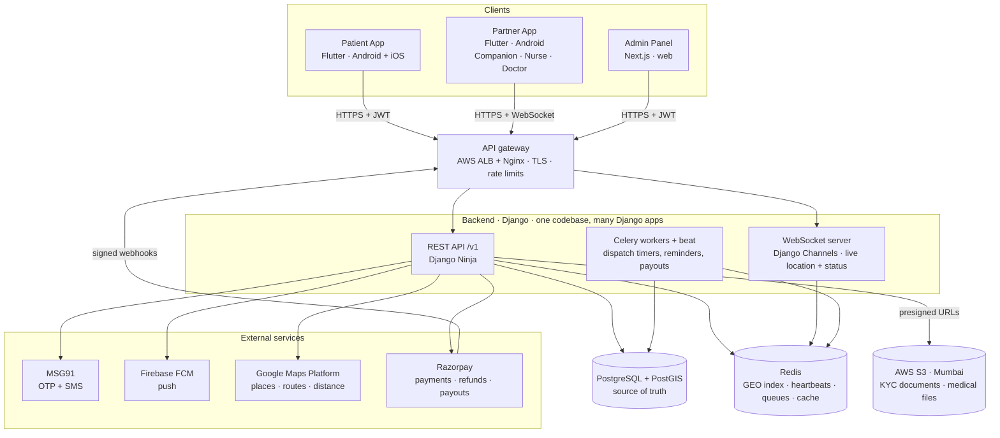
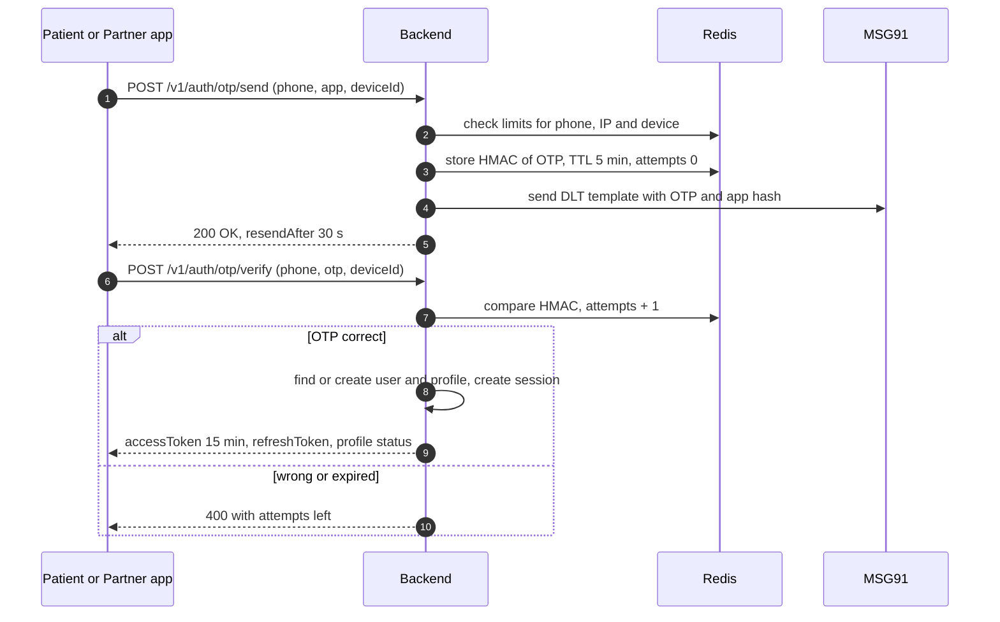
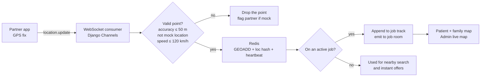
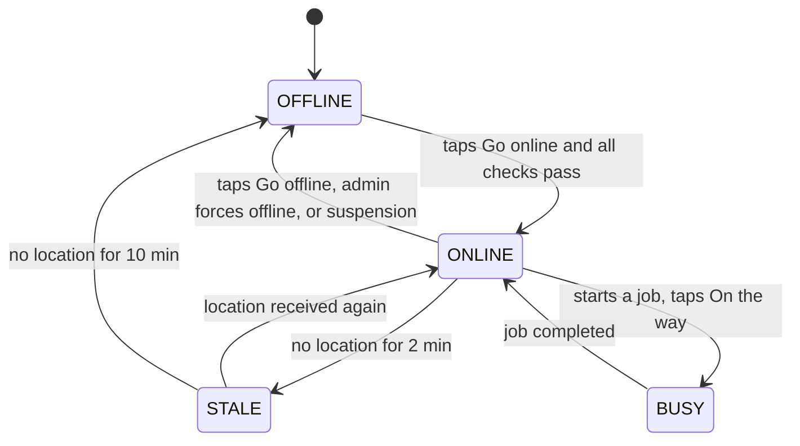
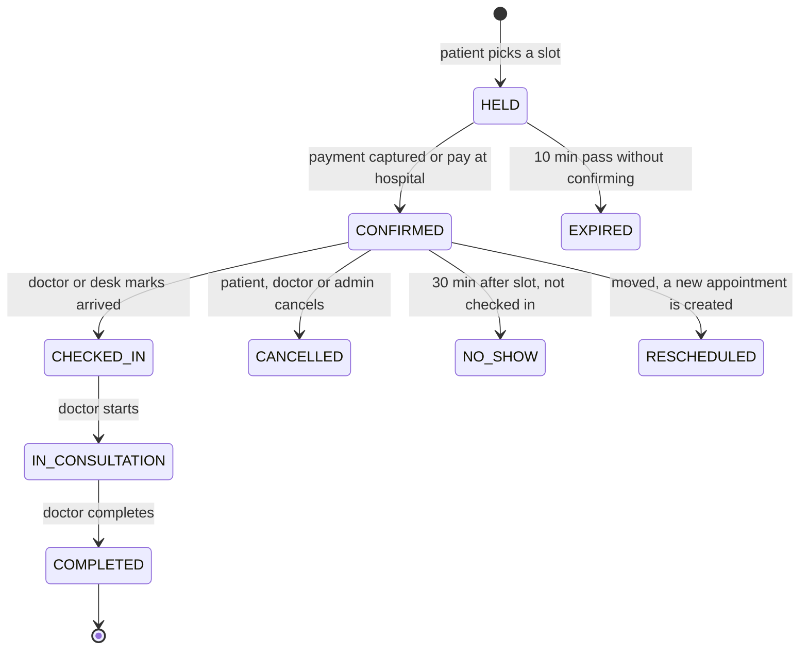
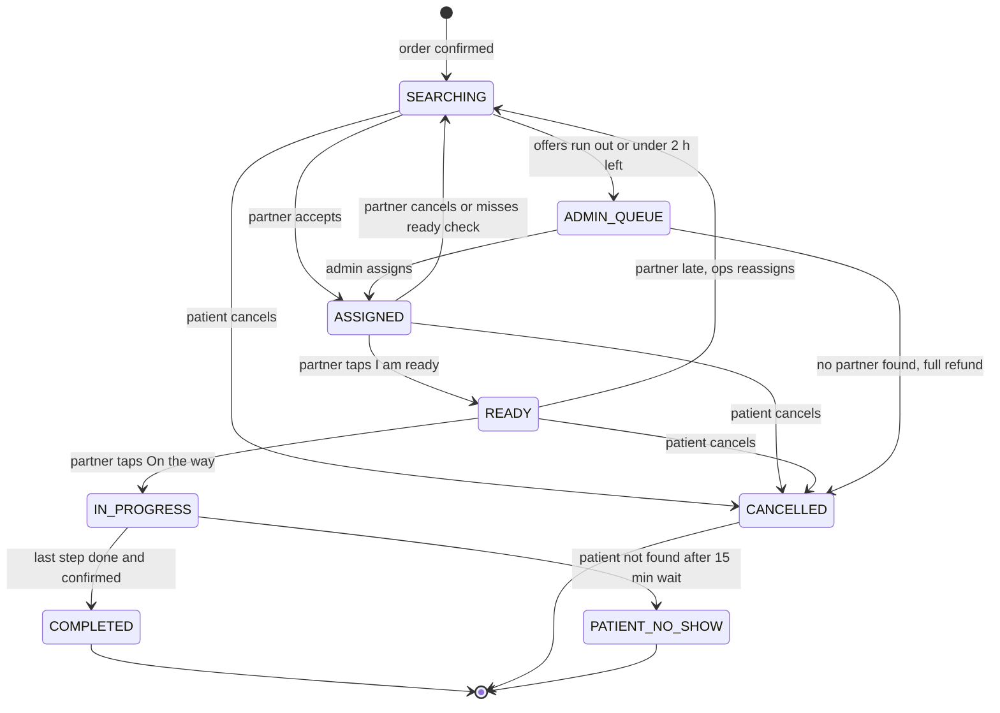
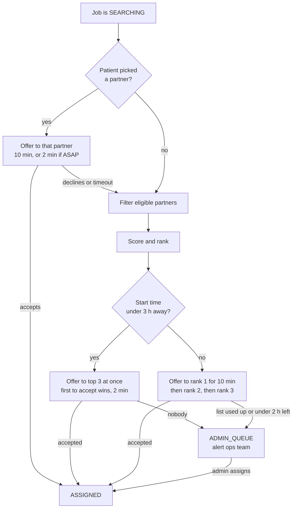
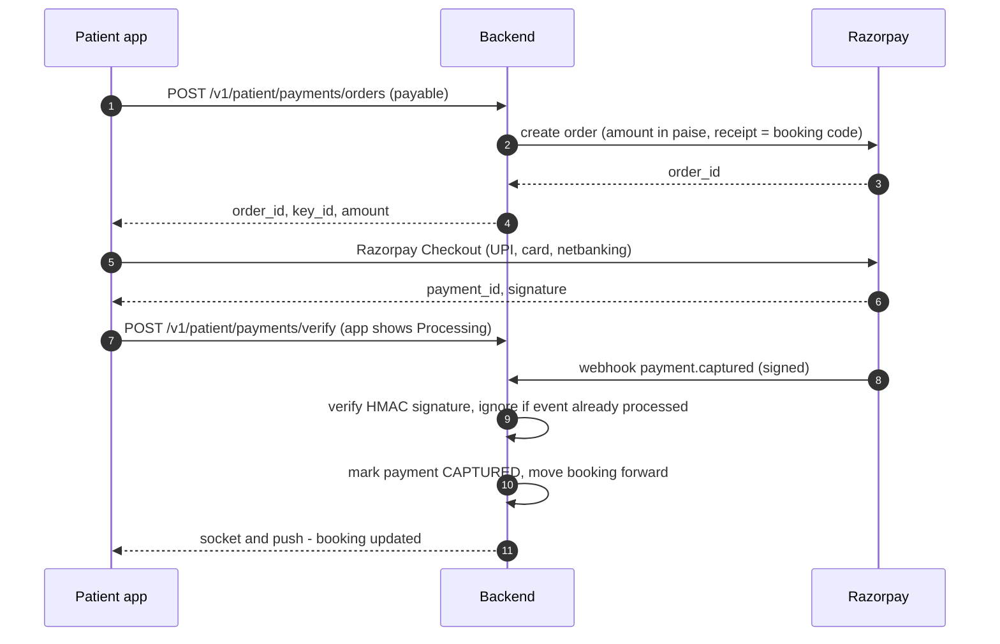
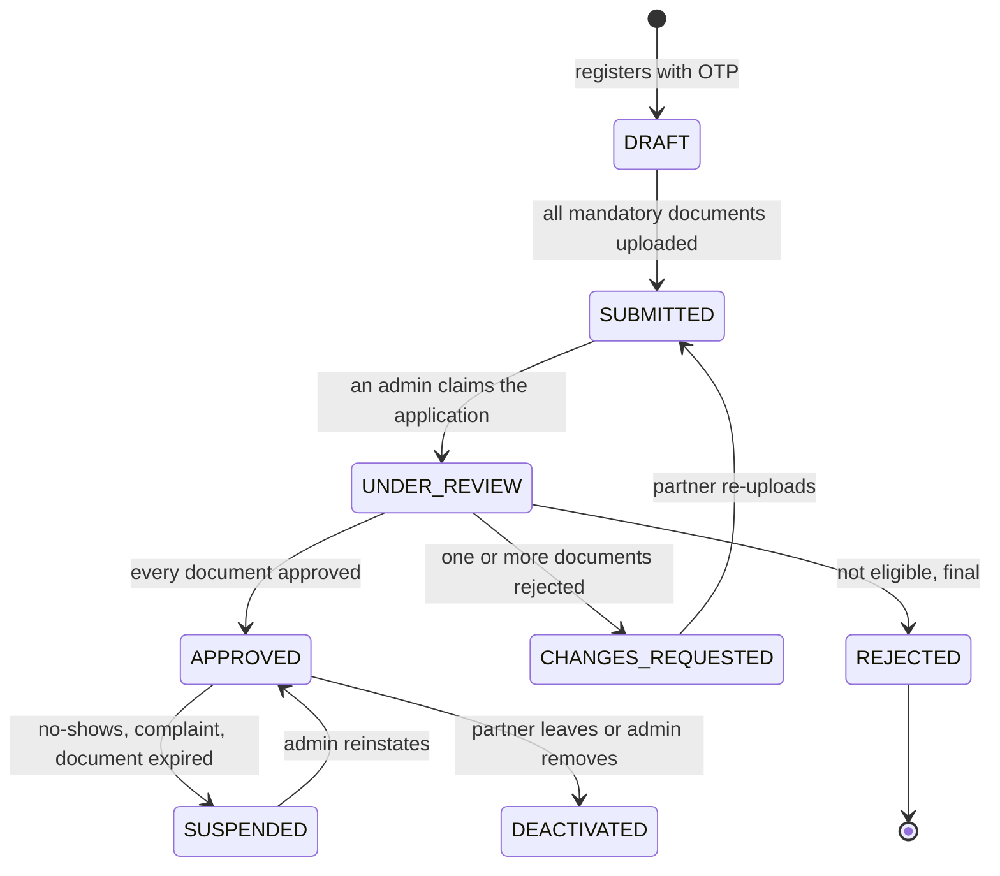

# WellWish — Architecture and Module Workflows

> **Version** 1.2 · **Date** 6 Oct 2026 · **Status** Draft for review
> **Changed in 1.2:** backend is **Django + Django Ninja** (FastAPI-style API layer on Django; was NestJS in 1.0, DRF in 1.1). Apps stay Flutter, admin stays Next.js. Logic questions for the client meeting are in [CLIENT-MEETING-QUESTIONS.md](CLIENT-MEETING-QUESTIONS.md).
> **Next step after review:** split the work between Kiran and Akash and create the phase documents (see [§16](#16-documentation-folder-and-phase-completion)).
>
> आपकी सेहत, हमारी जिम्मेदारी। — *Your health, our responsibility.*

This is the single source of truth for how WellWish works. It covers every module, every main workflow, and the logic behind OTP, security, location, online/offline status, nearby search, bookings, dispatch, pricing and payments. If code and this document disagree, fix one of them in the same PR.

---

## Contents

**Part A — Overview**
1. [What we are building](#1-what-we-are-building)
2. [Users and roles](#2-users-and-roles)
3. [System architecture and tech stack](#3-system-architecture-and-tech-stack)
4. [Repository structure](#4-repository-structure)
5. [UI reference and design system](#5-ui-reference-and-design-system)

**Part B — Core logic (shared by all modules)**
6. [Core logic](#6-core-logic)
   - 6.1 Identity and accounts · 6.2 OTP login · 6.3 Sessions and devices · 6.4 Authorization
   - 6.5 Zones · 6.6 Location capture and tracking · 6.7 Partner online / offline
   - 6.8 Nearby search · 6.9 Doctor schedules and slots · 6.10 Bookings, orders and jobs
   - 6.11 Dispatch · 6.12 Job OTP, geofence and safety · 6.13 Pricing
   - 6.14 Payments, wallet and payouts · 6.15 Notifications and realtime
   - 6.16 Medical records and consent · 6.17 Family · 6.18 Membership
   - 6.19 Ratings and reliability · 6.20 Cancellations and no-shows · 6.21 Edge cases

**Part C — Module workflows**
7. [Module 1 — Patient App](#7-module-1--patient-app)
8. [Module 2 — Partner App (Companion, Home Nurse, Doctor)](#8-module-2--partner-app)
9. [Module 3 — Admin Panel](#9-module-3--admin-panel)
10. [Backend modules, APIs, events and jobs](#10-backend-modules-apis-events-and-jobs)

**Part D — Data, security, operations**
11. [Database schema](#11-database-schema)
12. [Security checklist](#12-security-checklist)
13. [Environments, CI/CD and monitoring](#13-environments-cicd-and-monitoring)
14. [Rules for two developers working in parallel](#14-rules-for-two-developers-working-in-parallel)

**Part E — Delivery**
15. [Project phases](#15-project-phases)
16. [Documentation folder and phase completion](#16-documentation-folder-and-phase-completion)
17. [Open decisions](#17-open-decisions)
18. [Glossary](#18-glossary)

---

# Part A — Overview

## 1. What we are building

WellWish helps patients, mostly elderly people and families who live far from them, get medical care in person. A patient (or a family member) can:

- find **nearby doctors and hospitals** and book a doctor's slot,
- book a **verified companion** who picks them up, stays with them at the hospital and drops them home,
- book a **home nurse** for care at home,
- keep **medical records** in one place, and let **family** follow everything live.

### 1.1 The three modules

| # | Module | App name | Platform | Used by | Main job |
|---|---|---|---|---|---|
| 1 | Patient App | **WellWish** | Flutter · Android + iOS | Patients and family | Discover, book, track, pay, records, family |
| 2 | Partner App | **WellWish Partner** | Flutter · Android first (iOS later) | Companions, Home Nurses, Doctors | Register, get verified, go online, accept and do jobs, manage appointments, earnings |
| 3 | Admin Panel | **WellWish Admin** | Next.js · web | WellWish staff | Hospitals, doctors, schedules, prices, partner verification, operations, finance |
| — | Backend | WellWish API | Django + Django Ninja (Python) | All three | Business logic, data, realtime, background jobs |

**One Partner app, three roles.** Companions, home nurses and doctors all log in to the same Partner app. After login the app shows a different home screen and menu for each role (§8).

### 1.2 Services

| Service | Delivered by | Booked from (Patient App) | Priced by |
|---|---|---|---|
| Doctor consultation, in person at a hospital or clinic | Doctor | Doctors → Book Appointment | Doctor's fee (set by admin) + optional booking fee |
| Doctor visit companion (pickup → hospital → drop) | Companion | Book a Companion | Per km + per hour |
| Test / diagnostic companion | Companion | Book a Companion | Per km + per hour |
| Hospital paperwork | Companion | Book a Companion | Per hour |
| Medicine pickup | Companion | Book a Companion | Base + per km |
| Elderly care at home | Companion | Book a Companion | Per hour |
| Post-visit support (drop home, follow-up) | Companion | Book a Companion | Per km + per hour |
| Home nursing visit (injection, dressing, IV, post-op care) | Home Nurse | Home Nurse | Per visit |
| Nursing shift (12 h / 24 h attendant) | Home Nurse | Home Nurse | Per shift |

### 1.3 What changed from the first plan (WellWish.docx)

| First plan | Now |
|---|---|
| "Service Person" app for pickup and drop staff | Merged into the **Companion** role in the Partner app |
| Doctors managed only by admin, no login | Doctors **can log in** to the Partner app and see their bookings. Admin can still manage doctors who don't use the app. |
| Home nurses managed only by admin | Home nurses **register and log in** to the Partner app |
| Admin assigns every job by hand | **Automatic dispatch** with admin fallback. Patients can also pick a nearby companion themselves. |
| Prices not defined | Admin sets **price rules** per km, per hour, per visit or per shift |

---

## 2. Users and roles

| Role | App | How the account is created | What they can do |
|---|---|---|---|
| **Patient (account owner)** | Patient | Signs up with phone OTP (or Google + phone OTP) | Book for themselves and their family members, pay, see everything for their family |
| **Family viewer** | Patient | Invited by the account owner by phone number | See live updates, alerts and (if allowed) records of the members shared with them |
| **Companion** | Partner | Self sign-up → documents → **admin approval** | Go online, accept companion jobs, do trips, earn |
| **Home Nurse** | Partner | Self sign-up → documents (with nursing registration) → **admin approval** | Go online, accept nursing jobs, record care notes and vitals, earn |
| **Doctor** | Partner | Admin invites by phone, **or** self sign-up → documents (with medical registration) → **admin approval** | See and manage their appointments, upload prescriptions, manage schedule and leave |
| **Admin staff** | Admin | Created by a Super Admin. Email + password + 2FA. | Depends on admin role (§9.2) |

**One phone number = one person.** The same person can have a patient profile *and* a partner profile (for example, a nurse who also books doctors for their own mother). Each app logs into its own profile (§6.1).

---

## 3. System architecture and tech stack

### 3.1 Architecture diagram



**How a request flows**

1. An app calls `https://api.wellwish.in/v1/...` with a JWT. The gateway handles TLS and rate limits, then forwards to the API.
2. The API checks the token, the app audience, the role and object ownership (§6.4), runs the business logic in one module, and reads or writes PostgreSQL.
3. Anything that should happen later goes to a Celery task queue in Redis: offer timeouts, reminders, SMS, payouts. Celery workers process it. Celery beat runs the scheduled sweeps.
4. Live data (partner GPS, job status) goes over WebSockets served by Django Channels. Redis keeps the latest positions; PostgreSQL keeps the history.
5. Files never pass through the API. Apps upload and download straight to and from S3 using short-lived presigned URLs.

**Rule:** REST + PostgreSQL is the truth. Socket events only tell an app *that something changed*. After a reconnect, the app always re-fetches the current state over REST.

### 3.2 Tech stack

| Layer | Choice | Why |
|---|---|---|
| Patient + Partner apps | **Flutter** (stable), state with **Riverpod**, routing with **go_router**, monorepo with **melos** | One codebase for Android and iOS. Flutter is already installed on the dev machine. |
| Admin panel | **Next.js** (React, TypeScript) + **Ant Design** | Admin is mostly tables, filters and forms. |
| Backend | **Python 3.12 + Django 5.2 LTS + Django Ninja** | FastAPI-style endpoints (type hints, Pydantic schemas, auto docs) on top of Django's ORM, migrations and auth. Each Django app owns its models and its own `migrations/` folder, so two developers working in different apps never edit the same migration files. LTS gets security fixes until April 2028. |
| Geo | **GeoDjango** (`django.contrib.gis`) on PostGIS | `geography` fields, "within 10 km" and distance sorting in the ORM |
| API contract | **Django Ninja's built-in OpenAPI** (Swagger UI at `/v1/docs`, dev/staging only) | OpenAPI 3 generated from the Pydantic schemas → Dart client for Flutter, TypeScript client for admin |
| Auth | **PyJWT** inside a Ninja `HttpBearer` auth class (adds `aud`, `sid` and checks the session table), **pyotp** for admin TOTP, Django's Argon2 password hasher | §6.2–6.3 |
| Database | **PostgreSQL 16+ with PostGIS** | Transactions for bookings and money. Fast "within 10 km" queries. |
| Cache and presence | **Redis 7** (redis-py) | GEO index of online partners, heartbeats, rate limits, short caches |
| Background jobs | **Celery** + **django-celery-beat**, Redis as broker | Offer timeouts, reminders, sweeps, payouts |
| Realtime | **Django Channels** + channels-redis | WebSockets for live location and status. Scales across servers. |
| App server | **Gunicorn + Uvicorn workers** (ASGI) | One Docker image, run as separate `api`, `ws`, `worker` and `beat` services |
| Quality | pytest-django, factory_boy, ruff, mypy + django-stubs | |
| Files | **AWS S3** (ap-south-1 Mumbai), private buckets, SSE-KMS | KYC documents and medical files stay in India |
| Maps | **Google Maps Platform**: Places Autocomplete, Routes API, Maps SDK | Address search, route distance in km, ETA, map views |
| SMS / OTP | **MSG91** with DLT-registered templates | Indian SMS rules require DLT templates |
| Push | **Firebase Cloud Messaging** | Android + iOS push |
| Payments | **Razorpay** (Orders, Checkout, Webhooks, Refunds, Subscriptions) + **RazorpayX** payouts | UPI, cards and netbanking. Payouts to partners. |
| Hosting | **AWS Mumbai**: ECS Fargate (or EC2), RDS PostgreSQL, ElastiCache Redis, S3, CloudFront | Low latency in Odisha. Data stays in India. |
| Monitoring | **Sentry** (apps + backend), CloudWatch logs + alarms | Crash and error tracking, alerts |
| Local dev | **Docker Compose**: PostGIS, Redis, MinIO (S3 clone), Django, Celery | Same setup for both developers. Python is pinned in the Docker image, so the version installed on each laptop doesn't matter. |

**Why Django Ninja (and not FastAPI or DRF).** Django Ninja lets us write endpoints the way FastAPI does, while keeping everything Django gives us.

| | Django Ninja | FastAPI | Django REST Framework |
|---|---|---|---|
| How endpoints look | Type hints + Pydantic, like FastAPI | Type hints + Pydantic | Serializers + viewsets |
| Auto API docs (OpenAPI) | Built in | Built in | Extra package |
| ORM, migrations, auth, admin | Django's, built in | Assemble yourself: SQLAlchemy, Alembic, auth | Django's, built in |
| Maps / "within 10 km" | GeoDjango | GeoAlchemy2, more manual work | GeoDjango |
| Migrations with two developers | One folder per app, rare conflicts | One shared Alembic chain, frequent conflicts | One folder per app, rare conflicts |
| Celery, WebSockets (Channels) | Standard Django setup | Possible, more glue code | Standard Django setup |

- **FastAPI is best for small, fully async services.** WellWish is a large rules-and-data system with many tables, admin workflows and map queries. FastAPI would make us build what Django already has.
- **Django Ninja vs DRF:** same Django underneath. Ninja is less code, typed, and generates the API docs itself. DRF has a bigger ecosystem, but we don't need its extras: rate limits, OTP and permissions are custom anyway (§6.2–6.4).
- **Speed is not the limit.** Django easily handles a few hundred partners sending location every 10 s. Endpoints are normal (sync) Django views, because database transactions are simpler that way. Live updates use Django Channels.

The built-in Django admin is turned on for developers only (behind VPN or an IP allowlist) as a debugging tool. Staff use the Next.js admin panel.

---

## 4. Repository structure

One Git repository (monorepo) so API changes, app changes and docs move together.

```
wellwish/
├── apps/
│   ├── patient_app/              Flutter · "WellWish"
│   ├── partner_app/              Flutter · "WellWish Partner" (companion, nurse, doctor)
│   └── admin_web/                Next.js · "WellWish Admin"
├── packages/
│   ├── ww_ui/                    Dart · theme, colours, text styles, shared widgets (from the mockup)
│   ├── ww_core/                  Dart · models, generated API client, auth/token storage, socket client
│   └── ww_l10n/                  Dart · translations: English, Hindi, Odia
├── backend/                      Django project
│   ├── config/                   settings/ (base, dev, staging, prod), urls.py, asgi.py, celery.py
│   ├── common/                   auth classes, permissions, errors, pagination, money, events, state machine helper
│   ├── apps/                     one Django app per module, each with its own models + migrations + tests
│   │   ├── accounts/  patients/  family/  addresses/
│   │   ├── partners/  kyc/  presence/  tracking/
│   │   ├── zones/  hospitals/  doctors/  appointments/
│   │   ├── service_types/  orders/  jobs/  dispatch/  pricing/
│   │   ├── payments/  wallet/  membership/
│   │   ├── records/  notifications/  reviews/  safety/
│   │   └── staff/  audit/  files/  app_config/  webhooks/
│   ├── seeds/                    `python manage.py seed` → test zones, hospitals, doctors, partners, prices
│   ├── requirements/             base.txt, dev.txt, prod.txt (all versions pinned)
│   ├── manage.py
│   └── Dockerfile
├── infra/
│   ├── docker-compose.yml
│   └── nginx/
├── docs/                         ← this folder
└── .github/
    ├── workflows/                CI: lint, test, build, export OpenAPI
    └── CODEOWNERS
```

**Inside every Django app (same layout everywhere):**

```
apps/jobs/
├── models.py          tables this app owns
├── migrations/        this app's migrations only
├── schemas.py         Pydantic request/response schemas (become the OpenAPI contract)
├── api/               patient.py, partner.py, staff.py: one Ninja Router per client app, thin
├── urls.py
├── services.py        business logic: every write goes through here
├── selectors.py       read queries, always filtered by the caller
├── tasks.py           Celery tasks
├── consumers.py       WebSocket consumers (only apps with live data)
├── events.py          events this app publishes and handles
└── tests/
```

**Each Django app owns its own tables.** Another app never writes to those tables directly. It calls the owning app's `services.py` or reacts to its events (§10.2). This is what lets two developers work at the same time without breaking each other's code.

App names avoid Django's built-in labels: `accounts` (instead of `auth`/`users`) and `staff` (instead of `admin`).

---

## 5. UI reference and design system

### 5.1 Reference

All screens in the Patient App **must look like this mockup**. The Partner App and Admin Panel use the **same colours, type and components**, so the three products feel like one brand.


| Mockup # | Screen | Module |
|---|---|---|
| 1 | Splash | Patient (Partner app uses the same splash with "Partner" under the logo) |
| 2 | Login + OTP | Patient (same layout in Partner app) |
| 3 | Home | Patient |
| 4 | Doctors list | Patient |
| 5 | Doctor appointment | Patient |
| 6 | Book a Companion | Patient |
| 7 | Medical Reports | Patient |
| 8 | Family Updates | Patient |
| 9 | Digital Membership & Subscription | Patient |
| 10 | Profile | Patient |

Screens that are **not** in the mockup (listed in §7.1 and §8.1) must be designed in the same style. Build them from the `ww_ui` components first, before writing any screen-specific widget.

### 5.2 Design tokens (in `packages/ww_ui`)

> Values are estimated from the mockup image. Replace them with the exact values from the designer's source file when you have it, in one place: `ww_ui/lib/src/tokens.dart`.

| Token | Value (approx.) | Used for |
|---|---|---|
| `primary` | `#1A6DE0` | Main buttons (Send OTP, Confirm Appointment, Subscribe Now), selected date, active tab |
| `brandGreen` | `#22A045` | "Book Now", "Online" dot, check marks, heart in logo |
| `textPrimary` | `#0F2547` | Titles and main text (dark navy) |
| `textSecondary` | `#6B7785` | Sub-text, captions |
| `background` | `#F5F9FF` | Screen background |
| `surface` | `#FFFFFF` | Cards |
| `border` | `#E3EAF3` | Card and input borders |
| `tint` | `#EAF2FF` | Hero card, selected chips |
| `danger` | `#E53935` | Logout, errors, PDF icon |
| `gold` | `#F4B400` | Premium crown |
| Radius | cards 12, buttons 10, chips 10 | |
| Spacing | 16 px screen padding, 12 px between cards | |
| Font | **Poppins** (or the design file's font), with **Noto Sans Devanagari** and **Noto Sans Oriya** for Hindi and Odia | |
| Type scale | Screen title 20/600 · section 16/600 · card title 15/500 · body 14/400 · caption 12/400 | |

### 5.3 Shared components (build once in `ww_ui`)

`WWPrimaryButton`, `WWSecondaryButton`, `WWTextField`, `WWPhoneField` (+91 prefix), `WWOtpField`, `WWCard`, `WWListTile` (icon + title + subtitle + chevron, as in Profile and Family Updates), `WWStatusDot` (Online), `WWDateStrip` (day pills, as in mockup 5), `WWTimeSlotGrid`, `WWTabs` (pill tabs, as in Medical Reports), `WWBottomNav` (5 tabs), `WWDoctorCard`, `WWPartnerCard`, `WWStatusTimeline` (trip steps), `WWEmptyState`, `WWErrorState`, `WWLoading` (skeletons), `WWMapView`, `WWSosButton`, `WWPriceBreakdown`.

### 5.4 Languages

English, Hindi and Odia from day one, using Flutter ARB files in `ww_l10n`. Never hard-code text in a widget. The admin panel is English only.

---

# Part B — Core logic

## 6. Core logic

### 6.1 Identity and accounts

```
users (one row per phone number)
 ├── patient_profile      — created on first Patient App login
 │    └── members          — "Self" plus dependents (mother, father…)
 └── partner_profile      — created on first Partner App registration
      └── role: COMPANION | NURSE | DOCTOR
admin_users               — separate table, email + password + 2FA
```

- `users.phone` is unique and stored in E.164 format (`+919876543210`).
- **Every booking points to a `member`**, never directly to a user. The account owner is also a member with relation `SELF`. Booking for yourself and booking for your mother then work the same way.
- A partner has **one role** in v1. A nurse can additionally be allowed to take companion jobs if the admin enables the `companion_services` skill on their profile.
- A doctor record (`doctors`) can exist **without** an app account (admin manages them). When the doctor logs in to the Partner app with the same phone number, the account is linked automatically (§8.6).

### 6.2 OTP login

**Who uses it:** Patient App and Partner App. The admin panel uses email + password + 2FA (§6.3).



| Rule | Value |
|---|---|
| Phone format | Indian mobile only: `+91` and 10 digits starting 6–9 (`^[6-9]\d{9}$`). Blocks SMS-pumping fraud to foreign numbers. |
| OTP | 6 digits, from Python's `secrets` module (`f"{secrets.randbelow(10**6):06d}"`). Never use `random`. |
| Storage | Never store the plain OTP. Redis key `otp:{app}:{phone}` holds `HMAC-SHA256(otp, OTP_SECRET + phone)`, `attempts`, `createdAt`. TTL 5 minutes. |
| Verify | Constant-time compare. Max **5 wrong tries** per OTP, then the OTP is deleted and a new one is needed. |
| Resend | After 30 s, then 60 s, then 120 s |
| Send limits | 5 per phone per hour, 10 per phone per day, 20 per IP per hour, 10 per device per day |
| Lockout | 10 failed verifications for a phone within 1 hour → 1-hour lock and an admin alert |
| Auto-read | Android: SMS Retriever API (the 11-character app hash goes in the SMS template). iOS: `oneTimeCode` autofill. |
| DLT | SMS template and sender ID registered on DLT before launch |
| Test numbers | Dev/staging: seeded test numbers accept `123456`. Production: only one store-review number, set in env and logged on every use. |
| Google sign-in (Patient App) | Google login is allowed, but the phone number must still be verified by OTP once, because SMS alerts and job OTPs depend on it. |

**After OTP — what each app does**

- **Patient App:** new user → profile setup (name, date of birth, gender) → location permission → Home. Existing user → Home.
- **Partner App:** new user → choose role → registration → documents → "Under review" screen. Existing user → screen for their current verification status (§6.7 has the go-online rules).

### 6.3 Sessions, tokens and devices

| Item | Patient App | Partner App | Admin Panel |
|---|---|---|---|
| Login | Phone OTP (or Google + phone) | Phone OTP | Email + password (argon2id) + TOTP 2FA |
| Access token | JWT, 15 min | JWT, 15 min | JWT, 15 min |
| Refresh token | 30 days, rotating | 30 days, rotating | 12 hours, logout after 30 min idle |
| Devices | Many | **One active device.** A new login logs out the old device and notifies it. | Many, all logged |
| Token storage | `flutter_secure_storage` (Keychain / Keystore) | Same | httpOnly, Secure, SameSite=Strict cookie |

**JWT claims:** `sub` (user id), `aud` (`patient` / `partner` / `admin`), `pid` (profile id), `role` (partner role or admin role), `sid` (session id), `vs` (verification status, partners only).

**Refresh token rotation:**
- Refresh tokens are 256-bit random strings, stored only as SHA-256 hashes in `sessions`.
- Each refresh returns a new pair and marks the old token as used.
- If a used token is ever presented again, someone copied it. The whole session family is revoked and the user must log in again.

**Instant revoke:** when a partner is suspended or an admin is disabled, all their sessions are revoked and their socket is disconnected (`session.revoked` event).

### 6.4 Authorization (who can see what)

Every request passes four checks, in this order:

1. **Auth class** (`common.auth.SessionJWTAuth`, a Ninja `HttpBearer`): valid, unexpired JWT and an active session row.
2. **Audience check:** `aud` matches the route prefix. `/v1/patient/*` needs `aud=patient`, `/v1/partner/*` needs `aud=partner`, `/v1/admin/*` needs `aud=admin`. The three top-level Ninja routers are created with `auth=SessionJWTAuth(audience=…)`, so every endpoint inside `api/patient.py`, `api/partner.py` or `api/staff.py` gets the check automatically. A partner token can never call a patient or admin route.
3. **Role/permission check:** decorators on the endpoint. `@partner_role("DOCTOR")` for `/v1/partner/doctor/*`. Unverified partners can only call registration and KYC routes. Staff endpoints use `@staff_permission("pricing.rules.approve")` (§9.2).
4. **Ownership check inside the service:** this prevents IDOR bugs. Every query is scoped to the caller:
   - Patient: the booking's `booked_by_user_id` is the caller, **or** the caller is an active family viewer of that booking's member.
   - Partner: the job's `partner_id` is the caller. For open offers, only the limited offer fields are returned.
   - Doctor: appointments for their own practices only. Patient records only inside an active consent window (§6.16).
   - Admin: by permission. Opening a KYC document or a medical file writes an audit-log row.

**Rule for code review:** any selector that takes an `id` from the request must also take the caller and filter by it, for example `get_order_for_patient(order_id, user)`. A bare `Order.objects.get(id=order_id)` is not allowed in patient or partner views. A failed ownership check returns **404, not 403**, so callers can't probe which IDs exist.

### 6.5 Zones (service areas)

- A **zone** is a polygon on the map (PostGIS `geography(Polygon)`), for example "Bhubaneswar Central". Admin draws it in the admin panel.
- **Companion and nurse bookings** are only allowed when the pickup or home address is inside an active zone (`ST_Covers(zone.area, address.location)`). If it isn't, the app shows "We're not in your area yet" and saves the request to a waitlist.
- **Doctor discovery works anywhere.** Outside a zone the app hides companion and nurse options.
- Every partner has a **home zone** and a `service_radius_km` (default 10). Each zone has its own settings: default search radius, dispatch timeouts and price rules.

### 6.6 Location capture and tracking

#### Patient location
- Asks for "While using the app" permission. If denied, the patient types an address with Google Places Autocomplete.
- **Saved addresses** (Home, Mother's home…) store `lat/lng`, landmark, floor, and notes for the partner ("3rd floor, no lift"). Each saved address gets its `zone_id` worked out.
- The patient's live location is **never tracked**. It's used only to sort nearby results.

#### Partner location

| Partner state | How often the app sends location | Android requirement |
|---|---|---|
| Offline | Never | — |
| Online, no job | Every **60 s** or every **100 m** moved | Foreground service with a notification: "You're online — WellWish is using your location to find nearby jobs" |
| On an active job | Every **10 s** or every **20 m** | Same foreground service: "Sharing trip location with the patient" |
| Doctor | Never. Doctors don't share live location. | — |

Background location needs Google Play's location permission declaration. Prepare the declaration video and text in Phase 7.

#### Location pipeline



**Payload:** `{ lat, lng, accuracy, speed, heading, clientTs, isMock, battery }`

**Redis keys**

| Key | Type | Content | TTL |
|---|---|---|---|
| `geo:online:COMPANION`, `geo:online:NURSE` | GEO set | Partners who are ONLINE and free | — (removed when not ONLINE) |
| `loc:{partnerId}` | Hash | lat, lng, accuracy, ts, jobId | 10 min |
| `hb:{partnerId}` | String | last heartbeat | 120 s |
| `trk:{jobId}` | List | track points during a job | 48 h |

**Rules**
- **Mock location:** Android reports `isMock`. Such points are rejected. Three mock flags in 7 days auto-suspend the partner for review.
- **Noise filter for km:** ignore points with accuracy > 50 m and jumps that imply speed > 120 km/h. `gps_km` is the sum of the remaining segments.
- **Offline buffer:** if the network drops, the app stores points with their timestamps and uploads them later in one batch (`POST /v1/partner/jobs/:id/track-batch`).
- **Persist:** every 60 s the last location is copied to `partner_last_location` in PostgreSQL. When a job ends, the track is saved to `job_tracks` (polyline + km) and the Redis list is deleted.

### 6.7 Partner online / offline

This applies to **companions and nurses**. Doctors have a different, simpler model (§8.6).

There are two separate ideas:

| | Weekly availability | Live online status |
|---|---|---|
| What | "I can work Mon–Fri 08:00–14:00" | "I'm working right now" |
| Used for | **Scheduled** bookings (days ahead) | **ASAP** bookings and the "nearby companions" map |
| Set by | Availability screen | Go online / offline switch |



**Checks before going online** (the app shows the reason if one fails):

1. Verification status is `APPROVED` and the partner is not suspended.
2. No mandatory document has expired.
3. Location permission is granted and there is a GPS fix with accuracy ≤ 50 m.
4. The current location is inside the partner's home zone + service radius.
5. App version ≥ `min_partner_app_version`.
6. Today's **selfie check** is done: once a day, the first time they go online. It's compared with the approved profile photo, by admin spot checks in v1 and an automatic face match later.
7. **Cash owed** to WellWish is below the limit (default ₹2,000). Above it, they must settle by UPI in the app first (§6.14).

**Rules**
- **BUSY** partners are removed from `geo:online:*`. They don't appear on patients' maps and get no ASAP offers. They can still receive *scheduled* offers that don't overlap.
- A partner **can't go offline during an active job**. They must finish it or ask ops to reassign.
- A socket disconnect isn't treated as offline straight away. Heartbeat rules decide (STALE after 2 min, OFFLINE after 10 min), so a short network drop does nothing.
- Every status change writes `availability_log`. Online hours are shown in earnings and admin reports.

### 6.8 Nearby search

#### Doctors and hospitals
- Doctors are "near" based on their **practice location** (hospital or clinic).
- Default radius **10 km**. If fewer than 5 results, the search widens to **25 km**.
- Filters: speciality, available today, fee range, language, gender. Sort by distance (default), next available slot, or rating.
- Badges on doctor cards (as in mockup 4):
  - **Online** (green dot) = the doctor is accepting bookings today and is on duty today. It's **not** a GPS status.
  - **Available today** = at least one free slot left today.
  - **Next: Thu 10:15** = first free slot.

```sql
-- :here = ST_SetSRID(ST_MakePoint(:lng, :lat), 4326)::geography
SELECT d.id, d.full_name, s.name AS speciality, h.id AS hospital_id, h.name AS hospital,
       dp.id AS practice_id, dp.consultation_fee, dp.accepting_bookings,
       ST_Distance(h.location, :here) AS metres
FROM   doctor_practices dp
JOIN   doctors d      ON d.id = dp.doctor_id AND d.status = 'ACTIVE'
JOIN   hospitals h    ON h.id = dp.hospital_id AND h.status = 'ACTIVE'
JOIN   specialities s ON s.id = d.speciality_id
WHERE  dp.status = 'ACTIVE'
  AND  ST_DWithin(h.location, :here, :radius_m)
  AND  (:speciality_id IS NULL OR d.speciality_id = :speciality_id)
ORDER  BY metres
LIMIT  50;
```

The same query with GeoDjango (this is how it's written in `doctors/selectors.py`):

```python
from django.contrib.gis.db.models.functions import Distance
from django.contrib.gis.geos import Point
from django.contrib.gis.measure import D

here = Point(lng, lat, srid=4326)
qs = (DoctorPractice.objects
      .filter(status="ACTIVE", doctor__status="ACTIVE", hospital__status="ACTIVE",
              hospital__location__dwithin=(here, D(km=radius_km)))
      .select_related("doctor", "doctor__speciality", "hospital")
      .annotate(distance=Distance("hospital__location", here))
      .order_by("distance")[:50])
if speciality_id:
    qs = qs.filter(doctor__speciality_id=speciality_id)
```

The next free slot for each practice is worked out by the slot engine (§6.9) and cached in Redis per practice per day (`slots:{practiceId}:{date}`, cleared whenever an appointment changes).

#### Companions and nurses near the patient

The patient can see **who is available nearby** before booking, and can pick one or let the system choose (§6.11).

| Booking time | Data source | Query |
|---|---|---|
| **ASAP** (within the next 2 hours) | Redis live positions | `GEOSEARCH geo:online:COMPANION FROMLONLAT lng lat BYRADIUS 5 km ASC COUNT 50`, then drop STALE/BUSY and filter by needs |
| **Scheduled** (later) | PostgreSQL | Partners whose `base_location` is within their own `service_radius_km` of the pickup, who have weekly availability covering the time window and no overlapping job (§6.10) |

**Privacy rules** (partners' safety matters as much as patients'):
- Before a job is assigned, the patient **never sees a partner's exact location**. The distance is rounded to 0.5 km ("about 1.5 km away"), and the map dot is snapped to a ~300 m grid with a random offset for each search session.
- Shown fields: first name + last initial, photo, rating, trips done, languages, skills, "Verified" badge, and vehicle type.
- Never shown: phone, exact address, document details.
- After assignment the patient sees the partner's real live location, **only during the active job**.

**Caching:** nearby results are cached for 30 s per ~1.2 km map cell (geohash precision 6) + filter combination.

### 6.9 Doctor schedules and slots

**Practice:** one doctor at one hospital or clinic. A doctor can have several practices (e.g. hospital mornings, own clinic evenings).

| Setting (per practice) | Example | Notes |
|---|---|---|
| `schedule_managed_by` | `ADMIN` or `DOCTOR` | Only one side edits the schedule, which avoids edit fights. If `ADMIN`, the doctor can send change requests from the app. |
| Weekly rules | Mon, Thu · 10:00–13:00 · 15 min · 1 seat | Several rules per day are allowed (morning + evening) |
| Leave | 24–26 Dec 2026 | Blocks slots and notifies booked patients |
| Booking window | 14 days (30 for Premium) | How far ahead patients can book |
| Lead time | 60 min | No booking less than 60 min before the slot |
| `fee_collection` | `ONLINE` or `AT_HOSPITAL` | Online → slot is confirmed after payment |
| `accepting_bookings` | on/off | Doctor or admin can pause new bookings |

**Slot algorithm** (`slots(practiceId, date)`):

```
if date is outside the booking window → []
rules  = weekly rules for date.weekday where effective_from ≤ date ≤ effective_to
if a leave covers date → []
slots  = for each rule: from start to end step slot_minutes → (slotStart, seats)
taken  = count of appointments per slotStart with status in (HELD, CONFIRMED, CHECKED_IN, IN_CONSULTATION)
free   = slots where taken < seats and slotStart ≥ now + lead_time
return free
```

All times are stored in UTC (`timestamptz`) and shown in IST (`Asia/Kolkata`). Weekly rules are written in IST local time.

**Holding a slot (no double booking):**
1. Patient picks a slot → the API inserts an appointment with status `HELD` and `hold_expires_at = now + 10 min`.
2. A **unique partial index** makes the database refuse a second active booking for the same seat:
   ```sql
   CREATE UNIQUE INDEX uq_appt_seat ON appointments (practice_id, slot_start, seat_no)
   WHERE status IN ('HELD','CONFIRMED','CHECKED_IN','IN_CONSULTATION');
   ```
   In Django this is a `UniqueConstraint(fields=["practice", "slot_start", "seat_no"], condition=Q(status__in=ACTIVE_STATUSES), name="uq_appt_seat")` in `Appointment.Meta.constraints`. If two patients tap the same slot, only one insert succeeds. The other gets an `IntegrityError`, which the API turns into `409 SLOT_TAKEN`: "Just taken — pick another time".
3. Payment captured (or pay-at-hospital) → `CONFIRMED`. If nothing happens in 10 minutes, a worker moves it to `EXPIRED` and the seat is free again.

**Schedule changes that hit booked patients:** when a schedule edit or leave removes slots that already have bookings, the save is paused and the editor sees the affected appointments. They must choose: keep them (as exceptions) or cancel and notify (patients get a full refund and suggested new slots).

**Running late:** the doctor taps "Running late 15 / 30 / 45 min". Every patient booked for the rest of the day is notified, and so are their companions.

### 6.10 Bookings, orders and jobs

There are two kinds of booking:

| Kind | Table | Who serves it | Dispatched? |
|---|---|---|---|
| **Appointment** | `appointments` | Doctor (fixed by the patient's choice) | No |
| **Service order** | `service_orders` → `jobs` | Companion or nurse | Yes |

**Order vs job**
- A **service order** is what the patient bought: service, address, time or recurring schedule, needs, price snapshot and payment.
- A **job** is one unit of work for one partner. A doctor-visit companion order = 1 job. "Wound dressing daily for 7 days" = 1 order → 7 jobs.
- Dispatch, OTP, tracking, steps and earnings all belong to the **job**.
- An order can be linked to an appointment (`appointment_id`), for example "Book a companion for my 10:15 appointment with Dr. Patnaik". If the appointment is rescheduled or cancelled, the linked job follows automatically.

**Booking codes** for support calls: `APT-10234` (appointment), `ORD-20311` (order), `JOB-20311-1` (job).

#### Appointment states



#### Job lifecycle (companion and nurse)



`status` is the lifecycle above. While a job is `IN_PROGRESS`, `current_step` tracks progress. **The steps are set per service type in the `service_types` table, not hard-coded**, so admin can add a service without code changes.

| Service | Steps in order | OTP at | Geofence (150 m) at | Hourly meter |
|---|---|---|---|---|
| Doctor visit, Test / diagnostic | ON_THE_WAY → ARRIVED → STARTED → AT_HOSPITAL → SERVICE_DONE → LEFT_HOSPITAL → DROPPED | STARTED | ARRIVED, AT_HOSPITAL, DROPPED | AT_HOSPITAL → LEFT_HOSPITAL |
| Hospital paperwork | ON_THE_WAY → AT_HOSPITAL → STARTED → SERVICE_DONE | STARTED (family member present) | AT_HOSPITAL | STARTED → SERVICE_DONE |
| Medicine pickup | ON_THE_WAY → AT_PHARMACY → PICKED_UP_ITEMS → DELIVERED | DELIVERED | AT_PHARMACY, DELIVERED | — |
| Elderly care at home | ON_THE_WAY → ARRIVED → STARTED → ENDED | STARTED | ARRIVED | STARTED → ENDED |
| Post-visit support | ON_THE_WAY → AT_HOSPITAL → STARTED → DROPPED | STARTED | AT_HOSPITAL, DROPPED | STARTED → DROPPED |
| Home nursing visit / shift | ON_THE_WAY → ARRIVED → CHECKED_IN → CARE_NOTES → CHECKED_OUT | CHECKED_IN | ARRIVED | CHECKED_IN → CHECKED_OUT (shifts) |

After the last step the job waits for the patient's "Confirm completed" tap, or completes automatically after 30 minutes.

#### How state changes are coded (one pattern for everything)

- Every change goes through one function: `transition(entity, event, actor, context)`. It checks an **allowed-transitions table**. Anything not in the table is rejected with `409 INVALID_TRANSITION`.
- Every table with a state machine has a `version` column. Updates use `Model.objects.filter(id=…, version=v).update(…, version=F("version") + 1)` and check that exactly 1 row changed (optimistic locking), so a cancel and an accept arriving at the same moment can't both win. Where a longer check is needed, use `select_for_update()` inside `transaction.atomic()`.
- Every transition writes an event row (`appointment_events` / `job_events`): from, to, actor, time, lat/lng, note. These rows feed the timeline screens and the audit trail.
- "Create" and "pay" endpoints require an `Idempotency-Key` header. If the app retries after a timeout, the API returns the first result instead of creating a second booking.

**A partner can never be double-booked.** The database enforces it:
```sql
CREATE EXTENSION IF NOT EXISTS btree_gist;
ALTER TABLE jobs ADD CONSTRAINT no_partner_overlap
  EXCLUDE USING gist (partner_id WITH =, busy_window WITH &&)
  WHERE (status IN ('ASSIGNED','READY','IN_PROGRESS'));
-- busy_window = tstzrange(scheduled_start - travel_buffer, scheduled_end + 30 min)
```
In Django: `busy_window = DateTimeRangeField()` plus `ExclusionConstraint(name="no_partner_overlap", expressions=[("partner", RangeOperators.EQUAL), ("busy_window", RangeOperators.OVERLAPS)], condition=Q(status__in=["ASSIGNED", "READY", "IN_PROGRESS"]))`. Add a `BtreeGistExtension()` operation in that app's first migration.

### 6.11 Dispatch (matching partners to jobs)

**Three ways a job gets a partner**

| Mode | When | How |
|---|---|---|
| **Patient chose** | Patient tapped "Request this companion" on the nearby list | Offer goes only to that partner. If they decline or don't answer, the system asks the patient "Assign the best available match instead?" (default yes, set at booking time). |
| **Auto** | Default | Filter → score → offer (below) |
| **Admin** | Job lands in the admin queue, or ops overrides | Admin picks from a ranked list in the panel |



**When dispatch starts**
- Right after the order is confirmed, so the family sees the partner's name and photo early.
- For jobs more than **3 days** away, dispatch starts 3 days before the job (schedules aren't firm that far out). Until then the patient sees "We'll assign your companion by Mon 9 Nov".
- For recurring nursing orders, the system first tries to give **all jobs to one nurse** (continuity). If no nurse can take all of them, it dispatches job by job and prefers the nurse who did the previous visit.

**Step 1 — Filter (a partner must pass every check)**
1. Role matches the service (COMPANION / NURSE), the partner is `APPROVED`, not suspended, and has no expired documents.
2. Weekly availability covers `busy_window`, and there's no time-off in it.
3. No overlapping job. This is checked again by the database constraint when they accept.
4. Pickup is within the partner's `service_radius_km` of their base (scheduled) or within 5 km of their live position (ASAP).
5. Matches the patient's needs: gender preference, language, skills (wheelchair, elderly care, injection, IV…), vehicle type.
6. Not blocked by this patient (after a bad experience, a patient can block a partner).
7. ASAP only: status is ONLINE (not STALE or BUSY).

**Step 2 — Score (0 to 1, weights editable by admin)**

| Factor | Weight | Measured as (0–1) |
|---|---|---|
| Near the pickup | 0.30 | `1 − road_km ÷ radius_km`. Live GPS if under 2 h away, otherwise base location. |
| Reliable | 0.25 | Reliability score (§6.19). New partners start at 0.80. |
| Well rated | 0.20 | Average stars ÷ 5, last 50 jobs |
| Fair share | 0.15 | `1 − jobs this week ÷ 10`, spreads work around |
| Knows this patient | 0.10 | 1 if they served this member before with 4★ or more |
| Premium patient | +0.00 | Premium doesn't change the order. It widens the fan-out (top 5 instead of top 3) so the job is assigned faster. |

**Example:** a son in Bengaluru books a doctor-visit companion for his 72-year-old mother in Bhubaneswar.

| Companion | Distance | Reliable | Rating | Jobs this week | Served her before | Score |
|---|---|---|---|---|---|---|
| **Ramesh B.** | 2.1 km | 0.96 | 4.8 | 3 | Yes, 5★ | **0.87** |
| Bikash S. | 4.5 km | 0.99 | 4.9 | 1 | No | 0.74 |
| Sunita P. | 1.2 km | 0.88 | 4.6 | 6 | No | 0.73 |

Ramesh gets the first offer even though Sunita is closer. Every offer stores its `score_breakdown`, so ops can see why a partner was chosen.

**Step 3 — Offer and accept**
- The partner gets a full-screen offer with sound and a countdown. Before accepting they see:
  - service, date and time
  - **area name and distance only** (not the exact address)
  - patient needs
  - estimated earning
- Accept is **atomic**:
  ```sql
  UPDATE jobs
  SET    partner_id = :partnerId, status = 'ASSIGNED', assigned_at = now(), version = version + 1
  WHERE  id = :jobId AND status = 'SEARCHING' AND partner_id IS NULL;
  -- 1 row updated → the job is yours. 0 rows → "This job was already taken".
  ```
  In `dispatch/services.py`:
  ```python
  with transaction.atomic():
      won = (Job.objects
             .filter(id=job_id, status="SEARCHING", partner__isnull=True)
             .update(partner_id=partner_id, status="ASSIGNED",
                     assigned_at=timezone.now(), version=F("version") + 1))
      if not won:
          raise JobAlreadyTaken()        # → 409 JOB_TAKEN
  ```
  Plus the overlap constraint from §6.10. Other open offers for the job are withdrawn (`offer.withdrawn`).
- After acceptance the partner sees the exact address, member name, age and notes. The patient's phone number is visible only from 2 hours before the job until 1 hour after it.
- A decline asks for a reason (too far, not available, other). Declines don't hurt the reliability score. Accepting and then cancelling does.

### 6.12 Job OTP, geofence and safety

**Job OTP (proves the right partner reached the right patient)**
- A 4-digit code is created when a job is assigned. It's stored as a hash and shown in the Patient App to the account owner and family viewers.
- The partner enters it at the OTP step for that service (§6.10). After 5 wrong tries the job is locked and ops is alerted.
- If the job is reassigned, a new OTP is created.
- **No network at the door?** The OTP needs the internet. Fallback: the patient or family taps "My companion is here" in the Patient App, or ops confirms by phone. This is logged.

**Geofence**
- Steps marked with a geofence in §6.10 only work if the partner's GPS is within **150 m** of the target with accuracy ≤ 50 m.
- Large hospitals have weak indoor GPS. The partner can **override** with a reason and a photo. The step is accepted and flagged for ops review. More than 3 overrides in a week → reliability penalty.

**Patient not at pickup**
- After ARRIVED a 15-minute timer starts. The partner must try calling (the call attempt is logged).
- After 15 minutes they can mark `PATIENT_NO_SHOW`. The no-show fee from the price rule applies.

**Before arrival** the patient sees the partner's photo, name, rating, vehicle number and live ETA.

**SOS** (button on every active job in both apps)
1. Creates an `sos_events` row with live location and job details.
2. Alerts the admin dashboard with a loud alarm and a red banner until someone acknowledges it.
3. Sends an SMS to the patient's emergency contact and the partner's emergency contact.
4. Shows one-tap buttons for **112** (national emergency) and **108** (ambulance).

**Trip share link:** the patient can share a web link (random token, expires when the job ends) showing live status and location to someone without the app.

**Daily selfie check:** see §6.7.

### 6.13 Pricing

**Price rule** (admin creates one per zone + service type + vehicle type; changes need approval, §9.4):

| Field | Example | Notes |
|---|---|---|
| zone | Bhubaneswar Central | |
| service_type | DOCTOR_VISIT | |
| vehicle_type | CAR | CAR / AUTO / BIKE / NONE (patient's own car) |
| base_fare | ₹100 | |
| per_km | ₹12 | 0 if vehicle is NONE |
| per_hour | ₹150 | |
| per_visit / per_shift | — / — | For nursing |
| min_hours | 1 | |
| billing_block_min | 30 | Hours are billed in 30-min blocks, after 5 min grace |
| night_multiplier | 1.25 | 22:00–06:00 |
| partner_share_pct | 80 | The rest is WellWish's commission |
| late_cancel_fee | ₹50 | |
| patient_no_show_fee | base fare | |
| starts_on | 1 Nov 2026 | New rules replace old ones from this date |

**No surge pricing.** Healthcare prices must be predictable. Only night and holiday multipliers are allowed.

**Money is stored as integer paise** (`74200` = ₹742.00). Never use floats for money.

**Estimate (shown before booking):**
```
km        = routeKm(pickup → destination) × (2 if round trip else 1)      // Google Routes API
hours     = max(rule.min_hours, service.default_hours)
subtotal  = base_fare + km × per_km + ceilToBlock(hours) × per_hour    (or per_visit / per_shift)
if start is at night: subtotal = subtotal × night_multiplier
discount  = membership discount % × subtotal                           // §6.18
total     = round(subtotal − discount) + taxes
partner   = round(subtotal × partner_share_pct)                        // discount comes from WellWish's share
```
The estimate screen says plainly: **"₹592 for 2 hours, then ₹150 per extra 30 min block"**, so a longer hospital wait is never a surprise.

**Final (after the job):**
- `km = min(gps_km, route_km × 1.15)`. Detours never cost the patient.
- `hours` = time between the service's meter start and stop steps (§6.10), billed in 30-min blocks after 5 min grace.
- Same formula, same **price snapshot** stored on the order when it was booked. If admin changes prices later, existing orders keep their prices.

**Worked example** (Doctor visit, car, Premium 10% off, home → hospital 8 km)

| Line | Estimate | Final |
|---|---|---|
| Base | ₹100 | ₹100 |
| Distance | 16 km × ₹12 = ₹192 | 16 km × ₹12 = ₹192 |
| Hospital time | 2 h × ₹150 = ₹300 | 3 h (09:40–12:40) × ₹150 = ₹450 |
| Subtotal | ₹592 | ₹742 |
| Premium 10% | −₹59 | −₹74 |
| **Patient pays** | **₹533** | **₹668** |
| Partner earns (80% of subtotal) | ₹474 | ₹594 |
| WellWish keeps | ₹59 | ₹74 |

**Doctor fees:** set per practice by admin. If a doctor wants a different fee, they request it from the Partner app and admin approves. An optional platform booking fee (e.g. ₹30) is set per zone.

**Taxes:** GST lines are added only after the CA confirms which services are taxable. The engine supports a `tax_pct` per service type, default 0.

### 6.14 Payments, wallet and payouts

**When patients pay (default, editable per zone)**

| What | When | How |
|---|---|---|
| Doctor fee, `fee_collection = ONLINE` | At booking, during the 10-min hold | Razorpay |
| Doctor fee, `AT_HOSPITAL` | At the hospital | Outside WellWish (only the optional booking fee is paid online) |
| Companion / nurse job | **After completion** | Razorpay in the app, **or cash** to the partner |
| Membership | At subscribe, then auto-renew | Razorpay Subscriptions |



**Rules**
- **The webhook is the truth.** The app's success callback only shows "Processing". Bookings move forward only on a verified webhook or a server-side status check.
- Webhook signature: `HMAC-SHA256(rawBody, RAZORPAY_WEBHOOK_SECRET)` must equal `X-Razorpay-Signature`. Every event ID is saved in `webhook_events`, so duplicates are ignored.
- **Reconciliation job** every 10 minutes: any payment stuck in `CREATED`/`AUTHORIZED` for more than 10 minutes is checked against the Razorpay API.
- Unpaid completed jobs: reminders at 2 h and 24 h. After 2 unpaid jobs, that patient must prepay future orders.
- **Refunds** use the Razorpay Refunds API. Refunds over ₹2,000 need Finance approval. Every refund has a reason.

**Partner wallet (append-only ledger)**

| Entry kind | Sign | Example |
|---|---|---|
| EARNING | + | +₹594 for JOB-20311-1 |
| CASH_COLLECTED | − | −₹668 (patient paid cash to the partner) |
| PENALTY | − | −₹50 late cancel |
| INCENTIVE | + | +₹200 weekly bonus |
| PAYOUT | − | −₹4,820 paid to bank |
| CASH_SETTLEMENT | + | +₹74 partner paid cash dues by UPI |
| ADJUSTMENT | ± | Admin correction (needs a reason, audit-logged) |

- Ledger rows are **never updated or deleted**. Mistakes are fixed with a new ADJUSTMENT row.
- Balance = sum of entries. For a cash job: +594 − 668 = −74, meaning the partner owes WellWish ₹74.
- **Payouts:** every Monday 10:00 IST, any positive balance ≥ ₹100 is paid to the verified bank account or UPI through RazorpayX. Failed payouts retry and alert Finance.
- Doctors and hospitals have ledgers too when consultation fees are collected online. `payee` is set per practice: `DOCTOR` or `HOSPITAL`.
- **Money check (automated test and nightly job):** for every completed paid job, *amount paid by patient = partner earning + WellWish share*, exact to the paisa.

### 6.15 Notifications and realtime

**Channels:** push (FCM), SMS (MSG91), in-app inbox (`notifications` table), socket events for screens that are open.

| Event | Patient + family viewers | Partner | Admin | Channels |
|---|---|---|---|---|
| OTP | — | — | — | SMS |
| Appointment confirmed / cancelled / running late | ✔ | Doctor ✔ | — | Push + in-app (+ SMS for cancel) |
| Job assigned (with partner photo) | ✔ | ✔ | — | Push + in-app |
| New offer | — | ✔ | — | Push (high priority, sound) + socket |
| Reminder T−24 h, T−2 h | ✔ | ✔ | — | Push |
| Partner on the way / arrived / each step | ✔ | — | live map | Push + socket |
| Job in admin queue | — | — | ✔ | Socket + email |
| Partner late (ETA > start + 10 min) | ✔ ("running a few minutes late") | ✔ | ✔ | Push + socket |
| SOS | ✔ emergency contact | ✔ emergency contact | ✔ alarm | SMS + socket |
| Vitals outside safe range | ✔ | — | optional | Push + in-app |
| Report uploaded / prescription added | ✔ | — | — | Push + in-app |
| Partner application approved / rejected / document expiring | — | ✔ | — | Push + SMS |
| Payment received / refund done / payout sent | ✔ / ✔ / — | — / — / ✔ | — | Push + in-app |

**WebSocket setup (Django Channels)**
- Three endpoints: `wss://api.wellwish.in/ws/patient/`, `/ws/partner/`, `/ws/staff/`. The app sends its JWT as the first message (`{"type":"auth","token":"…"}`) within 5 s, or the connection is closed. Tokens are never put in the URL, because URLs end up in logs. The same audience rule as REST applies.
- Every message is JSON `{ "type": "job.updated", "data": { … } }`.
- Channel groups (Channels group names can't contain `:`): `user.{userId}`, `job.{jobId}` (owner, active viewers, assigned partner, staff), `staff.ops`, `staff.zone.{zoneId}`.
- Code outside a consumer (services, Celery tasks) sends with `async_to_sync(channel_layer.group_send)(group, message)`, always inside `transaction.on_commit`, so no event goes out for a change that was rolled back.
- Flutter uses `web_socket_channel` with auto-reconnect (1 s, 2 s, 5 s, then every 10 s). After every reconnect it re-fetches the screen's state over REST.
- Events are listed in §10.4.

### 6.16 Medical records and consent

| Record type | Uploaded by |
|---|---|
| Lab report, X-ray/scan, discharge summary, other | Patient (camera or PDF), Admin (for the patient) |
| Prescription | Doctor (after a consultation), Patient, Admin |
| Care note (vitals + tasks) | Nurse (created automatically from CARE_NOTES) |

**Upload flow (direct to S3)**
1. App calls `POST /v1/patient/records/upload-url` with type, mime and size. The API checks limits and returns a presigned PUT URL (valid 5 min) and a `fileKey`.
2. App uploads the file to S3.
3. App calls `POST /v1/patient/records` with `fileKey` + details. The API checks the object exists, its size and its MIME type (by reading the file's magic bytes), then saves the record.

Limits: PDF, JPG, PNG, HEIC · max 10 MB · storage quota per account (200 MB free, 5 GB Premium).

**Viewing:** `GET /records/:id/view-url` returns a presigned GET URL valid for **5 minutes**. Files are never public.

**Sharing with a doctor (consent)**
- When booking an appointment the patient can switch on "Share my reports with Dr. Patnaik". They choose all reports or selected ones.
- This creates a `record_shares` row valid **from booking time until 7 days after the appointment**. The doctor can view the shared records only inside that window. Every view is logged.
- The patient can revoke sharing at any time.

### 6.17 Family

| Type | Has own login? | Example | What they get |
|---|---|---|---|
| **Member (dependent)** | No | Mother, father | Bookings and records are kept under the owner's account |
| **Family viewer** | Yes, own Patient App account | Daughter in Pune | Invited by phone. Owner chooses which members and which permissions: view bookings, view records, health alerts, book on behalf. |

- Invite → the viewer gets an SMS + push → accepts in the app → becomes ACTIVE. If the owner removes them, access ends immediately and they leave the socket rooms.
- **Family Updates screen** (mockup 8):
  - **My Family Members:** members and viewers
  - **Health Alerts:** vitals out of range, missed or cancelled visits, SOS
  - **Messages:** in-app inbox of important updates: care notes, prescriptions, ops messages. Chat between patient and partner is a later phase.
  - **Recent Activity:** a timeline of bookings, steps and uploads
- **Charges for family members:** admin setting. Default: the first 2 dependents are free, then ₹49 per month each, and Premium includes up to 5 (see §17).

**Health alert thresholds** (admin-editable; a medical advisor must confirm them before launch). These only flag readings; they are not a diagnosis.

| Vital | Alert when | Critical (also show 108/112 buttons) |
|---|---|---|
| Blood pressure | Systolic ≥ 160 or ≤ 90, diastolic ≥ 100 | Systolic ≥ 180 |
| Pulse | ≥ 120 or ≤ 50 | ≥ 140 or ≤ 40 |
| SpO₂ | ≤ 92 % | ≤ 90 % |
| Temperature | ≥ 38.5 °C | ≥ 40 °C |
| Blood sugar | ≥ 300 or ≤ 70 mg/dL | ≤ 54 mg/dL |

### 6.18 Membership

Plans from mockup 9: **Monthly ₹299 · Quarterly ₹799 · Yearly ₹2,999.**

Benefits are stored as **entitlements**, so the code checks `hasEntitlement(user, KEY)` and never checks the plan name.

| Mockup benefit | Entitlement key | Premium value | Free value |
|---|---|---|---|
| Priority Doctor Access | `BOOKING_WINDOW_DAYS`, `PRIORITY_SUPPORT` | 30 days, yes | 14 days, no |
| Discount on Consultations | `CONSULT_DISCOUNT_PCT` | 10 % (online-paid fees only, paid from WellWish's share) | 0 |
| Reports Storage (Cloud) | `STORAGE_MB` | 5,120 | 200 |
| Companion Service Benefits | `COMPANION_DISCOUNT_PCT`, `DISPATCH_FANOUT` | 10 %, top 5 | 0, top 3 |
| Family Health Monitoring | `FAMILY_VIEWERS_MAX`, `HEALTH_ALERTS` | 5, yes | 1, no |

Renewal uses Razorpay Subscriptions. If a renewal payment fails, there's a 3-day grace period, then the account moves back to the Free entitlements. Bookings made during Premium keep their discount.

### 6.19 Ratings and reliability

- After completion the patient rates the partner (1–5 stars + tags such as "On time", "Caring", "Late") within 7 days. They rate the doctor separately after an appointment.
- Partners rate patients privately (1–5 + "Address hard to find", "Rude"). This is never shown to patients and is used only by ops.
- Reviews with comments can be hidden by admin (abuse, personal data).
- **Reliability score** (0–1, recalculated nightly over the last 30 days, needs at least 5 jobs; until then it's 0.80):
  ```
  reliability = 0.40 × on_time_rate        // arrived within 10 min of start time
              + 0.40 × completion_rate     // completed ÷ accepted
              + 0.20 × (1 − late_cancel_rate)
  ```
- Automatic actions:
  - average rating below 3.5 over the last 20 jobs → flagged for ops review
  - 3 no-shows or late cancels in 30 days → auto-suspend pending review (§6.20)

### 6.20 Cancellations and no-shows

All fees and time limits are admin settings. These are the defaults:

| Who cancels | When | Result |
|---|---|---|
| Patient (companion/nurse job) | Before a partner is assigned | Free |
| | After assignment, > 2 h before start | Free |
| | < 2 h before start | Late-cancel fee ₹50, partner gets their share |
| | After the partner taps On the way | Base fare charged |
| Patient (appointment) | > 4 h before slot | Full refund |
| | < 4 h before slot | Doctor fee refunded, booking fee kept |
| Partner | > 12 h before start | No penalty, job re-dispatched |
| | 2–12 h before | Reliability penalty, re-dispatched |
| | < 2 h, or doesn't show up | Counts as a no-show, re-dispatched with priority to standby partners |
| Doctor | Any time | Full refund. Patient is offered the nearest free slots first. The linked companion job is cancelled free, or rescheduled with the appointment. |
| WellWish (no partner found) | — | Full refund + ops follow-up call |

### 6.21 Edge cases

| Situation | What the system does |
|---|---|
| Partner's phone dies mid-trip | No heartbeat for 2 min on an active job → admin alert. Family sees "Location paused". Ops calls the partner and can record steps on their behalf with a reason (audit-logged). |
| No internet inside the hospital | Partner app queues step events with GPS and time and syncs later. The server accepts them if they're in valid order and the timestamps are within 6 h. OTP fallback: §6.12. |
| Doctor running late | Patient and companion are notified. The companion's hourly meter keeps running, and the estimate screen already said so. |
| Appointment rescheduled | Linked job's time is updated → overlap re-checked → if the partner can't make the new time, the job is re-dispatched. |
| Two partners tap Accept together | Atomic update (§6.11). One wins, the other sees "Already taken". |
| Patient double-taps Book | Idempotency key returns the same order |
| Payment done, app closed | Webhook confirms. The patient sees the confirmed booking the next time they open the app. |
| Webhook delayed or lost | Reconciliation job fixes it within 10 min |
| Partner goes online with an expired document | Blocked: "Your police verification expired on 3 Oct. Upload a new one." |
| GPS spoofing | Mock points rejected. 3 flags → auto-suspend for review. |
| Geofence fails in a big hospital | Override with reason + photo, flagged for ops |
| Admin changes price while orders are open | Orders keep their price snapshot |
| Schedule edit removes booked slots | Save paused, affected appointments listed, editor chooses keep or cancel + notify |
| Partner suspended during a job | Default: suspension starts after the current job ends. "Suspend now" requires ops to pick a replacement first. |
| Family viewer removed | Access ends immediately, socket rooms left |
| Nurse asked to inject without a prescription | App blocks medicine tasks unless a prescription is attached to the order. The nurse can decline the task. |
| Patient outside every zone | Doctor booking works. Companion and nurse options are hidden. Waitlist entry saved. |
| App version too old | `GET /v1/public/app-config` returns `minVersion`. The app shows a force-update screen. |

---

# Part C — Module workflows

## 7. Module 1 — Patient App

### 7.1 Screens

Bottom navigation (as in the mockup): **Home · Doctors · Reports · Family · Profile**.

| ID | Screen | Mockup | Key logic |
|---|---|---|---|
| P01 | Splash | 1 | Check app version → refresh token → route to Login or Home |
| P02 | Login (mobile / Google) | 2 | §6.2 |
| P03 | OTP verify | style of 2 | 6-digit field, resend timer, auto-read |
| P04 | Profile setup | — | Name, DOB, gender, language. Creates the `SELF` member. |
| P05 | Home | 3 | Greeting, hero, tiles: **Doctors, Book a Companion, Home Nurse (new), Medical Reports, Family Updates**, membership banner, upcoming booking card, bell |
| P06 | Nearby map | — | Tabs: Doctors · Hospitals · Companions · Nurses (§6.8) |
| P07 | Doctors list | 4 | Search, speciality chips, filter sheet, distance, Online / Available today badges |
| P08 | Doctor profile | — | Photo, qualifications, experience, languages, practices with map, fee, reviews, next slots |
| P09 | Hospital detail | — | Address, map, OPD hours, departments, doctors |
| P10 | Book appointment | 5 | Who is it for (member), date strip, time slots, reason, share reports switch, "Add a companion" switch, fee, Confirm |
| P11 | Book a Companion — service list | 6 | Six services from the mockup |
| P12 | Companion booking form | — | When (ASAP / date-time), pickup address, destination (hospital or linked appointment), member, needs, vehicle, estimate, "Choose a companion" or "Auto-assign best match" |
| P13 | Nearby companions / nurses | — | List + map, fuzzed distance, partner mini-profile, "Request this companion" |
| P14 | Home Nurse — services | — | Visit types + shifts, recurring schedule (daily × N days), prescription upload (required for injections and IV) |
| P15 | Review and pay | — | Price breakdown, payment method, membership discount, cancellation policy |
| P16 | My bookings | — | Tabs: Upcoming · Ongoing · Past (also from Profile → My Appointments) |
| P17 | Live job | — | Map with partner location, ETA, step timeline, partner card, **job OTP**, call, share link, SOS |
| P18 | Appointment detail | — | Status, hospital, directions, running-late banner, reschedule, cancel |
| P19 | Rate and review | — | Stars, tags, comment |
| P20 | Medical Reports | 7 | Tabs All · Lab Reports · Prescriptions, filter by member, **+ Upload** |
| P21 | Report viewer | — | PDF/image viewer via 5-min URL, share with doctor |
| P22 | Family Updates | 8 | Members, Health Alerts, Messages, Recent Activity |
| P23 | Family members | — | Add or edit dependents, invite or remove viewers, permissions |
| P24 | Membership | 9 | Plans, benefits, Subscribe Now |
| P25 | Profile | 10 | Personal info, My Appointments, My Reports, Family Members, Subscription Details, Help & Support, Logout |
| P26 | Addresses | — | Saved addresses with map pin and notes |
| P27 | Notifications | — | Inbox from the bell |
| P28 | Help & Support | — | FAQ, call support, raise a ticket about a booking |
| P29 | Settings | — | Language, notification preferences, privacy, **Delete account** |

### 7.2 Workflows

**W-P1 · Sign up and set up**
1. Splash → Login → phone → OTP (§6.2).
2. New user → P04 profile → `SELF` member created → consent screen (terms, privacy, health data) → location permission.
3. Home loads: nearby doctors count, upcoming bookings, membership status.

**W-P2 · Find a doctor and book**
1. Home → Doctors (or Nearby map). The app sends location → `GET /v1/patient/nearby/doctors`.
2. Pick a doctor → profile → pick a practice → date → `GET /practices/:id/slots?date=`.
3. Pick a slot → `POST /appointments/hold` → **HELD** for 10 min (a countdown is shown).
4. Choose the member, reason, and whether to share reports. Optional: switch on **"Add a companion"**, which goes to W-P3 with this appointment linked.
5. Pay online (if `ONLINE`) → webhook → **CONFIRMED** → push + SMS. Pay-at-hospital → **CONFIRMED** straight away.
6. Day of the visit: reminders at T−24 h and T−2 h, running-late updates, then a prescription appears in Reports after the doctor completes.

**W-P3 · Book a companion**
1. Book a Companion → pick a service (mockup 6).
2. Form: ASAP or date/time, pickup address (inside a zone), destination or linked appointment, member, needs, vehicle.
3. `POST /orders/estimate` → price breakdown, with the hourly part explained.
4. Choose:
   - **"Auto-assign best match"**, or
   - **"Choose a companion"** → P13 nearby list → "Request this companion" + "If they can't, assign the best match" (default on).
5. Confirm → order created → job **SEARCHING** → dispatch (§6.11).
6. Assigned → partner card with photo, rating and vehicle, plus the **job OTP**.
7. On the day → W-P5.

**W-P4 · Book a home nurse**
1. Home → Home Nurse → service (injection, dressing, IV, post-op, elderly care, 12 h / 24 h shift).
2. Schedule: one visit, or recurring (e.g. daily 09:00 for 7 days). Address, member, condition notes. **Prescription upload is required** for injections and IV.
3. Estimate → confirm → order → one job per visit → series dispatch (§6.11).
4. Each visit: tracking → check-in OTP → care notes and vitals appear live → check-out → rate (once per series or per visit).

**W-P5 · Track a job live and finish it**
1. P17 opens from the push or from My bookings. The app subscribes to the `job.{jobId}` group.
2. Statuses: Assigned → Ready → On the way (live map + ETA) → Arrived → patient shows the **OTP** → each step.
3. Family viewers see the same screen without the OTP's owner-only actions. They can see the OTP itself if they have the "be present" permission.
4. Last step → "Confirm completed" (or auto after 30 min) → final bill → pay (online/cash) → rate.

**W-P6 · Reports**
Upload (§6.16) → appears under All + its type tab → can share with a doctor for an appointment → doctor prescriptions and nurse care notes appear automatically.

**W-P7 · Family**
Add a dependent (name, relation, DOB, gender, blood group) → invite a viewer by phone with chosen permissions → the viewer accepts → the viewer gets Family Updates for the shared members.

**W-P8 · Membership**
Membership → choose plan → Razorpay subscription → entitlements active at once → Subscription Details shows the renewal date. On failed renewal → 3-day grace → Free.

---

## 8. Module 2 — Partner App

One app, **three roles**. The role is chosen once at registration and can't be changed by the partner (admin can change it).

### 8.1 Screens

**Common to all roles**

| ID | Screen | Notes |
|---|---|---|
| R01 | Splash | Same as mockup 1, with "Partner" under the logo |
| R02 | Login + OTP | Same layout as mockup 2 |
| R03 | Choose role | Companion · Home Nurse · Doctor (cards with icon + one line) |
| R04 | Registration form | Role-specific fields (§8.2) |
| R05 | Documents | Checklist of required documents for the role, camera capture, expiry date, status chip per document |
| R06 | Verification status | Submitted → Under review → Changes requested (with reasons per document) → Approved |
| R07 | Home | Role-specific (§8.4–8.6) |
| R08 | Notifications | Inbox |
| R09 | Earnings and wallet | Today / week, ledger, cash owed, payouts, bank account |
| R10 | Ratings | Average, recent reviews |
| R11 | Profile and documents | Edit profile, re-upload expiring documents, languages, skills |
| R12 | Help and settings | Support, language, logout |

**Companion and Nurse**

| ID | Screen | Notes |
|---|---|---|
| R20 | Home | Big **Go online** switch, today's jobs, open offers, today's earnings, selfie-check prompt |
| R21 | Weekly availability | Days + time ranges, time off |
| R22 | Offer (full screen) | Sound + vibration, countdown, service, time, **area and distance only**, needs, estimated earning, Accept / Decline (with reason) |
| R23 | My jobs | Today · Upcoming · Completed |
| R24 | Job detail | Address, member (name, age, notes), destination, timeline, "I'm ready" (T−90 min) |
| R25 | Active job | Navigate (opens Google Maps), step button, **OTP entry**, call, wait timer, SOS, upload photo (bill, documents) |
| R26 | Care notes (nurse) | Vitals form (BP, pulse, temp, SpO₂, sugar), tasks checklist, notes, photos |

**Doctor**

| ID | Screen | Notes |
|---|---|---|
| R30 | Home | Today's appointments by time, counters (booked / checked in / done), **Accepting bookings** switch, **Running late** button |
| R31 | Appointment detail | Patient name, age, gender, reason, shared reports (if consented), "Arriving with companion Ramesh, ETA 9:50" |
| R32 | Consultation actions | Check in · Start · Complete (upload prescription photo/PDF, notes, suggested follow-up date) · No-show · Cancel (reason) |
| R33 | Schedule | Weekly rules per practice (editable if `schedule_managed_by = DOCTOR`, otherwise "Request change"), leave |
| R34 | Practices | Hospitals/clinics, fee (request change), payee |

### 8.2 Registration fields and documents by role

| Field / document | Companion | Home Nurse | Doctor |
|---|---|---|---|
| Name, DOB, gender, photo, languages | ✔ | ✔ | ✔ |
| Home address + map pin (base location) | ✔ | ✔ | — |
| Service radius | ✔ | ✔ | — |
| Skills | Wheelchair, elderly care, first aid… | Injection, wound dressing, IV, catheter, post-op, elderly care, ICU care | — |
| Vehicle type + number | Optional | Optional | — |
| Aadhaar (masked) or DigiLocker | ✔ | ✔ | ✔ |
| PAN | ✔ | ✔ | ✔ |
| Live selfie | ✔ | ✔ | ✔ |
| Police verification certificate (renew yearly) | ✔ | ✔ | Optional |
| Bank account / UPI | ✔ | ✔ | ✔ if fees are paid online to the doctor |
| Emergency contact | ✔ | ✔ | — |
| Driving licence, RC, insurance | If vehicle | If vehicle | — |
| Nursing qualification (ANM / GNM / B.Sc / M.Sc) | — | ✔ | — |
| Nursing council registration (number + certificate + valid till) | — | ✔ | — |
| Medical degree (MBBS and above) | — | — | ✔ |
| Medical council registration (NMC / State council number + certificate) | — | — | ✔ |
| Speciality, experience, practice (pick hospital or add clinic with map pin) | — | — | ✔ |
| First-aid / elderly-care training certificate | Optional | — | — |

The list of required documents lives in the `required_documents` table (role, document type, mandatory, condition such as `HAS_VEHICLE`, has expiry), so admin can change it without an app release.

### 8.3 Common workflow — register and get verified



1. Login (OTP) → choose role → registration form → upload each document (direct to S3 using presigned URLs, §6.16) → **Submit**.
2. Status screen shows each document's status. If changes are requested, rejected documents show the admin's reason, for example "Photo is blurry — please upload again".
3. On **Approved**: push + SMS. Companions and nurses can now set weekly availability and go online. Doctors see their appointments.
4. 30 days before any document expires, the partner gets a reminder. On expiry they're auto-suspended until a new document is approved.

### 8.4 Companion workflow (one day)

1. **Morning:** open app → selfie check → **Go online** (§6.7 checks) → location sharing starts.
2. **Offer arrives** → full-screen offer → **Accept** (atomic, §6.11) → job appears in Upcoming, with full address now visible.
3. **T−24 h and T−2 h:** reminders. **T−90 min:** tap **I'm ready**, or the job is reassigned.
4. **Start:** tap **On the way** → status BUSY → live tracking every 10 s → patient sees ETA.
5. **At the door:** **Arrived** (geofence) → ask the patient for the **OTP** → **Started**.
6. **At the hospital:** **At hospital** (geofence, hourly meter starts) → help with registration, consultation and tests → **Service done** (optional photo of the prescription or receipt).
7. **Return:** **Left hospital** (meter stops) → **Dropped** (geofence) → patient confirms.
8. **Payment:** if cash, tap **Cash received** → wallet updated (§6.14).
9. **Evening:** Go offline → see earnings.

### 8.5 Home nurse workflow

Same as companion for online/offline, offers, ready check, on the way, and arrived. The differences:
- Offers show the **care tasks** and whether a prescription is attached. Medicine tasks are locked without one.
- At the door: **Check in** with the patient's OTP.
- **Care notes are required before check-out:** vitals (BP, pulse, temperature, SpO₂, sugar if needed), tasks done, notes, photos (e.g. wound). Saving them creates a care-note record (§6.16) and may raise a health alert (§6.17).
- **Check out** → patient or family confirms → next visit of the series shows in Upcoming.
- Shift jobs (12 h / 24 h): a gentle check-in prompt every 2 hours ("Patient OK?") so the family sees regular updates.

### 8.6 Doctor workflow

**Getting access (two ways)**
- **Admin-invited:** admin creates the doctor and practice in the panel and taps **Invite**. The doctor gets an SMS with the app link. On first OTP login with that phone, the account links to the existing doctor record, already verified. They only accept terms and add bank details if needed.
- **Self-registration:** doctor registers in the Partner app → documents (§8.2) → admin verifies the medical registration number on the national/state register → approves → admin links or creates the practice.

**No GPS, no Go online.** A doctor's "Online" badge means "accepting bookings today". It comes from the `accepting_bookings` switch + schedule + leave.

**A day**
1. Open app → R30 shows today's appointments in time order.
2. Patient arrives → **Check in** (or the hospital desk tells the doctor, who taps it).
3. **Start** → read reason and shared reports (inside the consent window) → **Complete** → upload prescription → the patient gets it in Reports immediately.
4. Patient didn't come → **No-show** (allowed only after slot time + 15 min).
5. Delayed → **Running late** → all of today's later patients and their companions are notified.
6. Need a day off → **Leave** → if bookings exist, the doctor sees them and must choose (keep or cancel and notify), same rule as §6.9.

---

## 9. Module 3 — Admin Panel

### 9.1 Pages

| Area | Pages |
|---|---|
| **Dashboard** | Today: appointments, active jobs, jobs in queue, partners online, SOS open, revenue, new applications. Charts for the last 30 days. |
| **Network** | Zones (draw polygon) · Specialities · Hospitals (map pin picker, departments, OPD hours) · Doctors (profile, practices, fee, payee) · Schedules and leave · Doctor invites · Fee-change requests |
| **Partners** | Applications queue (by role) · Application review (per-document approve/reject) · All partners (filters: role, zone, status, online) · Partner profile (documents, jobs, ratings, reliability, ledger) · Suspend / reinstate / force offline · Required-documents settings |
| **Services and pricing** | Service types (steps, OTP step, geofence steps, meter steps) · Price rules (draft → approval → active) · Cancellation and fee settings · Dispatch weights and timeouts |
| **Operations** | Live map (partners by status, active jobs) · Dispatch queue (ADMIN_QUEUE with ranked suggestions) · Appointments · Orders and jobs (timeline, events, track replay) · Assign / reassign · SOS console · Alerts (late, geofence override, mock GPS, ready-check missed) |
| **Patients** | Patient list · Patient profile (members, bookings, payments; medical files only with a logged reason) · Upload reports for a patient |
| **Finance** | Payments · Refunds (request → approve) · Partner ledgers · Payouts (weekly run, failures) · Commission and revenue reports (export CSV) |
| **Engagement** | Membership plans · Subscriptions · Broadcast notifications (by zone/role) · Reviews moderation · Support tickets |
| **System** | Admin users · Roles and permissions · Audit log · App config (min versions, feature flags) |

### 9.2 Admin roles (RBAC)

| Area | Super Admin | Operations | Verification | Network | Finance | Support |
|---|---|---|---|---|---|---|
| Dashboard | ✔ | ✔ | view | view | ✔ | view |
| Zones, hospitals, doctors, schedules | ✔ | view | — | ✔ | — | view |
| Partner applications and documents | ✔ | — | ✔ | doctors only | — | — |
| Suspend / reinstate partners | ✔ | ✔ | ✔ | — | — | — |
| Bookings, dispatch queue, assign | ✔ | ✔ | — | — | view | view |
| Live map and SOS | ✔ | ✔ | — | — | — | view |
| Patient details | ✔ | view | — | — | view | view |
| Medical files | ✔ (logged) | upload, view (logged) | — | — | — | — |
| Price rules | approve | — | — | — | propose | — |
| Payments and refunds | ✔ | request | — | — | ✔ approve | request |
| Payouts and commission | ✔ | — | — | — | ✔ | — |
| Membership plans | ✔ | — | — | — | ✔ | view |
| Broadcasts | ✔ | ✔ | — | — | — | — |
| Service types, settings, app config | ✔ | — | — | — | — | — |
| Admin users, roles, audit log | ✔ | — | — | — | — | — |

Permissions are stored as strings (`partners.applications.review`, `pricing.rules.approve`…) in `admin_role_permissions`. The panel hides menu items without the permission, and the API checks them again on every call.

### 9.3 Workflow — verify a partner

1. Verification → Applications (oldest first; SLA badge turns red after 48 h).
2. **Claim** the application. It's locked to you for 30 minutes so two admins don't review the same one.
3. Open each document (logged). Check the name matches, the photo matches the selfie, expiry, and the registration number (nurse/doctor) against the council register.
4. Approve or reject each document with a reason chosen from a list + free text.
5. If all mandatory documents are approved → **Approve** (optional checklist: "orientation call done"). If any are rejected → **Request changes**. If not eligible → **Reject** (final, reason required).
6. The partner is notified. Everything is in the audit log.

### 9.4 Workflow — change prices (maker-checker)

1. Finance creates or edits a price rule → status **DRAFT** → **Submit**.
2. Super Admin sees "Pending approval" with a before/after comparison and a sample fare → **Approve** (with a start date) or **Return**.
3. On the start date the new rule becomes ACTIVE and the old one RETIRED. Open orders keep their snapshot.

### 9.5 Workflow — dispatch queue and live operations

1. A job enters **ADMIN_QUEUE** → alert sound + red count in the sidebar.
2. Open the job → see why auto-dispatch failed (offers sent, declines with reasons, timeouts) and a **ranked list** of partners, including ones just outside the filters (marked, e.g. "12 km — outside radius").
3. **Assign** → offer sent with "Assigned by WellWish ops" → partner must accept within 5 min, or ops can **Force assign** after a phone call (logged).
4. Live map: filter by zone/role/status, click a partner for current job and last update, click a job for track replay.

### 9.6 Workflow — SOS

1. SOS → full-width red banner + alarm on every Operations screen.
2. **Acknowledge** (records who and when) → call the partner and the patient (numbers shown) → actions: call 112/108, send a backup partner, notify family.
3. **Resolve** with notes. SOS events can't be deleted.

### 9.7 Workflow — weekly payouts

1. Monday 10:00 IST the payout job prepares the batch → Finance reviews the totals → **Approve batch**.
2. RazorpayX payouts are sent → status updates by webhook → failed payouts listed with the reason (wrong IFSC, etc.) → partner asked to fix bank details.

---

## 10. Backend modules, APIs, events and jobs

### 10.1 Django apps and the tables they own

| Django app | Owns tables | Responsibility |
|---|---|---|
| `accounts` | users, sessions, devices, consents, (Redis OTP keys) | Custom user model, OTP, tokens, refresh rotation, devices, FCM tokens, consents |
| `patients` | patient_profiles, members | Patient profile, members |
| `family` | family_viewers, family_viewer_members | Invites, permissions |
| `addresses` | addresses | Saved addresses, zone lookup |
| `zones` | zones | Zone polygons and settings |
| `hospitals` | hospitals, specialities, hospital_departments | Hospitals, specialities |
| `doctors` | doctors, doctor_practices, doctor_schedules, doctor_leaves, fee_change_requests | Doctors, practices, schedules, slot engine |
| `appointments` | appointments, appointment_events | Holds, state machine, check-in, completion |
| `partners` | partner_profiles, nurse_details, partner_availability, partner_time_off, selfie_checks | Partner profiles, availability |
| `kyc` | partner_applications, partner_documents, required_documents | Registration, documents, verification |
| `presence` | availability_log, partner_last_location, (Redis geo/hb/loc) | Online/offline, heartbeats |
| `tracking` | job_tracks, (Redis trk) | Location ingest, tracks, km |
| `service_types` | service_types | Steps config |
| `orders` | service_orders | Orders, recurrence → jobs |
| `jobs` | jobs, job_events, care_notes | Job state machine, steps, OTP, geofence |
| `dispatch` | job_offers | Filter, score, offers, admin queue |
| `pricing` | price_rules, fee_settings | Estimates, finals, approvals |
| `payments` | payments, refunds, webhook_events | Razorpay orders, webhooks, refunds, reconciliation |
| `wallet` | ledger_entries, payouts, bank_accounts | Ledgers, cash dues, payouts |
| `membership` | membership_plans, subscriptions | Plans, subscriptions, entitlements |
| `records` | medical_records, record_shares, health_alerts | Files, sharing, alerts |
| `notifications` | notifications, notification_templates | Push, SMS, in-app |
| `reviews` | reviews, partner_blocks | Ratings, reliability job |
| `safety` | sos_events, share_links | SOS, trip share |
| `staff` | admin_users, admin_roles, admin_role_permissions | Admin users, staff login + TOTP, RBAC |
| `audit` | audit_log | Audit trail |
| `files` | — | Presigned URLs, file checks |
| `app_config` | app_config | Versions, feature flags |
| `webhooks` | — | Razorpay webhook entry point → payments |

**`accounts.User` is the custom `AUTH_USER_MODEL`** (phone number as the username field). It must be created in the very first migration. Django can't easily switch user models later.

### 10.2 Domain events (how modules talk to each other)

Apps publish events through one small helper, `common.events.publish(name, payload)`. It runs inside `transaction.on_commit`, so an event only fires after the change is saved. Each handler runs as a **Celery task**, so a slow handler (SMS, push) never slows down the API response and a failed handler can retry. Handlers never write to the publisher's tables. We don't use Django signals for this, because they're harder to follow and run inside the same transaction.

| Event | Published by | Consumed by |
|---|---|---|
| `partner.approved` / `partner.suspended` | kyc | partners, presence, notifications, auth (revoke sessions on suspend) |
| `document.expired` | kyc | partners (suspend), notifications |
| `appointment.confirmed` / `.cancelled` / `.rescheduled` | appointments | orders (linked jobs), notifications, payments (refund) |
| `appointment.completed` | appointments | records (prescription), reviews, notifications |
| `doctor.running_late` | doctors | notifications, jobs (linked companion) |
| `order.confirmed` | orders | dispatch |
| `job.assigned` / `.status_changed` / `.completed` / `.cancelled` | jobs | notifications, tracking, pricing (final fare), wallet, payments, reviews |
| `offer.accepted` / `.expired` / `.declined` | dispatch | jobs, notifications |
| `payment.captured` / `.failed` / `refund.processed` | payments | appointments, orders, wallet, membership, notifications |
| `care_note.created` | jobs | records, family (alerts), notifications |
| `sos.raised` | safety | notifications, admin socket |
| `subscription.activated` / `.expired` | membership | notifications |

### 10.3 API map

All routes are prefixed `/v1`, with no trailing slash. Request and response shapes are Pydantic schemas in each app's `schemas.py`. Django Ninja generates the OpenAPI document, and CI exports it to `docs/api/openapi.json`. The Flutter apps (Dart, via `openapi-generator`) and the admin panel (TypeScript) use clients **generated** from that file, so field names can't drift.

**Error format (all routes):**
```json
{ "error": { "code": "SLOT_TAKEN", "message": "This slot was just booked. Please pick another time.", "details": {} } }
```

**Auth and public**
```
POST /v1/auth/otp/send              { phone, app, deviceId }
POST /v1/auth/otp/verify            { phone, otp, app, deviceId } → tokens + profile status
POST /v1/auth/google                { idToken } → needs phone OTP if no phone linked
POST /v1/auth/refresh               { refreshToken }
POST /v1/auth/logout                { allDevices? }
GET  /v1/public/app-config          min versions, feature flags, support numbers
GET  /v1/public/specialities
GET  /v1/public/service-types
GET  /v1/public/zones/check?lat=&lng=
```

**Patient (`aud=patient`)**
```
GET|PUT          /v1/patient/me
GET|POST|PUT|DEL /v1/patient/members
GET|POST|PUT|DEL /v1/patient/addresses
GET|POST|DEL     /v1/patient/family/viewers
GET  /v1/patient/nearby/doctors?lat=&lng=&radiusKm=&specialityId=&availableToday=
GET  /v1/patient/nearby/hospitals?lat=&lng=&radiusKm=
GET  /v1/patient/nearby/partners?role=COMPANION|NURSE&lat=&lng=&at=ASAP|<ISO time>&needs=
GET  /v1/patient/hospitals/:id
GET  /v1/patient/doctors/:id
GET  /v1/patient/practices/:id/slots?date=YYYY-MM-DD
POST /v1/patient/appointments/hold          { practiceId, slotStart, memberId }  (Idempotency-Key)
POST /v1/patient/appointments/:id/confirm   { reason, shareRecords }
POST /v1/patient/appointments/:id/cancel    { reason }
POST /v1/patient/appointments/:id/reschedule { slotStart }
GET  /v1/patient/appointments?bucket=upcoming|past
POST /v1/patient/orders/estimate            { serviceType, pickup, destination, vehicle, schedule }
POST /v1/patient/orders                     { ..., memberId, needs, dispatchMode, preferredPartnerId? }  (Idempotency-Key)
GET  /v1/patient/orders?bucket=upcoming|ongoing|past
GET  /v1/patient/orders/:id
POST /v1/patient/orders/:id/cancel
GET  /v1/patient/jobs/:id                   live view incl. OTP (owner / permitted viewer)
POST /v1/patient/jobs/:id/partner-arrived   OTP fallback (§6.12)
POST /v1/patient/jobs/:id/confirm-complete
POST /v1/patient/jobs/:id/sos
POST /v1/patient/jobs/:id/share-link
POST /v1/patient/payments/orders            { payableType, payableId }
POST /v1/patient/payments/verify            { razorpayOrderId, razorpayPaymentId, signature }
GET  /v1/patient/records?memberId=&type=
POST /v1/patient/records/upload-url         { type, mime, sizeBytes }
POST /v1/patient/records                    { fileKey, memberId, type, title, recordDate }
GET  /v1/patient/records/:id/view-url
DEL  /v1/patient/records/:id
POST|DEL /v1/patient/records/shares
GET  /v1/patient/family/feed
GET  /v1/patient/alerts
GET  /v1/patient/membership/plans
POST /v1/patient/membership/subscribe       { planId }
GET  /v1/patient/membership
POST /v1/patient/reviews                    { jobId | appointmentId, stars, tags, comment }
POST /v1/patient/partners/:id/block
GET  /v1/patient/notifications ; POST /v1/patient/notifications/read
POST /v1/patient/support/tickets
POST /v1/patient/me/delete-request
```

**Partner (`aud=partner`)**
```
POST /v1/partner/register                   { role, profile fields }
GET|PUT /v1/partner/me
GET  /v1/partner/documents/required
POST /v1/partner/documents/upload-url
POST /v1/partner/documents                  { docType, fileKey, number?, expiresOn? }
POST /v1/partner/application/submit
GET  /v1/partner/application
PUT  /v1/partner/availability/weekly        (companion, nurse)
POST|DEL /v1/partner/time-off
POST /v1/partner/selfie-check               { fileKey }
POST /v1/partner/online                     { lat, lng, accuracy }   → 422 with reason if a check fails
POST /v1/partner/offline
GET  /v1/partner/offers
POST /v1/partner/offers/:id/accept
POST /v1/partner/offers/:id/decline         { reason }
GET  /v1/partner/jobs?bucket=today|upcoming|completed
GET  /v1/partner/jobs/:id
POST /v1/partner/jobs/:id/ready
POST /v1/partner/jobs/:id/steps             { step, lat, lng, accuracy, clientTs, otp?, photoKey?, overrideReason? }
POST /v1/partner/jobs/:id/track-batch       [ points ]
POST /v1/partner/jobs/:id/care-notes        (nurse)
POST /v1/partner/jobs/:id/cash-collected    { amountPaise }
POST /v1/partner/jobs/:id/cancel            { reason }
POST /v1/partner/jobs/:id/sos
GET  /v1/partner/doctor/appointments?date=
POST /v1/partner/doctor/appointments/:id/check-in | start | complete | no-show | cancel
POST /v1/partner/doctor/appointments/:id/prescription   { fileKey, notes, followUpDate? }
GET  /v1/partner/doctor/appointments/:id/records        (consent-checked)
GET|PUT /v1/partner/doctor/practices/:id/schedule       (PUT only if managed by DOCTOR)
POST /v1/partner/doctor/practices/:id/schedule-change-request
POST|DEL /v1/partner/doctor/leaves
POST /v1/partner/doctor/practices/:id/accepting         { on }
POST /v1/partner/doctor/running-late                    { minutes }
POST /v1/partner/doctor/practices/:id/fee-change-request { feePaise }
GET  /v1/partner/wallet ; GET /v1/partner/wallet/ledger ; GET /v1/partner/payouts
PUT  /v1/partner/bank-account
POST /v1/partner/wallet/settle-cash         → Razorpay order for cash dues
GET  /v1/partner/reviews
```

**Admin (`aud=admin`, permission-checked)**
```
POST /v1/admin/auth/login ; POST /v1/admin/auth/totp ; POST /v1/admin/auth/logout
GET  /v1/admin/dashboard
CRUD /v1/admin/zones | specialities | hospitals | doctors | doctors/:id/practices
CRUD /v1/admin/practices/:id/schedules | leaves
POST /v1/admin/doctors/:id/invite
GET  /v1/admin/fee-change-requests ; POST /:id/approve|reject
GET  /v1/admin/applications?role=&status= ; POST /v1/admin/applications/:id/claim|approve|request-changes|reject
POST /v1/admin/documents/:id/approve|reject
GET  /v1/admin/documents/:id/view-url       (logged)
GET  /v1/admin/partners ; GET /v1/admin/partners/:id
POST /v1/admin/partners/:id/suspend|reinstate|force-offline
CRUD /v1/admin/required-documents | service-types
CRUD /v1/admin/price-rules ; POST /v1/admin/price-rules/:id/submit|approve|return
GET  /v1/admin/appointments ; POST /v1/admin/appointments/:id/cancel|reschedule
GET  /v1/admin/orders ; GET /v1/admin/jobs ; GET /v1/admin/jobs/:id (events, track)
GET  /v1/admin/dispatch/queue ; GET /v1/admin/jobs/:id/candidates
POST /v1/admin/jobs/:id/assign|force-assign|reassign|cancel|record-step
GET  /v1/admin/live/partners?zoneId=&role=&status=
GET  /v1/admin/sos ; POST /v1/admin/sos/:id/ack|resolve
GET  /v1/admin/patients ; GET /v1/admin/patients/:id
POST /v1/admin/patients/:id/records         (upload for patient)
GET  /v1/admin/payments ; POST /v1/admin/refunds ; POST /v1/admin/refunds/:id/approve
GET  /v1/admin/ledgers/:accountType/:id ; POST /v1/admin/ledgers/adjustments
GET  /v1/admin/payouts ; POST /v1/admin/payouts/batches/:id/approve
GET  /v1/admin/reports/commission?from=&to= (CSV)
CRUD /v1/admin/membership-plans ; GET /v1/admin/subscriptions
POST /v1/admin/broadcasts
GET  /v1/admin/reviews ; POST /v1/admin/reviews/:id/hide
GET  /v1/admin/tickets ; POST /v1/admin/tickets/:id/reply|close
CRUD /v1/admin/admin-users | roles
GET  /v1/admin/audit-log
GET|PUT /v1/admin/app-config
```

**Webhooks**
```
POST /v1/webhooks/razorpay                  signature-checked, idempotent
```

### 10.4 Socket events

| Endpoint | Event `type` | Direction | Payload | When |
|---|---|---|---|---|
| `/ws/partner/` | `location.update` | app → server | lat, lng, accuracy, speed, heading, clientTs, isMock | Every 10–60 s (§6.6) |
| `/ws/partner/` | `offer.new` | server → app | offerId, job summary, expiresAt | New offer |
| `/ws/partner/` | `offer.withdrawn` | server → app | offerId, reason | Taken by someone else or cancelled |
| `/ws/partner/` | `job.updated` | server → app | jobId, status, step | Patient cancels, admin changes |
| `/ws/partner/` | `session.revoked` | server → app | reason | Suspended, logged in elsewhere |
| `/ws/patient/` | `job.location` | server → app | jobId, lat, lng, etaMin | Each valid point on an active job |
| `/ws/patient/` | `job.updated` | server → app | jobId, status, step, at | Each change |
| `/ws/patient/` | `appointment.updated` | server → app | id, status, runningLateMin | Each change |
| `/ws/patient/` | `alert.new` | server → app | alert summary | Health alert, SOS on a family job |
| `/ws/staff/` | `partner.location` | server → admin | partnerId, lat, lng, status | Live map, throttled to 15 s |
| `/ws/staff/` | `queue.changed` | server → admin | count, jobId | Admin queue changes |
| `/ws/staff/` | `alert` | server → admin | type (LATE, READY_MISSED, GEOFENCE_OVERRIDE, MOCK_GPS, HEARTBEAT_LOST), jobId | Rule triggers |
| `/ws/staff/` | `sos.new` | server → admin | sosId, job, location | SOS raised |

### 10.5 Background jobs (Celery)

**Two kinds of timing:**
- **Short timers** (≤ 15 min, e.g. offer timeouts) use `task.apply_async(countdown=…)`.
- **Anything further away** (T−24 h reminders, T−3 days dispatch, T−90 min ready check) is **not** scheduled as a far-future task, because Redis-broker tasks with long delays can run twice or get lost on restart. Instead, a Celery beat **sweeper** runs every minute and picks up rows that are due (`WHERE remind_at <= now() AND reminded_at IS NULL`).
- Every task is **idempotent**: running it twice has the same effect as running it once.

Queues: `default`, `dispatch` (own worker so offers are never stuck behind SMS), `notify`, `money`.

| App | Task | How it's triggered | Queue | Does |
|---|---|---|---|---|
| `notifications` | `send_sms` | On request | notify | MSG91 send, 3 retries with backoff |
| `notifications` | `fan_out` | Domain events | notify | Push + in-app + SMS by template |
| `dispatch` | `start_dispatch` | Order confirmed (event) · or beat sweep for jobs reaching T−3 days | dispatch | Filter, score, first offer(s) |
| `dispatch` | `offer_timeout` | `countdown` = offer window (2–10 min) | dispatch | Expire offer, next candidate or admin queue |
| `dispatch` | `escalate_sweep` | Beat, every 1 min | dispatch | Jobs still SEARCHING with < 2 h left → ADMIN_QUEUE + alert |
| `jobs` | `reminder_sweep` | Beat, every 1 min | notify | Due T−24 h and T−2 h reminders |
| `jobs` | `ready_check_sweep` | Beat, every 1 min | dispatch | Not READY at T−90 min → reassign + alert |
| `jobs` | `late_watch` | Beat, every 1 min | default | ETA vs start time for jobs in the next 2 h → alert |
| `jobs` | `auto_complete_sweep` | Beat, every 5 min | default | Last step + 30 min → COMPLETED |
| `jobs` | `heartbeat_watch` | Beat, every 30 s | default | Active job with no location for 2 min → alert |
| `appointments` | `expire_holds` | Beat, every 1 min | default | HELD past expiry → EXPIRED |
| `appointments` | `mark_no_shows` | Beat, every 5 min | default | CONFIRMED, slot + 30 min passed → NO_SHOW |
| `presence` | `presence_sweep` | Beat, every 30 s | default | ONLINE → STALE → OFFLINE |
| `kyc` | `document_expiry` | Beat, daily 07:00 IST | default | 30-day reminders, expire documents, suspend |
| `reviews` | `reliability_scores` | Beat, daily 02:00 IST | default | Recalculate reliability scores |
| `payments` | `reconcile` | Beat, every 10 min | money | Fix stuck payments |
| `wallet` | `prepare_payout_batch` | Beat, Monday 10:00 IST | money | Prepare the payout batch for Finance approval |
| `wallet` | `ledger_check` | Beat, nightly | money | Paid = partner + platform for every job, alert on mismatch |
| `membership` | `renewals` | Beat, daily | money | Grace period and downgrade |
| `records` | `cleanup_orphans` | Beat, daily | default | Delete uploads never attached to a record, older than 24 h |

---

# Part D — Data, security, operations

## 11. Database schema

All tables have `id uuid PK`, `created_at`, `updated_at`. Times are `timestamptz` (UTC). Money is `bigint` paise. Locations are `geography(Point, 4326)` with GIST indexes.

### Identity and access
| Table | Key columns |
|---|---|
| `users` | phone (unique), phone_verified_at, email, google_sub (unique), status, preferred_language |
| `sessions` | user_id, app, device_id, refresh_hash, family_id, expires_at, revoked_at, last_used_at, ip |
| `devices` | user_id, app, device_id, fcm_token, platform, app_version |
| `consents` | user_id, type, version, accepted_at, ip |
| `admin_users` | name, email (unique), password_hash, totp_secret_enc, role_id, status, last_login_at |
| `admin_roles`, `admin_role_permissions` | role name; role_id, permission |
| `audit_log` | admin_id, action, entity_type, entity_id, before jsonb, after jsonb, reason, ip, at |

### Patients and family
| Table | Key columns |
|---|---|
| `patient_profiles` | user_id (PK), full_name, dob, gender, blood_group, emergency_name, emergency_phone |
| `members` | owner_user_id, relation (SELF / MOTHER / …), full_name, dob, gender, blood_group, medical_notes |
| `family_viewers` | owner_user_id, viewer_user_id, permissions text[], status (INVITED / ACTIVE / REMOVED) |
| `family_viewer_members` | viewer_id, member_id |
| `addresses` | user_id, label, line1, landmark, notes, location, zone_id |

### Network
| Table | Key columns |
|---|---|
| `zones` | city, name, area geography(Polygon), active, settings jsonb |
| `specialities` | name, icon |
| `hospitals` | name, type (HOSPITAL / CLINIC / DIAGNOSTIC), address, location, zone_id, phone, opd_hours jsonb, status |
| `doctors` | partner_user_id (nullable), full_name, phone, speciality_id, qualifications, registration_no, council, experience_years, languages, status |
| `doctor_practices` | doctor_id, hospital_id, fee_paise, fee_collection, payee, schedule_managed_by, accepting_bookings, running_late_min, status |
| `doctor_schedules` | practice_id, weekday, start_time, end_time, slot_minutes, seats, effective_from, effective_to |
| `doctor_leaves` | practice_id, from_ts, to_ts, reason |
| `appointments` | code, practice_id, doctor_id, member_id, booked_by_user_id, slot_start, seat_no, status, reason, hold_expires_at, fee_paise, payment_status, version · **unique partial index (practice_id, slot_start, seat_no)** |
| `appointment_events` | appointment_id, from_status, to_status, actor_type, actor_id, at, note |

### Partners
| Table | Key columns |
|---|---|
| `partner_profiles` | user_id (PK), role, display_name, gender, dob, languages, photo_key, verification_status, zone_id, base_location, service_radius_km, skills text[], vehicle_type, vehicle_number, availability_status, last_seen_at, rating_avg, rating_count, reliability, cash_due_paise, active_device_id |
| `nurse_details` | user_id, qualification, council, registration_no, registration_valid_till, experience_years |
| `partner_applications` | user_id, role, status, submitted_at, claimed_by, claimed_until, decided_by, decided_at, notes |
| `partner_documents` | user_id, doc_type, file_key, number_masked, expires_on, status, reject_reason, reviewed_by, reviewed_at |
| `required_documents` | role, doc_type, mandatory, condition, has_expiry |
| `partner_availability` | user_id, weekday, start_time, end_time |
| `partner_time_off` | user_id, from_ts, to_ts |
| `availability_log` | user_id, status, from_ts, to_ts |
| `partner_last_location` | user_id (PK), location, accuracy, at |
| `selfie_checks` | user_id, file_key, at, result |
| `partner_blocks` | member_id, partner_user_id, reason |

### Orders and jobs
| Table | Key columns |
|---|---|
| `service_types` | code, partner_role, name, steps jsonb, otp_step, geofence_steps text[], meter_start_step, meter_stop_step, default_hours, requires_prescription, round_trip |
| `service_orders` | code, service_type, member_id, booked_by_user_id, pickup_location, pickup_address_id, destination_hospital_id, destination_location, appointment_id, schedule jsonb (start, recurrence), needs jsonb, dispatch_mode, preferred_partner_id, price_rule_id, price_snapshot jsonb, estimate_paise, final_paise, payment_mode, payment_status, prescription_record_id, status |
| `jobs` | code, order_id, seq_no, partner_id, status, current_step, scheduled_start, scheduled_end, busy_window tstzrange, otp_hash, otp_attempts, assigned_at, started_at, completed_at, gps_km, route_km, billable_minutes, final_paise, partner_earning_paise, version · **exclusion constraint no_partner_overlap** |
| `job_events` | job_id, from_status, to_status, step, actor_type, actor_id, lat, lng, accuracy, client_ts, server_ts, geofence_ok, override_reason, photo_key, note |
| `job_offers` | job_id, partner_id, rank, score, score_breakdown jsonb, mode, sent_at, expires_at, response, responded_at, decline_reason |
| `job_tracks` | job_id, polyline, gps_km, points_count |
| `care_notes` | job_id, member_id, vitals jsonb, tasks_done text[], notes, photo_keys text[] |
| `sos_events` | job_id, raised_by_type, raised_by_id, location, status, ack_by, ack_at, resolved_at, notes |
| `share_links` | job_id, token_hash, expires_at |

### Money
| Table | Key columns |
|---|---|
| `price_rules` | zone_id, service_type, vehicle_type, base_fare, per_km, per_hour, per_visit, per_shift, min_hours, billing_block_min, night_multiplier, partner_share_pct, late_cancel_fee, patient_no_show_fee, tax_pct, status, starts_on, created_by, approved_by |
| `fee_settings` | zone_id, booking_fee_paise, cancellation windows jsonb |
| `payments` | payable_type, payable_id, method, amount_paise, razorpay_order_id, razorpay_payment_id, status, captured_at |
| `refunds` | payment_id, amount_paise, reason, razorpay_refund_id, status, requested_by, approved_by |
| `webhook_events` | provider, event_id (unique), type, payload jsonb, processed_at |
| `ledger_entries` | account_type (PARTNER / DOCTOR / HOSPITAL / PLATFORM), account_id, ref_type, ref_id, kind, amount_paise (signed), note · **insert only** |
| `payouts` | account_type, account_id, batch_id, amount_paise, razorpay_payout_id, status, utr |
| `bank_accounts` | account_type, account_id, holder_name, account_no_enc, ifsc, upi_id, verified_at |
| `membership_plans` | name, period, price_paise, entitlements jsonb, active |
| `subscriptions` | user_id, plan_id, razorpay_subscription_id, status, current_period_end, grace_until |

### Records and engagement
| Table | Key columns |
|---|---|
| `medical_records` | member_id, type, title, record_date, file_key, mime, size_bytes, uploaded_by_type, uploaded_by_id, source_appointment_id, source_job_id, deleted_at |
| `record_shares` | member_id, record_ids uuid[] (null = all), doctor_id, appointment_id, valid_from, valid_to, revoked_at |
| `health_alerts` | member_id, source, severity, message, created_at, seen_at |
| `reviews` | ref_type, ref_id, reviewer_user_id, target_type, target_id, stars, tags text[], comment, status |
| `notifications` | user_id, app, type, title, body, data jsonb, read_at |
| `notification_templates` | code, channel, language, title, body, dlt_template_id |
| `support_tickets` | user_id, ref_type, ref_id, category, status, messages jsonb |
| `app_config` | key, value jsonb |

---

## 12. Security checklist

India's **Digital Personal Data Protection Act, 2023** applies. WellWish holds health data, ID documents, home addresses and live locations, so the rules below are required before launch.

| Area | Rule | How |
|---|---|---|
| Transport | HTTPS only, TLS 1.2+ | ALB + HSTS. Apps refuse plain HTTP. |
| OTP | Rate limits, hashing, lockout, Indian numbers only | §6.2 |
| Tokens | Short access tokens, rotating refresh tokens, reuse detection, audience per app | §6.3 |
| Admin login | Password (argon2id, min 12 chars) + TOTP 2FA, 30-min idle logout | Optional office IP allowlist |
| Authorization | Audience → role/permission → ownership on every request | §6.4. A unit test exists for every endpoint's "other user's ID" case. |
| Input | Validate every request with a Pydantic schema that lists its fields explicitly. Reject unknown fields. | All input schemas extend `common.schemas.StrictIn` (`model_config = ConfigDict(extra="forbid")`), so unknown keys return 422. Never use `ModelSchema` with `fields="__all__"`. |
| SQL | Django ORM, or parameterised raw SQL | Raw SQL only in `selectors.py`, always `cursor.execute(sql, params)`. Never use f-strings or `%` formatting to build SQL. |
| Files | Private S3, SSE-KMS, presigned URLs (5 min), MIME check by magic bytes, size limits | §6.16 |
| Aadhaar | Store **masked number only** (XXXX XXXX 1234). Prefer DigiLocker. | Never log or store the full number |
| Bank details | Account numbers encrypted at the column level (KMS envelope) | Show only the last 4 digits |
| Location | Partners tracked only while online or on a job. Patients see partner location only during their active job. | §6.6, §6.8 |
| Health data access | Doctors only inside the consent window. Admin access logged with reason. | §6.16 |
| Logs | No OTPs, tokens, full phone numbers, Aadhaar or medical text in logs | Logger redaction list |
| Secrets | AWS Secrets Manager / SSM. Nothing in Git. Google Maps keys restricted by app signature and package. | Secret scanning in CI |
| Webhooks | Signature check + idempotency | §6.14 |
| Mobile | Secure storage for tokens, no secrets in the app, obfuscation (`--obfuscate`), root/jailbreak warning on the Partner app, mock-location detection | Play Integrity API in Phase 7 |
| Abuse | Rate limits per IP/user on all write endpoints | Redis sliding window at the gateway and app level |
| CORS | Admin domain only | |
| Backups | Daily RDS snapshots, 7-day point-in-time restore, monthly restore test | |
| Consent | Terms, privacy and health-data consent with version, time and IP | `consents` table |
| Deletion | "Delete account" → personal data removed or anonymised within 30 days. Payment and tax records kept as the law requires. | `records/cleanup` + manual review |
| Breach plan | Who to call, how to notify affected users and the Data Protection Board | Written before launch |
| Audit | Every admin action, KYC and medical file view, price change and manual job step | `audit_log` |

---

## 13. Environments, CI/CD and monitoring

| Environment | Purpose | Data |
|---|---|---|
| **local** | Each developer's machine. `docker compose up` starts PostGIS, Redis, MinIO. | Seed script |
| **dev** | Shared, auto-deployed from `develop` | Seed data, test OTP 123456 |
| **staging** | Release candidates, end-of-phase demos | Production-like data, Razorpay test mode |
| **production** | Live | Real data |

- **Flutter flavors:** `dev`, `staging`, `prod` (different app IDs, API URLs, Firebase projects). Partner app releases go through the Play Console internal testing track first.
- **CI (GitHub Actions) on every PR:**
  - backend: `ruff` + `mypy` + `pytest` (PostGIS and Redis as GitHub Actions service containers) + `python manage.py makemigrations --check` (fails if a model change has no migration)
  - apps: `flutter analyze` + tests
  - admin: lint + build
  - OpenAPI export + diff comment on the PR
- **CD:** merge to `develop` → dev. Tag `vX.Y.Z` → staging. Manual approval → production.
- **Monitoring:**
  - Sentry for crashes and errors in all apps and the backend
  - CloudWatch alarms: 5xx rate, p95 latency, queue backlog, admin-queue count > 0 for 10 min, SOS open > 2 min, payment webhook failures, OTP send failures
  - Uptime check on `/health`

---

## 14. Rules for two developers working in parallel

These rules apply whatever the final Kiran / Akash split is.

1. **Contract first.** Any new or changed endpoint starts as a small backend PR with the schemas + an endpoint that returns sample data, so the OpenAPI is published. App screens are built against the generated client, using a mock server (Prism, run from `openapi.json`) until the real endpoint is ready.
2. **Folder ownership.** Every folder in §4 has one owner in `CODEOWNERS`. The other developer reviews. You never edit a folder you don't own without telling the owner first.
3. **Shared code is small and slow-changing.** `ww_ui`, `ww_core`, `backend/src/common` change only through small PRs that both developers review.
4. **Modules own their tables** (§10.1). No module writes another module's tables. Use services or events (§10.2).
5. **Migrations:** each Django app has its own `migrations/` folder, so two developers only collide if they change the *same app* at the same time. Pull `develop` before `makemigrations`. Never edit a merged migration. If two migrations in one app clash, run `makemigrations --merge` and review it together.
6. **Branches:** `main` (production), `develop` (integration), `feature/<owner>-<topic>`. Rebase on `develop` daily. Keep PRs under ~400 changed lines. Squash merge.
7. **Same seed data** for both developers: test zone, 5 hospitals, 10 doctors, 10 companions, 5 nurses, price rules, test patients.
8. **Feature flags** (`app_config`) hide unfinished screens, so merging never blocks.
9. **Definition of done** for any task: code + tests + API documented + screen matches the mockup style + works on a real Android phone + PR approved.
10. **Daily 10-minute sync** and an **end-of-phase demo** on staging.

---

# Part E — Delivery

## 15. Project phases

Each phase ends with a demo on staging and a completion report (§16). Phases are in dependency order. The Kiran / Akash split will assign the deliverables below.

### Phase 0 — Foundation
| Area | Deliverables |
|---|---|
| Repo and DevOps | Monorepo, melos, docker-compose, CI, Sentry, environments, seed script skeleton |
| Backend | Django project + settings per environment, custom `accounts.User`, logging, error format, Ninja API + OpenAPI export, Celery + beat, Channels, `accounts` (OTP, tokens, sessions, devices), `files` (presign), `app_config`, `staff` login (password + TOTP), auth class + RBAC decorators, `common.events`, state-machine helper |
| Shared Flutter | `ww_ui` tokens + core widgets from the mockup, `ww_core` (generated client, token storage, refresh interceptor, socket client), `ww_l10n` (EN/HI/OR) |
| Patient App | Splash, Login, OTP, profile setup, empty Home with bottom nav |
| Partner App | Splash, Login, OTP, choose role |
| Admin | Next.js skeleton, login + 2FA, layout, permission-based menu |

**Exit:** both apps log in on staging with a real OTP. Admin logs in with 2FA. CI is green. `openapi.json` is published.

### Phase 1 — Master data and partner onboarding
| Area | Deliverables |
|---|---|
| Backend | `zones`, `hospitals`, `doctors` (practices, schedules, leaves), `service-types`, `pricing` (rules + approval), `partners`, `kyc`, document expiry job, `audit` |
| Admin | Zones (polygon), specialities, hospitals (map pin), doctors + practices + schedules + invites, service types, price rules, verification queue + review, partners list, suspend/reinstate, admin users and roles |
| Partner App | Registration per role, documents upload, verification status, profile, weekly availability |

**Exit:** admin approves one companion, one nurse and one doctor end to end. A rejected document can be re-uploaded. An invited doctor logs in and is linked.

### Phase 2 — Doctor discovery and appointments
| Area | Deliverables |
|---|---|
| Backend | Nearby doctors/hospitals, slot engine + cache, holds, appointment state machine, `notifications` (push + SMS + inbox), basic sockets, `members`, `addresses` |
| Patient App | Home (mockup 3), Doctors (4), doctor profile, hospital detail, nearby map (doctors/hospitals), Book appointment (5), My bookings, appointment detail, notifications, members, addresses |
| Partner App (Doctor) | Today's appointments, detail, check-in/start/complete/no-show/cancel, prescription upload, schedule + leave, accepting switch, running late |
| Admin | Appointments list, cancel/reschedule, hospital day-list export |

Payments in this phase: pay at hospital only.

**Exit:** a patient books a slot, and 20 parallel requests for the same slot give exactly one booking. The doctor completes with a prescription, and it appears in the patient's Reports.

### Phase 3 — Companion service and live tracking
| Area | Deliverables |
|---|---|
| Backend | `presence`, `tracking`, `orders`, `jobs` (step engine, OTP, geofence), `dispatch`, pricing estimate + final, reminders, ready-check, late-watch, `safety` (SOS, share link), nearby partners |
| Partner App (Companion) | Go online/offline + foreground location service, selfie check, offers screen, my jobs, job detail, active job flow, OTP entry, offline queue, cash collected, SOS |
| Patient App | Book a Companion (6), booking form, nearby companions (list + map), choose or auto, estimate, review, live job screen, OTP display, share link, SOS, rate |
| Admin | Live map, dispatch queue + manual assign, job timeline + track replay, SOS console, alerts |

Payments in this phase: cash only.

**Exit:** a full doctor-visit trip on staging with two real phones. A family viewer sees the live map. Dispatch falls back to the admin queue correctly. The final bill for the §6.13 example is exactly ₹668.

### Phase 4 — Home nursing
| Area | Deliverables |
|---|---|
| Backend | Recurring orders → jobs, series dispatch, care notes, health alerts |
| Patient App | Home Nurse tile and flow, recurring schedule, prescription upload, care notes and vitals view |
| Partner App (Nurse) | Nursing offers with tasks, check-in/out, care notes and vitals form |
| Admin | Nursing order series view, nurse assignment |

**Exit:** a 3-day daily dressing series is completed by the same nurse. An out-of-range SpO₂ reading raises a family alert.

### Phase 5 — Payments and money
| Area | Deliverables |
|---|---|
| Backend | `payments` (orders, webhooks, reconcile, refunds), `wallet` (ledger, cash dues, payouts), receipts PDF, ledger-check job |
| Patient App | Razorpay checkout for appointments and jobs, payment status, receipts, refunds view |
| Partner App | Earnings, ledger, settle cash dues, bank account, payouts |
| Admin | Payments, refunds approval, ledgers, payout batches, commission report |

**Exit:** a test matrix passes and every case balances to the paisa: online, cash, refund, partial refund, late-cancel fee, no-show fee.

### Phase 6 — Records, family, membership, ratings
| Area | Deliverables |
|---|---|
| Backend | `records` (upload, share, consent), `family` (viewers, feed), `membership` (plans, subscriptions, entitlements), `reviews` + reliability job |
| Patient App | Medical Reports (7) + viewer + upload, Family Updates (8), family members and viewers, Membership (9), Profile (10) complete, Help, Settings, delete account |
| Partner App | Ratings screen. Doctor sees shared reports. |
| Admin | Upload reports for patients, membership plans, subscriptions, reviews moderation, support tickets, broadcasts |

**Exit:** a viewer invite works with permissions. Doctor access to reports ends exactly when the consent window closes. Premium entitlements apply to price and dispatch.

### Phase 7 — Hardening and launch
- Security checklist (§12) fully ticked. Basic penetration test (OWASP API Top 10, IDOR tests on every endpoint).
- Load test: 300 online partners sending location every 10 s + 50 bookings per minute, with p95 API latency under 300 ms.
- Play Store: background-location declaration + video, data-safety form. App Store for the Patient App.
- DLT templates live, Razorpay live keys, privacy policy and terms published.
- Ops training (admin panel, SOS drill). Pilot in Bhubaneswar with ~20 partners.

**Exit:** go-live checklist signed by both developers and the project owner.

---

## 16. Documentation folder and phase completion

The `docs/` folder grows like this. Folders marked *(next step)* are created after this document is reviewed, together with the Kiran / Akash split.

```
docs/
├── ARCHITECTURE.md                     ← this file (source of truth)
├── ui-reference/
│   └── wellwish-patient-app-mockup.jpg
├── phases/                             (next step)
│   ├── README.md                       how phase documents work
│   ├── _TEMPLATE-completion.md         copy this when a phase ends
│   ├── phase-0-foundation/
│   │   ├── kiran.md                    Kiran's tasks, files owned, done checklist
│   │   ├── akash.md                    Akash's tasks, files owned, done checklist
│   │   └── completion.md               filled in at the end of the phase
│   ├── phase-1-onboarding/
│   ├── phase-2-appointments/
│   ├── phase-3-companion/
│   ├── phase-4-nursing/
│   ├── phase-5-payments/
│   ├── phase-6-records-family-membership/
│   └── phase-7-launch/
├── api/
│   └── openapi.json                    exported by CI on every merge
└── decisions/
    └── 001-tech-stack.md               short records of big decisions (ADR)
```

**Completion report template** (`_TEMPLATE-completion.md`):

```markdown
# Phase N — <name> · Completion report

| Item | Value |
|---|---|
| Dates | start → end |
| Developers | Kiran, Akash |
| Staging build | patient vX.Y.Z (build N), partner vX.Y.Z, admin <commit>, backend <commit> |
| Demo video | link |

## Delivered
- [x] Deliverable from §15, with PR links

## Not delivered / moved
- Item → moved to Phase M, reason

## API changes
- Endpoints added / changed (link to the OpenAPI diff)

## Database migrations
- <timestamp>_<name> — what it does

## Screens (screenshots, matching the mockup style)
- P07 Doctors list — screenshot

## Tests
- Unit: N passing · e2e: N passing · manual test sheet: link

## Exit criteria (copy from §15)
- [x] criterion — how it was verified

## Known issues
- Issue, severity, ticket

## Sign-off
- Kiran ☐  Akash ☐  Project owner ☐
```

---

## 17. Open decisions

Each item below has an assumption, so the design is complete. Please confirm or correct them during review.

| # | Question | Current assumption |
|---|---|---|
| 1 | Who provides the vehicle for pickup and drop? | Any: companion's car/bike, an auto/cab, or the family's car. Price rules are set per vehicle type. Licence/RC needed only if the companion drives. |
| 2 | Doctor fee: online or at the hospital? | Configurable per practice (`fee_collection`). |
| 3 | Can doctors self-register, or only by admin invite? | Both. All are verified by admin. |
| 4 | Companion and nurse jobs: pay after or prepay? | Pay after (online or cash). Prepay is forced only for patients with unpaid history. |
| 5 | Can patients choose a specific companion? | Yes, from the nearby list, with auto-assign as fallback. |
| 6 | Can nurses also take companion jobs? | Yes, if admin enables it on their profile. |
| 7 | Launch city and languages | Bhubaneswar. English, Hindi, Odia. |
| 8 | Family member charges | First 2 dependents free, then ₹49/month each. Premium includes 5. |
| 9 | Partner app on iOS at launch? | Android only at launch. iOS later. |
| 10 | GST on companion and nursing services | Engine supports it, default 0 until the CA confirms. |
| 11 | Health alert thresholds | Values in §6.17, to be confirmed by a medical advisor. |
| 12 | Medicines given by nurses | Only with a prescription attached to the order. |
| 13 | Patient–partner chat | Not in v1. Calls + in-app inbox only. Masked calling and chat later. |
| 14 | Doctor home visits | Not in v1. Can be added later as a service type delivered by doctors. |

---

## 18. Glossary

| Term | Meaning |
|---|---|
| **Partner** | Anyone who delivers a service: Companion, Home Nurse or Doctor |
| **Member** | A person care is booked for: the account owner (`SELF`) or a dependent |
| **Family viewer** | Another WellWish user the owner shares updates with |
| **Practice** | One doctor at one hospital or clinic, with its own fee and schedule |
| **Slot / seat** | A time in a doctor's schedule. A slot can have more than one seat. |
| **Hold** | A 10-minute reservation of a seat while the patient finishes booking |
| **Service order** | What the patient bought from a companion or nurse |
| **Job** | One unit of work for one partner. An order has one or more jobs. |
| **Offer** | A job proposed to a partner, with a deadline to accept |
| **Dispatch** | Choosing which partner gets an offer (§6.11) |
| **Admin queue** | Jobs that need a person to assign them |
| **Step** | Progress point inside a job (On the way, Arrived…), set per service type |
| **Geofence** | Rule that a step only works within 150 m of the right place |
| **Job OTP** | 4-digit code the patient gives the partner to start a job |
| **Zone** | A service area polygon. Companion and nurse services only work inside zones. |
| **Price snapshot** | Copy of the price rule saved on an order at booking time |
| **Ledger** | Append-only list of money entries per partner, doctor, hospital and WellWish |
| **Entitlement** | A membership benefit the code checks by key |
| **Reliability score** | 0–1 measure of a partner's on-time, completed and not-cancelled jobs |
