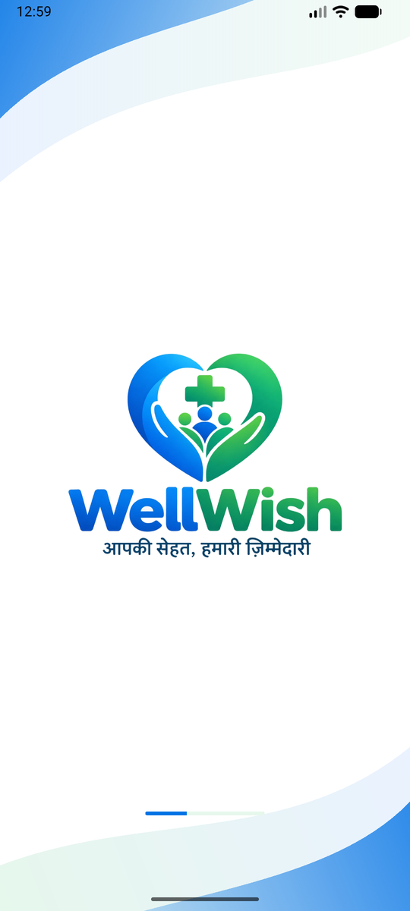
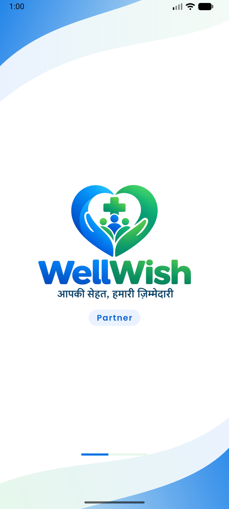
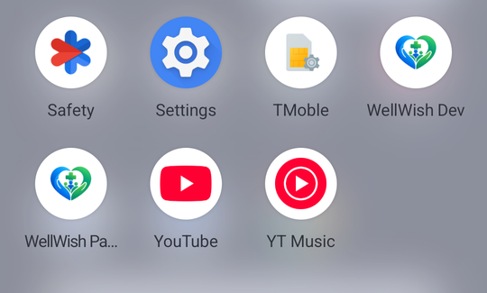

# Phase 0 — Project setup · Completion report

| Item | Value |
|---|---|
| Started | 8 Oct 2026 |
| Completed | 8 Oct 2026 |
| Built by | akashto76 with Claude |
| Git | `main` initialised. **Not committed** (developer's choice, 8 Oct 2026). |
| Architecture version used | v2.4 → v2.5 (updated during this phase, see Deviations) |

## Summary
The empty but working WellWish system now runs on the developer's Windows PC:
- **Backend:** Django in Docker (db, redis, api, worker, beat), all healthy.
- **Apps:** both Flutter apps open on the official WellWish logo on the Android emulator.
- **Admin panel:** opens at localhost:3000 with the full menu.
- **Checks:** `.\ww.ps1 check` runs all 10 checks across backend, Flutter and admin, and all pass.

## Tasks
- [x] 0.1 git, `.gitignore`, `.gitattributes`, `.editorconfig`, root `README.md`
- [x] 0.2 Folder layout (§4)
- [x] 0.3 `infra/docker-compose.yml`
  - PostgreSQL 16 + `btree_gist` (in `wellwish` and `template1`), Redis 7
  - api (Uvicorn, auto-reload with polling), worker, beat
  - health checks and start-up order
- [x] 0.4 `.env.example` for backend and admin. `apps/dart-defines.example.json` for the Flutter apps (they read settings with `--dart-define-from-file`).
- [x] 0.5 `ww.ps1`:
  - `up`, `down`, `restart`, `ps`, `logs`, `shell`, `manage`, `migrate`, `makemigrations`, `seed`, `test`, `lint`, `format`, `check`, `openapi`, `gen-clients`, `pin`, `reset-db`
- [x] 0.6 `backend/Dockerfile` (python:3.13-slim), Django 5.2 project, settings `base/dev/test/staging/prod`
- [x] 0.7 Pinned requirements (`requirements/*.in` → `pip-compile` → `*.txt`)
- [x] 0.8 `common/`: error format, `StrictIn`/`CamelSchema`, pagination, money (paise), phone, geo (bounding box + haversine), state machine, events, health
- [x] 0.9 `apps/accounts` with the custom phone-based `User` in migration 0001
- [x] 0.10 Ninja API `/v1`:
  - three audience routers
  - `/v1/health`
  - Swagger `/v1/docs`
  - OpenAPI export to `docs/api/openapi.json`
- [x] 0.11 ASGI: HTTP + `/ws/` (Channels) with a dev-only echo consumer
- [x] 0.12 Celery with queues `default`, `notify`, `money` + `common.ping` task
- [x] 0.13 `python manage.py seed` skeleton (refuses to run in prod)
- [x] 0.14 Pub workspace + melos (`apps/patient_app`, `apps/partner_app`, `packages/ww_ui`, `ww_core`, `ww_l10n`)
- [x] 0.15 `ww_ui`: tokens, theme, Poppins, logo, buttons, phone/OTP fields, card, list tile, bottom nav, states, splash
- [x] 0.16 `ww_core`: flavor config, Dio client, `ApiException`, secure token storage, socket client
- [x] 0.17 `ww_l10n`: English, Hindi, Odia ARB files, generated `WWLocalizations`
- [x] 0.18 Both apps:
  - flavors dev/staging/prod (Android)
  - Riverpod, go_router
  - splash from mockup 1 with the official logo (Partner app: "Partner" badge)
  - WellWish app icons
- [x] 0.19 `.\ww.ps1 gen-clients`: Dart client → `packages/ww_api`, TypeScript types → `apps/admin_web/src/api/schema.d.ts`
- [x] 0.20 `apps/admin_web`: Next.js 16 + TypeScript + Ant Design 6, WellWish colours and logo
- [x] 0.21 Sidebar with every §9.1 page (placeholder saying which phase builds it), header, login page shell
- [x] 0.22 `.\ww.ps1 check` runs backend, Flutter and admin checks
- [ ] 0.23 GitHub Actions: **skipped.** Where the code will be hosted isn't decided. Add it when the repo goes to GitHub.

## What was built

### Backend (`backend/`, 1,605 lines of Python)
- `config/`: settings per environment, `api.py` (NinjaAPI + three audience routers), `asgi.py`, `routing.py`, `celery.py`, `urls.py` (Django admin only when `ENABLE_DJANGO_ADMIN`)
- `common/`:
  - `errors.py`: `ApiError`, `NotFound`, `PermissionDenied`, `Conflict` + handlers
  - `schemas.py`: `CamelSchema`, `StrictIn`
  - `pagination.py`: `?page&pageSize`, capped at 100
  - `money.py`: `to_paise`, `percent_of`, `format_inr` (Indian grouping). Rejects floats.
  - `phone.py`: Indian mobiles only, `mask_phone`
  - `geo.py`: `haversine_km`, `bounding_box`, `nearby()` in SQL
  - `state_machine.py`: `transition()` with optimistic locking
  - `events.py`: `publish` on commit → one Celery task per handler
  - `health.py`, `consumers.py`, `tasks.py`, `management/commands/seed.py`
- `apps/accounts/`: `User` (UUID id, phone E.164 unique, status, language, Google id), manager, dev-only admin. Empty `api/{patient,partner,staff}.py` routers in the standard app layout.
- `scripts/healthcheck.py`: Docker health checks for api, worker and beat

### Patient app (`apps/patient_app`)
- **P01 Splash** (mockup 1): official logo, soft waves, progress bar
- Flavors: dev (`in.wellwish.patient.dev`, plain-HTTP allowed for the PC), staging, prod
- `bootstrap.dart`, `providers.dart` (config, token storage, API client), `router.dart`

### Partner app (`apps/partner_app`)
- **R01 Splash**: same, with the "Partner" badge
- Flavors with IDs `in.wellwish.partner(.dev/.staging)`. Android only, as planned.

### Shared Flutter packages
- `ww_ui`: design tokens (`tokens.dart`, the single place for exact values), `WWTheme`, `WWLogo`, `WWLogoLockup`, `WWWordmark`, buttons, `WWTextField`, `WWPhoneField`, `WWOtpField` (supports SMS auto-fill), `WWCard`, `WWListTile`, `WWBottomNav`, `WWLoading`, `WWEmptyState`, `WWErrorState`, `WWSplash`
- `ww_core`: `AppConfig` (per flavor, `API_BASE_URL` override), `createApiClient`, `ApiException`, `SecureTokenStorage`, `WWSocketClient`
- `ww_l10n`: `WWLocalizations` (en, hi, or)
- `ww_api`: **generated** client (`HealthApi`, `HealthOut`)

### Admin panel (`apps/admin_web`)
- Root layout: Ant Design registry, theme from `theme.ts` (same tokens as the apps), Poppins
- `(panel)` layout with `AdminShell` (sidebar from `config/menu.ts`, header with environment tag)
- `/` and `[...section]`: placeholders listing what each page will do and its phase. Unknown pages give 404.
- `/login`: shell with the official logo. Sign-in comes in Phase 1.
- `src/api/client.ts`: typed `openapi-fetch` client

## API changes
| Method | Path | Notes |
|---|---|---|
| GET | `/v1/health` | `{status, db, redis, env}`; 503 if DB or Redis is down. No auth. |
| GET | `/v1/docs`, `/v1/openapi.json` | dev + staging only (`API_DOCS_ENABLED`) |
| WS | `/ws/echo/` | dev only (`DEBUG`), smoke test |

OpenAPI regenerated: yes (`docs/api/openapi.json`, OpenAPI 3.1).

## Database changes
| App | Migration | What it does |
|---|---|---|
| accounts | `0001_initial` | `users` table: custom `User` (phone login, status, language, Google id) |
| django_celery_beat | its own | Celery beat schedule tables (third-party) |
| (init SQL) | `infra/postgres/init/01-extensions.sql` | `btree_gist` in `wellwish` and `template1` |

## Tests
| Check | Command | Result |
|---|---|---|
| Backend lint | `ruff check` · `ruff format --check` | clean · 56 files formatted |
| Backend types | `mypy .` | no issues in 56 files |
| Backend tests | `pytest` | **61 passed** |
| Missing migrations | `makemigrations --check` | none |
| Flutter analyze | `melos run analyze` (5 packages) | no issues |
| Flutter tests | `melos run test` | **26 passed** (ww_ui 9, ww_core 10, ww_l10n 5, patient 1, partner 1) |
| Admin | `npm run lint` · `npm run build` | clean · 28 pages built |
| **All together** | `.\ww.ps1 check` | **10 / 10 PASS** |

What the backend tests cover:
- money exactness (50% refund of ₹100 = ₹50)
- Indian phone rules
- distance and nearby sorting in SQL
- state machine: allowed and blocked moves, concurrent change, rollback
- events only after commit
- error format, unknown fields rejected, camelCase output, pagination
- health ok and Redis-down, Celery task, WebSocket echo, seed, OpenAPI document
- the custom User model

## Exit criteria
| Criterion | How it was verified | Result |
|---|---|---|
| `.\ww.ps1 up` starts db, redis, api, worker, beat healthy + admin; `/v1/health` ok | Ran `down` then `up` in PowerShell. All 5 containers `healthy`. `/v1/health` → `{"status":"ok","db":"ok","redis":"ok"}`. Celery round trip returned `pong`. | ✅ |
| Both Flutter apps run on an Android emulator and show the splash | Built dev APKs, installed on `Medium_Phone_API_37.0`, launched, screenshots below. WellWish icons visible in the app list. | ✅ |
| Admin opens at `localhost:3000` with the sidebar | Opened in the browser: full §9.1 menu. `/partners/applications` 200, `/login` 200 with the official logo, unknown page 404, no console errors. | ✅ |
| `.\ww.ps1 check` passes | 10/10 PASS (above) | ✅ |
| `docs/api/openapi.json` generated | `.\ww.ps1 openapi` → OpenAPI 3.1 with `/v1/health` | ✅ |

## Screens
| Patient app splash (P01) | Partner app splash (R01) |
|---|---|
|  |  |

App icons ("WellWish Dev", "WellWish Partner Dev"):



## Deviations from ARCHITECTURE.md
| What changed | Why | Agreed with developer | ARCHITECTURE.md updated |
|---|---|---|---|
| **Official logo** used for splash, app icons and admin. Brand colours sampled from it (primary `#0072E4`, green `#14965E`). Tagline spelled as in the logo: "आपकी सेहत, हमारी ज़िम्मेदारी". | Developer sent the official logo during the phase. It replaces the low-resolution crop from the mockup. | Yes (developer provided it) | v2.5 §5 |
| Generated Dart client is its own package `packages/ww_api`, not inside `ww_core` | Generated code is overwritten on every regeneration, so it must stay separate from hand-written code. It sits outside the pub workspace because the generator writes its own pubspec. | Recorded | v2.5 §4 |
| Extra settings file `config/settings/test.py` | pytest needs eager Celery and an in-memory channel layer | n/a (internal) | not needed |
| Admin: Next 16 `cacheComponents` turned off | Next 16's prerendering doesn't work with Ant Design's internals. It isn't needed for a signed-in admin panel. | n/a (internal) | not needed |
| Splash shows the logo as an image, not text | The official logo includes the lettering and tagline. Using the image keeps them exact. | Yes (follows the official logo) | v2.5 §5 |

## Known issues and follow-ups
- **No git commit yet**, as the developer chose. Everything is still untracked.
- **GitHub CI (0.23)** is not done. Add it when the code is hosted on GitHub.
- **Logo file** is a 1536 × 1024 JPEG from WhatsApp. It's sharp enough for the splash, but app icons and print need a **vector (SVG) or 2048 px PNG** from the client.
- **Hindi and Odia** texts are drafts until the client reviews them (Phase 9).
- **Patient app iOS:** flavors and the iOS build can't be set up or tested on Windows. Needs a Mac before App Store work (Phase 10).
- **Generated `ww_api`:** the generator's default SDK constraint (3.5) causes a harmless `json_serializable` warning, and it pins older code-generation tools. Revisit when the API grows.
- **One-time installs** on this PC during the phase:
  - Android **NDK 28.2** and **CMake 3.22.1** (the Android build needs them; Gradle's own download of CMake hung)
  - Android platforms 35/36 (installed automatically by Gradle)
  - **melos 8.9** and **flutter_launcher_icons 0.14.4** as global Dart tools
- **Backend auto-reload** uses polling (`WATCHFILES_FORCE_POLLING`) because file-change events don't cross the Windows → Docker boundary. Changes take a second or two to apply.
- **For Phase 1:**
  - add the login check to the three audience routers
  - the admin sign-in needs either CORS or a Next.js proxy so its httpOnly cookie works. A proxy is recommended.

## How to run and demo this phase
```powershell
cd C:\Users\tript\Desktop\Wellwish
.\ww.ps1 up        # containers + admin window; API http://localhost:8000/v1/health, docs /v1/docs
.\ww.ps1 check     # all 10 checks

# apps (emulator running):
cd apps\patient_app; flutter run --flavor dev -t lib/main_dev.dart
cd ..\partner_app;   flutter run --flavor dev -t lib/main_dev.dart
```
- **Admin panel:** http://localhost:3000. Sign-in is a placeholder until Phase 1.
- **Test accounts:** none yet (Phase 1 adds the OTP test numbers).

## Next phase
**Phase 1 — Login and security.**
- **Login:** phone OTP (MSG91 adapter + console adapter for dev), sessions with rotating refresh tokens, one active device per partner.
- **Access rules:** audience, role and ownership checks.
- **Staff:** login with password + TOTP 2FA, roles and permissions.
- **Records:** audit log, consents.
- **Apps:** login, OTP and profile-setup screens in the apps, and a working admin login.
- **Before Phase 1:** decide how the admin talks to the API (Next.js proxy recommended). An MSG91 account is not needed until real SMS is tested.
