# Phase 1 — Login and security · Completion report

| Item | Value |
|---|---|
| Started | 8 Oct 2026 |
| Completed | 8 Oct 2026 |
| Built by | akashto76 with Claude |
| Git | **Not committed.** Phase 0 and Phase 1 are both still untracked (see Known issues). |
| Architecture version used | v2.5 → **v2.7** (v2.6 during the phase, v2.7 after the deep check) |

## Summary
Patients and partners now log in with a phone OTP. Codes are stored as HMACs with all the §6.2 limits, and Android reads the SMS by itself. Patients go through profile setup, consent and the location step before reaching the Home shell. Partners land on a registration placeholder, and logging in on a second phone logs the first one out at once.

Staff sign in to the admin panel with email, password and TOTP 2FA. Sessions last 12 hours, with a 30-minute idle logout, and the menu shows only what the staff member's role allows.

Every request is checked for audience, then status or permission, then (later) ownership. Logins, failed logins and 2FA setup go to an audit log that can't be changed.

## Tasks
### Backend
- [x] 1.1 OTP service (§6.2): 6 digits from `secrets`, HMAC in Redis (5 min), 5 tries, resend after 30/60/120 s, limits per phone (5/h, 10/day), IP (20/h) and device (10/h), 10 failures → 1 h lock + `otp.locked` event, Indian numbers only, test numbers per environment
- [x] 1.2 SMS adapters: **MSG91** (Flow API, DLT template ids from settings) and a **console adapter** for dev (dev outbox, never logs the code)
- [x] 1.3 Sessions (§6.4): 15-min JWT (`aud`, `pid`, `role`, `sid`), refresh tokens stored as SHA-256, rotated, reuse revokes the family; logout and logout-all
- [x] 1.4 Partner: one active device; a new login revokes the old sessions and pushes `session.revoked` over `/ws/partner/`
- [x] 1.5 `SessionJWTAuth(audience)` on the patient/partner/admin routers, `@partner_status(...)`, `@staff_permission(...)`
- [x] 1.6 `apps/patients` (minimal): `PatientProfile` + `SELF` member created on first patient login
- [x] 1.7 Google sign-in endpoint: verifies the ID token against the configured client ids; phone OTP required once (link token)
- [x] 1.8 Devices: register/update device (+ FCM token when Firebase arrives) per app and device
- [x] 1.9 `apps/staff`: `StaffUser` (Argon2 password, Fernet-encrypted TOTP secret), five roles + permissions seeded by a migration, 12 h session, 30-min idle logout
- [x] 1.10 `apps/audit`: `record(actor, action, entity, before, after, reason, ip)`; rows can't be changed or deleted (Django + database trigger)
- [x] 1.11 Consents: terms, privacy, health data with version, time and IP

### Patient app
- [x] 1.12 Login (mockup 2): phone + Send OTP, Google button (shown when configured), Create Account
- [x] 1.13 OTP: 6 boxes, resend countdown, **Android SMS auto-read** (SMS Retriever, app hash sent with the request)
- [x] 1.14 Profile setup (name, DOB, gender, language) → consent → location permission (W-P1) → Home shell (Home · Doctors · Reports · Family · Profile)
- [x] 1.15 Token refresh interceptor (single refresh for many 401s), logout / logout on all devices, force-update screen from `app-config`

### Partner app
- [x] 1.16 Login + OTP (same screens, "Partner" badge), then the Register placeholder for Phase 3; instant logout when the number logs in elsewhere

### Admin panel
- [x] 1.17 Login (email + password) → first-time TOTP setup (QR + key) → TOTP code; logout; idle timeout (client timer + server check)
- [x] 1.18 Menu shows only pages the role's permissions allow; opening a forbidden page by URL shows "No access"

### Tests
- [x] 1.19 OTP: expiry, 5 tries, resend waits, every rate limit, lockout, non-Indian numbers, HMAC-only storage, nothing secret in logs
- [x] 1.20 Tokens: rotation, reuse revokes the family, partner token rejected on patient routes (and every other mix), staff permission denied without the permission

## What was built

### Backend (`backend/`)
- **common/**
  - `tokens.py`: access JWT, refresh token + SHA-256 hash, challenge tokens for login steps
  - `auth.py`: `SessionJWTAuth`, `Principal`, `@partner_status`, `@staff_permission`, and resolvers that apps register (so `common` never imports apps)
  - `ratelimit.py`: fixed-window counters in the cache
  - `sms.py`: SMS templates and the console and MSG91 adapters
  - `crypto.py`: Fernet encryption for TOTP secrets
  - `realtime.py`: authenticated `/ws/patient/` and `/ws/partner/` consumers (token as the first message), `user.{id}` and `session.{sid}` groups, `send_to_group()`
  - `request.py`: `client_ip()`
  - management command `sms_outbox`
- **apps/accounts**
  - models `Session`, `Device`, `Consent`
  - `otp.py`
  - `google.py`
  - services: login, Google link, sessions, devices, consents
  - `api/auth.py` (`/v1/auth/*`), plus patient and partner endpoints
- **apps/patients**
  - `PatientProfile`, `Member` (all §11 columns, one SELF per owner)
  - `GET`/`PUT /v1/patient/me`
- **apps/staff**
  - `StaffRole`, `StaffRolePermission`, `StaffUser`, `StaffSession`
  - `permissions.py` (§9.2 codes), services (login, TOTP, refresh, idle, create user), `/v1/admin/auth/*`, `/v1/admin/me`, `/v1/admin/roles`
  - command `create_staff_user`, dev seed `seed_dev_admin`
- **apps/audit**: `AuditLog` + `record()` + append-only trigger
- **apps/app_config**: `GET /v1/public/app-config`. Values come from Django settings until the Phase 2 settings table.
- `config/api.py`: auth, public, patient, partner and admin routers, each audience with its auth class

### Shared Flutter packages
- **ww_core**
  - `SessionManager` (tokens, single-flight refresh, `sessionEnded` stream with the reason)
  - `createApiClient` (bearer, refresh + retry on 401, error mapping)
  - `AuthRepository` (on the generated `ww_api`)
  - `DeviceIdStore`
  - `isOlderVersion`
- **ww_auth** (new package)
  - `PhoneLoginScreen` (P02/R02), `OtpScreen` (P03), `SmsCodeReader` (smart_auth / SMS Retriever)
  - translated error and session messages
- **ww_ui**
  - `WWAuthLayout`, `WWBadge`, `WWOrDivider`, `WWGoogleButton`, `WWMessageBox`, `WWLinkButton`
  - `WWDateField`, `WWChoicePills`, `WWCheckTile`, `WWFeatureTile`, `WWHeroCard`, `WWAvatar`
  - `WWOtpField` can now be filled by the screen (SMS)
  - new token `familyPurple`
- **ww_l10n**: 88 texts in English, Hindi and Odia, with a test that every English key is translated

### Patient app
- P01 Splash (version check + session restore)
- P02 Login, P03 OTP, P04 Profile setup, Consent, Location permission
- P05 Home (mockup 3 tiles marked "Coming soon" behind `FeatureFlags`)
- Doctors, Reports and Family tabs (coming soon)
- P23 Profile (mockup 10: name, phone, Verified, logout, logout everywhere)
- Force-update screen
- The app switches to the language chosen in the profile.

### Partner app
- R01 Splash, R02 Login + OTP
- Register placeholder (Phase 3)
- Force-update screen
- Socket listener for `session.revoked`, plus a check on app resume

### Admin panel
- `/v1/*` proxy (next.config.ts)
- `auth/session.ts` (in-memory access token, cookie refresh, `authFetch`), `AuthProvider` (session restore, 30-min idle timer)
- Login with QR (antd `QRCode`) and 6-box code (`Input.OTP`)
- Sign-in guard on all panel pages
- Menu filtered by permission, header with name, role and Sign out
- `Forbidden` page
- **System → Roles** page (read-only matrix)

## API changes
| Method | Path | Notes |
|---|---|---|
| POST | `/v1/auth/otp/send` | `{phone, purpose: login\|partner_primary, deviceId, appHash?}` → expiry, resend wait |
| POST | `/v1/auth/otp/verify` | `{phone, otp, purpose, deviceId, googleLinkToken?}` → tokens, `isNewUser` |
| POST | `/v1/auth/google` | `{idToken, deviceId}` → `LOGGED_IN` + tokens, or `PHONE_REQUIRED` + link token |
| POST | `/v1/auth/refresh` | `{refreshToken}` → new pair (rotation, reuse detection) |
| POST | `/v1/auth/logout`, `/v1/auth/logout-all` | patient or partner token |
| GET | `/v1/public/app-config` | min versions, store links, support phone, refund % |
| GET, PUT | `/v1/patient/me` | profile (P04), `profileComplete`, `consentsNeeded`, `selfMemberId` |
| POST | `/v1/patient/me/consents` | `{items:[{type, version}]}` |
| PUT | `/v1/patient/me/device`, `/v1/partner/me/device` | device + FCM token |
| GET | `/v1/partner/me` | phone, language, `partnerStatus` (null until Phase 3) |
| POST | `/v1/admin/auth/login` | email + password → `TOTP_SETUP` (QR uri + key) or `TOTP` + challenge |
| POST | `/v1/admin/auth/totp` | challenge + code → access token, sets the refresh cookie |
| POST | `/v1/admin/auth/refresh`, `/v1/admin/auth/logout` | cookie + `X-WW-Client: admin` |
| GET | `/v1/admin/me`, `/v1/admin/roles` | permissions for the menu; roles matrix (`staff.manage`) |
| WS | `/ws/patient/`, `/ws/partner/` | token as first message; `session.revoked` push |

OpenAPI regenerated: yes (`docs/api/openapi.json`). Dart client (`packages/ww_api`) and TypeScript types regenerated.

## Database changes
| App | Migration | What it does |
|---|---|---|
| accounts | `0002_consent_device_session` | `sessions`, `devices`, `consents` |
| patients | `0001_initial` | `patient_profiles` (user id as key), `members` (one SELF per owner) |
| staff | `0001_initial` | `staff_roles`, `staff_role_permissions`, `staff_users`, `staff_sessions` |
| staff | `0002_seed_roles` | the five roles and their permissions (§9.2), needed in production too |
| audit | `0001_initial` | `audit_log` |
| audit | `0002_append_only` | trigger: UPDATE and DELETE on `audit_log` raise an error |

## Tests
| Check | Command | Result |
|---|---|---|
| Backend lint / format / types | `ruff check`, `ruff format --check`, `mypy .` | clean (138 files) |
| Backend tests | `pytest` | **176 passed** (61 in Phase 0; 157 at first close, +19 from the deep check) |
| Missing migrations | `makemigrations --check` | none |
| Flutter analyze | `melos run analyze` (6 packages, incl. new `ww_auth`) | no issues |
| Flutter tests | `melos run test` | **65 passed**: ww_ui 15, ww_core 18, ww_l10n 6, ww_auth 9, patient 12, partner 5 |
| Admin | `npm run lint` · `npm run build` | clean · built |
| **All together** | `.\ww.ps1 check` | **10 / 10 PASS** |

What the new tests cover:
- **OTP:** send and verify, HMAC only, 5-min expiry, 5 tries, resend 30/60/120 s, phone, day, IP and device limits, 10 failures → lock + event, Indian numbers only, test numbers without SMS, SMS failure, nothing secret in the logs
- **Sessions:**
  - first login creates the profile and SELF member
  - rotation; reuse revokes the family
  - expired, tampered and wrong-key tokens rejected
  - every audience mix rejected
  - partner one device; patients many devices
  - logout and logout-all
  - blocked user
  - JWT claims
- **Google, devices, consents:** Google link (mocked Google), devices, consents (version, IP, re-ask on a new version)
- **Staff:** setup and sign-in, case-insensitive email, lockout, wrong and reused TOTP codes, challenge expiry, disabled staff, cookie rotation and reuse, client header, 30-min idle, 12 h expiry, logout, permission denied for each role, the §9.2 table, password strength, dev seed
- **Audit:** append-only through Django and raw SQL
- **Decorators and sockets:** partner status and staff permission decorators, socket auth, the `session.revoked` push, app-config
- **Real Redis channel layer:** a receive can wait longer than 5 s (regression test for the bug found on the emulator)
- **Flutter:** refresh interceptor (single refresh, retry, revoked reason, offline keeps the session), the login and OTP screens, the full patient sign-up flow, force update, session restore, revoked session message, language switch, partner socket logout and resume check

## Exit criteria
| Criterion | How it was verified | Result |
|---|---|---|
| A patient logs in on the emulator with the dev OTP and reaches Home. Profile and `SELF` member exist. | On `Medium_Phone_API_37.0` with the dev APK against the Docker backend. **Run 1:** +91 98765 43210 → code delivered by `adb emu sms send` with the app hash and **read automatically by the app** → profile setup → consent → location permission → Home → Profile tab. DB checked: phone verified, `PatientProfile`, 1 SELF member, 1 active session. **Run 2:** test number +91 90000 00003 with `123456` → same flow → Home. | ✅ |
| A partner logs in. A second device login logs the first one out. | Partner app on the emulator, test number +91 90000 00002 → Register placeholder. A second device (different `deviceId`) logged in through the API. **Instant:** the emulator showed "You logged in on another phone…" within 2 s via the socket push, after the socket had been idle 12 s. **Fallback:** with the socket down, bringing the app back to the foreground found the revoked session and showed the same message. | ✅ (second device simulated through the API, see Known issues) |
| Admin logs in with password + TOTP. The menu respects the role. | In the browser at `localhost:3000`, through the `/v1` proxy. Dev Super Admin: password → QR + key → code → dashboard with all 11 sections, and the Roles page works. A test Support user saw 8 sections (no Partners, Settings, System) and got "No access" on `/system/roles`. Refresh cookie not readable by page scripts; reload keeps the session; Sign out works; a session idle for 31 min (simulated by ageing it in the database) sends the user to login with the idle message. | ✅ |
| All tests pass. No OTP or token appears in the logs. | `.\ww.ps1 check` 10/10 (above). Searched the api, worker and beat logs after all the device and browser runs for the OTPs used, `123456`, the TOTP codes used, full phone numbers, `Bearer`, `accessToken`, `refreshToken`, `eyJ` (JWT), the cookie name, the dev admin password and TOTP secret: **0 matches**. Only masked numbers (`+91******3210`). Plus the automated log test. | ✅ |

## Screens
| Login (P02) | OTP (P03) | Profile setup (P04) | Consent |
|---|---|---|---|
| 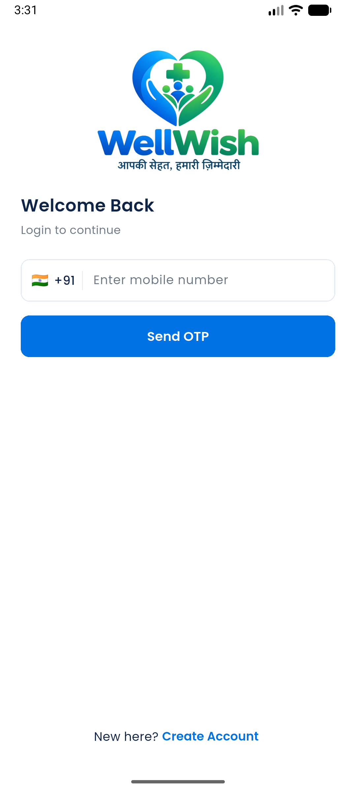 | 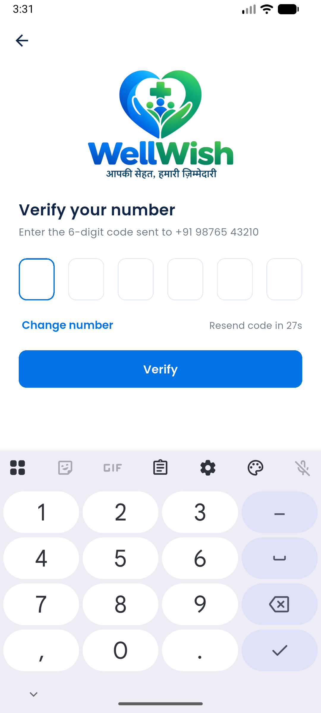 | 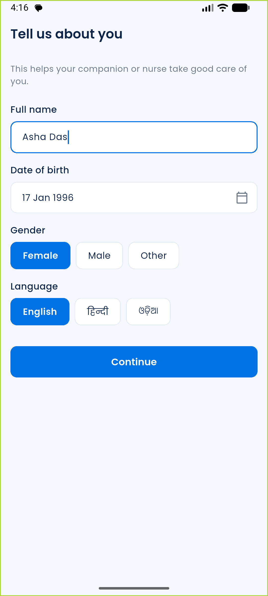 | 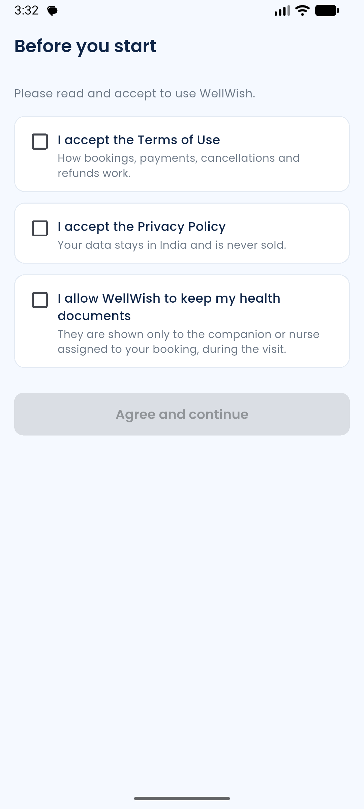 |

| Location | Home (P05) | Profile (P23) |
|---|---|---|
| 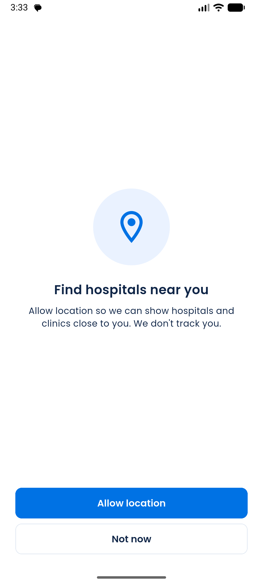 | 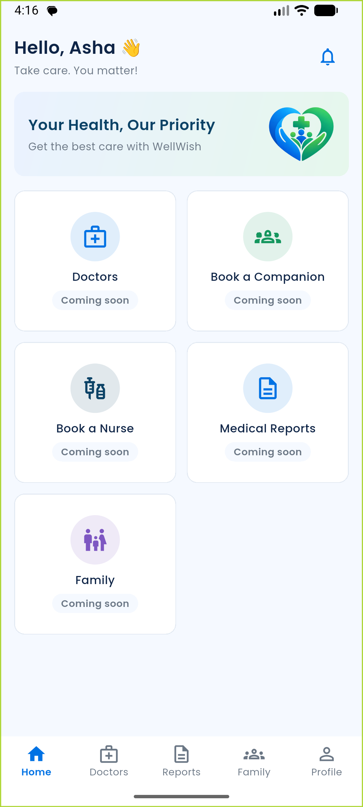 | 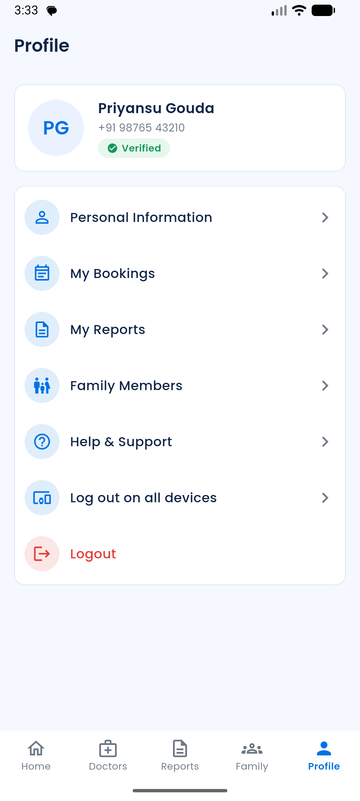 |

| Partner: after login | Partner: logged in elsewhere |
|---|---|
| 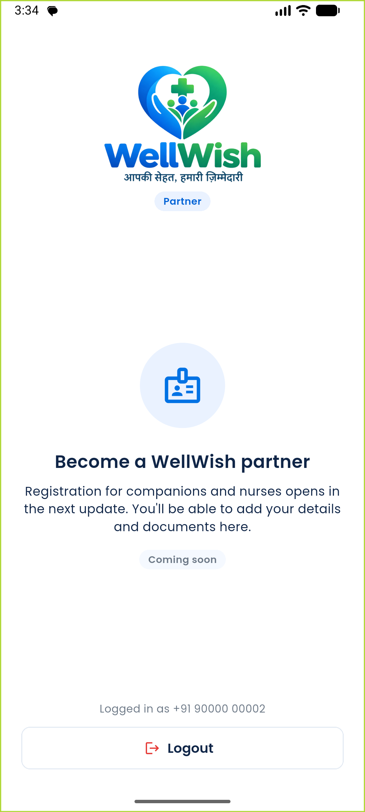 | 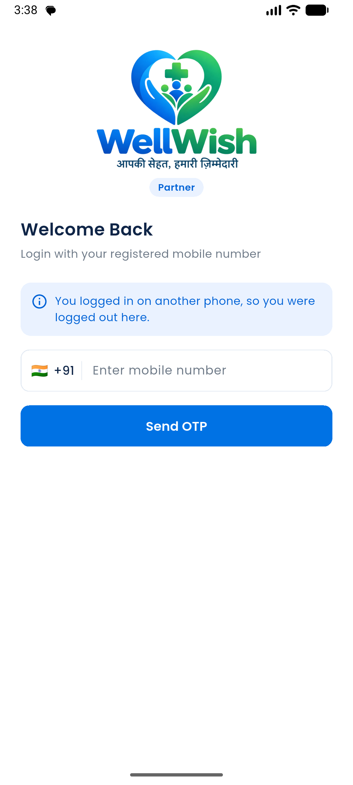 |

| Admin login | Admin: System → Roles |
|---|---|
| 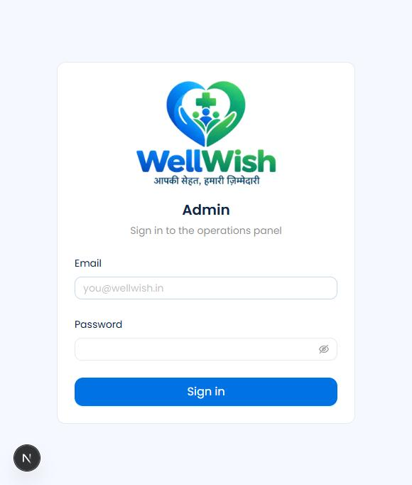 | 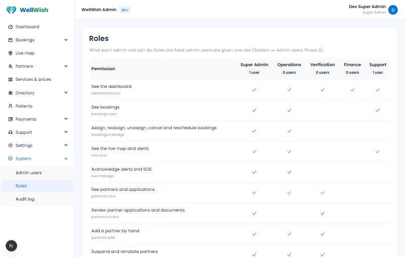 |

## Deviations from ARCHITECTURE.md
| What changed | Why | Agreed with developer | ARCHITECTURE.md updated |
|---|---|---|---|
| Admin sessions in their own table `staff_sessions` (staff app) instead of `sessions` | §11's `sessions` has `user_id` (patients/partners). Staff are a separate table with different rules (12 h, idle). Each app owns its tables. | No: decided during the build. Please confirm. | v2.6 §10.1, §11 |
| Admin panel calls the API on its own origin: Next.js forwards `/v1/*` (Nginx in production) | Makes the httpOnly refresh cookie first-party. No CORS. Recommended in the Phase 0 report. | Recommended before go; no objection | v2.6 §6.4 |
| New endpoints: `/auth/logout-all`, `/admin/auth/refresh`, `/admin/me`, `/admin/roles`, `/patient/me/consents`, `/patient/me/device`, `/partner/me/device`, `/partner/me`. OTP send takes `appHash`; OTP verify takes `googleLinkToken`. | Needed by tasks 1.3, 1.7, 1.8, 1.11, 1.13, 1.17, 1.18. | Follows the tasks | v2.6 §10.3 |
| OTP limit per device: 10 per hour | Task 1.1 asks for a device limit, but §6.2 gives no number | No: please confirm the number | v2.6 §6.2 |
| Login OTP SMS sent inside the request, not by the `send_sms` Celery task | So the plain code never sits in the Redis queue. "Never store plain OTPs." | No: security choice | v2.6 §10.5 |
| Shared login screens in a new package `packages/ww_auth` | Both apps use the same login and OTP screens. No copy-paste. | No: internal structure | v2.6 §4 |
| Permission codes defined for §9.2 (e.g. `bookings.manage`, `refunds.approve`) | The table names areas; endpoints need codes | No: please review the mapping in §9.2 | v2.6 §9.2 |
| Google sign-in button hidden until a Google OAuth client id is configured | Can't work without a Google Cloud project; PHASES says "no half-broken screens". | Asked before go, no answer yet | Decisions log |
| Extra security not in the spec: 5 wrong admin passwords → 15-min lock; a TOTP code works once; the TOTP challenge dies after 5 wrong codes; refresh and logout need the `X-WW-Client` header | Standard protection for the admin login | n/a | not needed |
| Location permission step included after consent | ARCHITECTURE W-P1 and §6.2 have it; PHASES 1.14 didn't list it. Followed ARCHITECTURE. | Asked before go, no answer; followed the document | no change needed |

## Deep check (after the first close)

The developer asked for a deep check. It covered:
- every task and exit criterion again
- loading the production settings
- the API contract against both generated clients
- the live endpoints and the logs
- hard-coded text
- an independent security review of the auth code

It found 15 problems. **All are fixed, tested and re-verified:** `.\ww.ps1 check` passes 10/10 (176 backend + 65 Flutter tests), a live API smoke test passes, and the partner one-device logout works again on the emulator.

| # | Problem | Fix | Test |
|---|---|---|---|
| 1 | **Admin 2FA could be brute-forced:** each new sign-in gave 5 fresh code guesses, and a right password reset the password counter | Wrong codes counted per staff member across sign-ins: 5 → 15-min lock + `staff.totp_failed` / `staff.locked` audit rows. Counters reset only after password **and** code. | `test_wrong_codes_lock_the_staff_member_across_new_sign_ins`, `test_a_right_password_alone_does_not_clear_the_password_limit` |
| 2 | Sentry would have received OTPs, tokens and phones (request bodies, local variables) on any error. Sentry was not switched on yet. | `common/monitoring.py`: no bodies, no local variables, a `before_send` that keeps only method + path | `test_sentry_events_never_carry_bodies_headers_cookies_or_variables` |
| 3 | Prod/staging accepted the dev console SMS backend (plain OTPs in Redis) | New `config/settings/deployed.py` for staging + prod refuses it at startup | `test_servers_refuse_the_dev_console_sms` |
| 4 | Client IP spoofable in prod (leftmost X-Forwarded-For); a garbage value caused a 500 | Read the entry our proxy added (`TRUSTED_PROXY_HOPS`), validate with `ipaddress` | 3 `test_client_ip_*` tests |
| 5 | The `otp.locked` alert was rolled back with the failed login | The code is checked before the login transaction | `test_lock_alert_is_published_after_commit` |
| 6 | Admin idle logout: a background tab signed out the whole session, and activity on pages that make no API calls never reached the server | Last activity shared across tabs; a 5-min heartbeat while active; sign-out reaches every tab | Browser: two tabs, sign-out followed in both; heartbeat seen after ~1 min |
| 7 | A refresh answer lost on a weak network, or two tabs refreshing together, counted as token theft and logged the user out | 30-s retry grace (same session, new token); cross-tab refresh lock in the admin panel (Web Locks) | `test_a_quick_retry_with_the_same_refresh_token_is_not_theft`, updated staff cookie test, live smoke test |
| 8 | Staging could not start with several test numbers; prod allowed the public `123456` for its review number | Prod-only rules in `prod.py`: max 1 number, private code | `test_staging_allows_several_test_numbers`, `test_prod_allows_one_review_number_with_a_private_code` |
| 9 | Admin sign-in challenge reusable for 5 min | Marked used on success | `test_a_challenge_works_for_one_sign_in_only` |
| 10 | Devanagari digits passed phone validation (second account for the same phone) | ASCII-only regex | `test_only_ascii_digits` |
| 11 | Patient and partner sockets shared `user.{id}` | `user.{app}.{id}` (ARCHITECTURE §6.14) | `test_socket_user_groups_are_per_app` |
| 12 | Device rows (push tokens) kept after logout or "logged in elsewhere"; one push token could sit on two accounts | Removed when no active session is left on that device; a push token moves to its newest owner | 3 device tests |
| 13 | iPhone: no location permission text, so the prompt never shows | `NSLocationWhenInUseUsageDescription` in `ios/Runner/Info.plist` | XML checked (iOS can't be built on Windows) |
| 14 | OTP screen stuck if loading the profile failed right after a right code | Both apps show "Try again" (splash), which resumes the saved session | `right code but the profile fails to load…` (patient app) |
| 15 | **From Phase 0:** the API container never auto-reloaded. The folded YAML command kept a newline before `--reload`. Backend edits only applied after a restart. (All Phase 1 device tests ran after restarts, so they used the right code.) | `command` written as a list in `infra/docker-compose.yml` | Logs show "Started reloader process"; an edit reloads within seconds |

**Kept as written (developer's call):** the spec's lockout (10 wrong codes lock a phone for 1 hour) also lets anyone lock someone else's number.

## Known issues and follow-ups
- **Not committed:** Phase 0 and Phase 1 are both untracked in git. The developer chose not to commit yet.
- **Bug found and fixed during the device test (from Phase 0):**
  - Idle WebSockets died after 5 seconds, because channels_redis waits 5 s on Redis and redis-py 8's default read timeout is also 5 s.
  - Fixed with `socket_timeout=30` in `CHANNEL_LAYERS`, plus a real-Redis regression test.
- **Second partner device** was simulated with an API login using another device id, not a second phone or emulator. The emulator side (instant socket logout and the resume fallback) was verified for real. A check with two real phones fits naturally in Phase 7/8, which need two phones anyway.
- **Google sign-in** is built and unit-tested with a mocked Google, but not tried live. To turn it on:
  - create OAuth client ids in Google Cloud (Web, and Android with the debug and release SHA-1)
  - set `GOOGLE_CLIENT_IDS` in `backend/.env`
  - run the app with `--dart-define=GOOGLE_SERVER_CLIENT_ID=<web client id>`
- **Push tokens:** devices are registered, but `fcmToken` stays empty until Firebase is added (notifications, Phase 7/8).
- **`otp.locked` admin alert:** the event is published with no handler yet. The admin alert arrives with the live alerts (Phase 7).
- **Consent texts** are short summaries. The full Terms of Use and Privacy Policy documents (and a page to open them) are needed from the client before launch.
- **Hindi and Odia** texts are drafts until the client reviews them (Phase 9).
- **Session rows** (rotated and expired refresh tokens) are never cleaned up. Add a daily cleanup task (Phase 9).
- **Partner socket** reconnects only when the app comes back to the foreground. Reconnect with backoff arrives with the first live feature (Phase 7).
- **Audit log:** the trigger blocks UPDATE and DELETE but not TRUNCATE (the test runner needs it). In production the API's database user must not own the table (Phase 10).
- **Dev PC memory:** Docker + emulator + Gradle left as little as 1.2 GB free of 16 GB. The emulator went offline once and a debug build hit an ANR on a slow first start.
  - Stop the Gradle daemon after builds: `cd apps\patient_app\android; .\gradlew --stop`.
  - Close other apps while testing.
  - Release builds start much faster.
- **Test data left in the local dev database:**
  - test patients +91 98765 43210 and +91 90000 00003
  - test partner +91 90000 00002
  - a disabled admin user `support.test@wellwish.test` used for the role test
- **iOS:** the patient app's iOS build (Google sign-in, SMS autofill) can't be tested on Windows.

## How to run and demo this phase
```powershell
cd C:\Users\tript\Desktop\Wellwish
.\ww.ps1 up          # backend containers + admin panel window
.\ww.ps1 seed        # creates the dev admin (DEV_ADMIN_EMAIL / DEV_ADMIN_PASSWORD in backend\.env)
.\ww.ps1 check       # all 10 checks

cd apps\patient_app; flutter run --flavor dev -t lib/main_dev.dart
cd ..\partner_app;   flutter run --flavor dev -t lib/main_dev.dart
```
- **Test phone numbers (dev):** +91 90000 00001 to 00005 accept the code `123456`, and no SMS is sent (`OTP_TEST_NUMBERS` in `backend/.env`).
- **Any other number:** the code goes to the dev SMS outbox. Read it with `.\ww.ps1 manage sms_outbox 9876543210`.
- **SMS auto-read on the emulator:** copy the outbox text and run `adb emu sms send 9000012345 "<text>"`.
- **Admin:** http://localhost:3000. Sign in with the dev admin from `backend/.env.example`. The first sign-in shows a QR code: scan it with Google Authenticator.
- **First Super Admin on a real server:** `.\ww.ps1 manage create_staff_user --email … --name … --role SUPER_ADMIN` (asks for the password).

## Next phase
**Phase 2 — Admin master data:** services and prices, hospitals, doctors, specialities, settings (the `app_settings` table replaces the Django-settings values behind `/v1/public/app-config`), service areas, blocked dates, admin users page and audit log page.
- Use `@staff_permission(...)` with the codes in `apps/staff/permissions.py` and `record()` from `apps.audit.services` for every change.
- Admin pages: add the real page under `src/app/(panel)/…`, set `built: true` in `src/config/menu.ts`, and call `api.GET/POST` (the token and refresh are handled).
